# 01. Payment Systems & Payment Networks

Comprehensive guide to understanding the global payment ecosystem, transaction lifecycles, stakeholders, message protocols, and technical architectures for payment processors and networks.

---

## 1. Core Ecosystem Participants (The "Four-Party" & "Five-Party" Models)

```mermaid
flowchart LR
    Cardholder["Cardholder / Customer"] -->|"1. Tap / Swipe / Online"| Merchant["Merchant"]
    Merchant -->|"2. Transaction Data"| Gateway["Payment Gateway / Acquirer"]
    Gateway -->|"3. Route Auth"| Network["Payment Network: Visa / Mastercard / Amex"]
    Network -->|"4. Auth Request"| Issuer["Issuing Bank: e.g., Capital One, Chase"]
    Issuer -->|"5. Auth Response"| Network
    Network -->|"6. Auth Response"| Gateway
    Gateway -->|"7. Approve / Decline"| Merchant
    Merchant -->|"8. Goods / Service"| Cardholder
```

| Entity | Role & Responsibilities | Key Examples |
| :--- | :--- | :--- |
| **Cardholder / Consumer** | Initiates payment with credit, debit, prepaid, or digital wallet. | End user, Apple Pay, Google Pay |
| **Merchant** | Sells goods/services; collects payment details via POS or Checkout page. | Amazon, Target, local retail |
| **Payment Gateway** | Encrypts payment details, provides checkout API, tokenizes PAN (Primary Account Number). | Stripe, Adyen, Braintree, Authorize.net |
| **Acquiring Bank / Processor** | Holds merchant account, processes transactions, routes to card networks, absorbs merchant credit risk. | Chase Paymentech, Fiserv (First Data), Worldpay, Adyen |
| **Payment Network / Scheme** | Operates routing switch, sets interchange rates, defines rules and technical standards. | Visa, Mastercard, American Express, Discover, UnionPay |
| **Issuing Bank (Issuer)** | Issues card to consumer, extends credit/debit facility, validates funds/fraud, authorizes transaction. | Capital One, JPMorgan Chase, Citi, Bank of America |

---

## 2. Transaction Lifecycle: Authorization vs. Clearing vs. Settlement

Payment processing is divided into two decoupled phases: **Real-Time (Auth)** and **Batch (Clearing & Settlement)**.

### Phase 1: Real-Time Authorization (< 2 seconds)
1. **Initiation**: Card presented (EMV chip, NFC, or e-commerce card-not-present).
2. **Tokenization & Encryption**: Card details tokenized (Network Token or Processor Token) and encrypted via PCI-DSS compliant hardware/protocols.
3. **Gateway to Acquirer**: Acquirer formats payload into card network protocol (ISO 8583 / ISO 20022).
4. **Network Routing**: Card network inspects BIN (Bank Identification Number, first 6-8 digits) to identify the issuer.
5. **Issuer Decisioning**: Issuing bank checks:
   - Account status & card expiration.
   - Available balance / credit line.
   - Fraud risk score (calculated within 20–100ms via real-time risk engine).
   - 3D Secure / SCA (Strong Customer Authentication) if applicable.
6. **Response Code**: Return approval code (e.g., `00`) or decline reason (`05 - Do Not Honor`, `51 - Insufficient Funds`, `54 - Expired Card`).
7. **Hold placed**: Ledger reflects pending hold on cardholder's funds; no money actually changes hands yet.

### Phase 2: Clearing (End-of-Day Batch)
- Merchant closes out daily register/batch and submits capture records to Acquirer.
- Acquirer batches records and sends them across the Payment Networks.
- Networks exchange reconciliation files between acquirers and issuers.

### Phase 3: Settlement (T+1 to T+3 Days)
- Actual movement of funds between bank reserve accounts at central banks (e.g., Federal Reserve Fedwire).
- Issuer debits cardholder account, remits net funds (minus interchange) to card network.
- Network transfers funds to acquirer (minus network assessment fees).
- Acquirer deposits funds into merchant's bank account (minus merchant discount rate).

---

## 3. Financial Economics: The Fee Breakdown (Interchange & Take Rates)

When a customer buys $100 worth of goods:

$$\text{Merchant Receives} = \$100 - \text{MDR (Merchant Discount Rate, e.g., 2.5\% = \$2.50)} = \$97.50$$

Where does the $2.50 go?
1. **Interchange Fee (~$1.80 - $2.20)**: Goes to the **Issuing Bank** to cover credit risk, float, reward programs (cashback/points), and operating costs.
2. **Network Assessment Fee (~$0.12 - $0.15)**: Goes to **Visa / Mastercard** for network infrastructure and brand licensing.
3. **Acquirer / Processor Markup (~$0.20 - $0.50)**: Goes to **Stripe / Adyen / Fiserv** for APIs, gateway services, and settlement processing.

### Key Factors Determining Interchange:
- **Card Type**: Credit > Debit (Durbin Amendment caps debit interchange for large US banks at $0.21 + 0.05%).
- **Tier**: Premium rewards cards (Visa Infinite, World Elite Mastercard) charge higher interchange.
- **Card Present (CP) vs. Card Not Present (CNP)**: CNP has higher risk of fraud $\rightarrow$ higher interchange fees.
- **Merchant Category Code (MCC)**: Grocery/charity gets lower rates; airlines/crypto get higher rates.

---

## 4. Message Standards & Protocols

### ISO 8583 (Legacy / Dominant Standard)
- Binary/bitmap message protocol with fixed & variable fields.
- 0100: Authorization Request
- 0110: Authorization Response
- 0200: Financial Transaction Request
- 0420: Reversal Request

### ISO 20022 (Modern XML / JSON standard)
- Rich semantic data structures, used by modern real-time rails (FedNow, RTP, SEPA Instant).
- Includes structured remittance data, end-to-end payment tracking, and enhanced fraud screening metadata.

---

## 5. Modern Payment Rails: Push vs. Pull Payments

| Payment Rail | Type | Clearing Speed | Settlement | Key Characteristics |
| :--- | :--- | :--- | :--- | :--- |
| **Card Networks (Visa/MC)** | Pull (merchant pulls) | Real-time Auth | T+1 to T+3 | High interchange, high consumer protection/chargebacks. |
| **ACH (Automated Clearing House)** | Push or Pull | Batch (Next-day/Same-day) | T+1 to T+2 | Very cheap (< $0.30/txn), non-guaranteed (can bounce 2-3 days later). |
| **FedNow / RTP (The Clearing House)** | Push (direct bank credit) | Immediate (< 10 sec) | Instant (24/7/365) | Irrevocable, lower fees, rich ISO 20022 messaging. |
| **Wire (Fedwire, CHIPS)** | Push | Immediate | Instant | High cost ($15-$30), high-value enterprise transfers. |

---

## 6. Interview Preparation Questions & Cheat Sheet

### Common Architectural & System Questions:
1. **Explain the difference between authorization, capture, and settlement.**
2. **What happens during network tokenization, and why does it improve authorization rates?**
   - *Answer*: Replaces 16-digit PAN with a cryptographic token issued by the card brand. Automatically updates when a card expires or reissues, reducing false declines and eliminating PAN exposure under PCI DSS.
3. **How does smart payment routing increase payment conversion?**
   - *Answer*: Dynamically routes transaction requests through multiple acquirers based on issuer geography, card brand, historical approval rates, cost optimization, and real-time acquirer health.
4. **How do chargebacks work, and what is the difference between fraud and friendly fraud?**
   - *Answer*: Chargebacks are issuer-mediated disputes where money is pulled back from the merchant. First-party fraud ("friendly fraud") is when a legitimate cardholder claims they didn't make or authorize a purchase they actually received.
