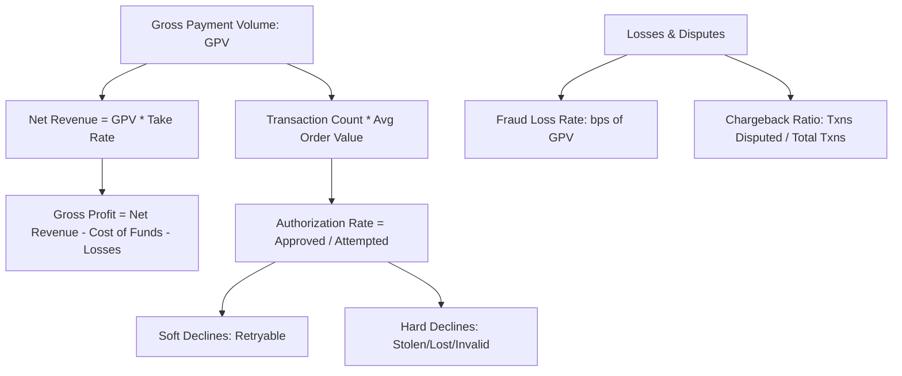

# 03. Data Analytics & Product Experimentation

Comprehensive guide covering essential payment KPIs, product analytics frameworks, advanced SQL patterns for financial transactions, and experimentation/A-B testing methodologies.

---

## 1. Core Payments & Fintech KPI Hierarchy



| Metric | Formula / Definition | Target / Benchmark | Business Meaning |
| :--- | :--- | :--- | :--- |
| **Gross Payment Volume (GPV)** | Total dollar volume of successfully settled payments. | Scale dependent | Topline transaction scale. |
| **Take Rate** | $\frac{\text{Net Revenue}}{\text{GPV}}$ | Typically 1.5% - 2.8% (Credit) | Pricing power & margin per dollar processed. |
| **Authorization Rate** | $\frac{\text{Count of Approved Txns}}{\text{Count of Attempted Txns}}$ | 85% - 95% (CNP), 95%+ (CP) | Direct measure of checkout conversion and payment health. |
| **Chargeback / Dispute Rate** | $\frac{\text{Number of Chargebacks}}{\text{Number of Captured Txns}}$ | Must stay $< 0.9\%$ (< 90-100 bps) | Card schemes (Visa VAMP / Mastercard ECP) penalize or suspend merchants exceeding this limit. |
| **Fraud Rate (Basis Points)** | $\frac{\text{Dollar Amount of Fraud}}{\text{Total Volume}} \times 10,000$ | Typically $< 5 - 10 \text{ bps}$ | Operational efficiency of fraud controls. |
| **Customer LTV : CAC** | $\frac{\text{Average Lifetime Value}}{\text{Customer Acquisition Cost}}$ | $\ge 3.0$ | Health of growth and customer retention. |

---

## 2. Advanced SQL Patterns for Payment Analytics

### Pattern 1: Real-time Velocity Window (Transactions within past 10 minutes)
Interviewers love asking how to calculate rolling frequency to identify brute-force card testing attacks.

```sql
SELECT
    transaction_id,
    user_id,
    card_id,
    transaction_time,
    amount,
    -- Count of transactions on this card in the trailing 10 minutes
    COUNT(*) OVER (
        PARTITION BY card_id 
        ORDER BY transaction_time 
        RANGE BETWEEN INTERVAL 10 MINUTE PRECEDING AND CURRENT ROW
    ) AS txns_last_10m,
    -- Sum of amount on this card in the trailing 1 hour
    SUM(amount) OVER (
        PARTITION BY card_id 
        ORDER BY transaction_time 
        RANGE BETWEEN INTERVAL 1 HOUR PRECEDING AND CURRENT ROW
    ) AS spend_last_1h
FROM 
    payments.transactions;
```

---

### Pattern 2: Monthly Cohort Retention Analysis
Evaluate how merchant or cardholder cohorts retain their transaction volume over time.

```sql
WITH cohort_items AS (
    SELECT 
        user_id,
        DATE_TRUNC(MIN(transaction_time), MONTH) AS cohort_month
    FROM payments.transactions
    WHERE status = 'APPROVED'
    GROUP BY user_id
),
activity AS (
    SELECT 
        t.user_id,
        c.cohort_month,
        DATE_DIFF(DATE_TRUNC(t.transaction_time, MONTH), c.cohort_month, MONTH) AS month_number
    FROM payments.transactions t
    JOIN cohort_items c ON t.user_id = c.user_id
    WHERE t.status = 'APPROVED'
)
SELECT 
    cohort_month,
    month_number,
    COUNT(DISTINCT user_id) AS active_users,
    ROUND(
        COUNT(DISTINCT user_id) * 100.0 / 
        MAX(COUNT(DISTINCT user_id)) OVER (PARTITION BY cohort_month), 
        2
    ) AS retention_rate_pct
FROM activity
GROUP BY cohort_month, month_number
ORDER BY cohort_month, month_number;
```

---

### Pattern 3: Consecutive Declines Followed by Approval (Card Testing Pattern)
Detect accounts where fraudsters tried multiple small cards until finding one that worked.

```sql
WITH flagged_events AS (
    SELECT
        device_id,
        transaction_id,
        transaction_time,
        status,
        LAG(status, 1) OVER (PARTITION BY device_id ORDER BY transaction_time) AS prev_status_1,
        LAG(status, 2) OVER (PARTITION BY device_id ORDER BY transaction_time) AS prev_status_2
    FROM payments.transactions
)
SELECT
    device_id,
    transaction_id,
    transaction_time
FROM flagged_events
WHERE status = 'APPROVED'
  AND prev_status_1 = 'DECLINED'
  AND prev_status_2 = 'DECLINED';
```

---

## 3. Experimentation & A/B Testing in Fintech

Testing payment flows, checkout UX, or fraud thresholds differs fundamentally from testing typical social media apps due to **financial loss risk** and **regulatory compliance**.

### 1. Key Experimentation Considerations
- **Sample Ratio Mismatch (SRM)**: Always run a Chi-Square test ($\chi^2$) on assignment counts before analyzing results. A mismatch frequently indicates routing drops or cache bugs.
- **CUPED (Controlled-experiment Using Pre-Experiment Data)**:
  Fintech metrics (like GPV or spend) have heavy skew and high variance. CUPED reduces variance using pre-experiment baseline spend:
  $$\hat{Y}_{CUPED} = Y - \theta (X - \mathbb{E}[X]), \quad \text{where } \theta = \frac{\operatorname{Cov}(Y, X)}{\operatorname{Var}(X)}$$
  This often shrinks needed sample size by 30–50%!
- **Network Spillover in Two-Sided Marketplaces**: If testing a new incentive for P2P payments or merchant checkout, treatment users interact with control users.
  - *Fix*: Use cluster-based randomization (e.g., randomize by geographic market or merchant vertical).

### 2. Decision Framework: Guardrail Metrics
When evaluating a treatment variant (e.g., "Relax 3DS challenge on low-risk transactions"):
- **Primary Metric**: Authorization rate (+1.4%).
- **Guardrail 1 (Must not degrade)**: Fraud dispute rate ($< 0.8\%$ threshold).
- **Guardrail 2**: P95 latency ($< 120\text{ms}$).
- **Guardrail 3**: Merchant refund rate.
