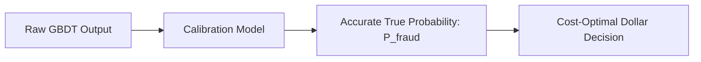

# 05. Machine Learning Algorithms for Risk & Payments

Comprehensive review of machine learning algorithms, mathematical formulations, implementation trade-offs, and evaluation metrics frequently tested in quantitative risk and data science interviews.

---

## 1. Algorithm Comparison Matrix

| Algorithm | Primary Fintech Use Case | Interpretability | Latency (Inference) | Handling Tabular Data |
| :--- | :--- | :--- | :--- | :--- |
| **Logistic Regression + WOE** | Credit scoring, Underwriting | ⭐⭐⭐⭐⭐ (Regulator standard) | Sub-millisecond (< 1ms) | Requires manual binning |
| **LightGBM / XGBoost** | Real-time fraud detection, Churn | ⭐⭐⭐ (via TreeSHAP) | Very Fast (1–5ms on CPU) | ⭐⭐⭐⭐⭐ (State of the Art) |
| **Isolation Forest** | Zero-day fraud & transaction anomalies | ⭐⭐⭐ (Path length attribution) | Fast (< 10ms) | Good for continuous values |
| **Autoencoders (Deep Learning)** | Multi-channel anomaly detection | ⭐ (Black box) | Moderate (10–25ms) | Requires feature normalization |
| **Graph Neural Networks (GNN)** | Fraud ring & syndicate detection | ⭐⭐ (Sub-graph explainers) | Batch or Async (50–200ms) | Relational multi-entity |

---

## 2. Gradient Boosted Decision Trees (GBDT)

GBDTs iteratively train shallow decision trees to predict the negative gradient (pseudo-residuals) of the loss function:

$$F_m(x) = F_{m-1}(x) + \gamma_m h_m(x)$$

### Why GBDT Dominates Tabular Risk Modeling:
1. **Handles heterogeneous feature types**: Mixes numerical amounts, categorical MCC codes, and boolean flags seamlessly.
2. **Robust to outliers & non-linear monotonic shifts**: Tree split points depend on feature rank order, not raw scale.
3. **Missing Value Handling**: Learns default split directions for null values automatically.

### LightGBM vs. XGBoost Differences:
- **Tree Growth**: XGBoost traditionally uses level-wise (depth-wise) growth; LightGBM uses **leaf-wise (best-first)** growth with maximum depth limits, achieving faster convergence and lower loss.
- **Histogram-based Binning**: LightGBM groups continuous values into discrete bins ($K=255$), transforming continuous feature search from $\mathcal{O}(\#\text{data} \times \#\text{features})$ to $\mathcal{O}(K \times \#\text{features})$.
- **GOSS (Gradient-based One-Side Sampling)**: Keeps instances with large gradients and downsamples instances with small gradients.

---

## 3. Traditional Credit Scorecards: WOE & Logistic Regression

In heavily regulated banking (e.g., Capital One credit card underwriting), models must be auditable and mathematically transparent.

### 1. Weight of Evidence (WOE)
For each bin $i$ of a feature:

$$\text{WOE}_i = \ln \left( \frac{\% \text{ Good (Non-default)}}{\% \text{ Bad (Default)}} \right) = \ln \left( \frac{G_i / G_{total}}{B_i / B_{total}} \right)$$

### 2. Information Value (IV)
Measures the overall predictive power of the feature:

$$\text{IV} = \sum_{i} \left( \frac{G_i}{G_{total}} - \frac{B_i}{B_{total}} \right) \times \text{WOE}_i$$

- $\text{IV} < 0.02$: Unpredictive.
- $0.02 \le \text{IV} < 0.1$: Weak predictor.
- $0.1 \le \text{IV} < 0.3$: Medium predictor.
- $0.3 \le \text{IV} < 0.5$: Strong predictor.
- $\text{IV} \ge 0.5$: Suspicious / possible target leakage!

### 3. Scorecard Scaling (Log-Odds to Points)
Transforms raw logistic regression log-odds into a consumer-friendly score (e.g., 300 to 850):

$$\text{Score} = \text{Offset} - \text{Factor} \times \ln(\text{Odds})$$

$$\text{Factor} = \frac{\text{PDO}}{\ln(2)}, \quad \text{Offset} = \text{Target Score} - \text{Factor} \times \ln(\text{Target Odds})$$
*(where $\text{PDO}$ is Points to Double Odds, e.g., 20 points).*

---

## 4. Unsupervised Anomaly Detection

### 1. Isolation Forest
- **Principle**: Anomalies are "few and different". Therefore, they require fewer random axis-aligned splits to isolate in feature space.
- **Anomaly Score**:
  $$s(x, n) = 2^{-\frac{\mathbb{E}[h(x)]}{c(n)}}$$
  where $h(x)$ is the path length in the isolation tree, and $c(n)$ is the average path length of unsuccessful searches in a Binary Search Tree:
  $$c(n) = 2 \left( \ln(n-1) + 0.5772156649 \right) - \frac{2(n-1)}{n}$$
- If $s \approx 1$, the instance is clearly an anomaly; if $s < 0.5$, it is considered normal.

### 2. Autoencoder Reconstruction Error
- Train an encoder-decoder neural network strictly on legitimate historical transactions:
  $$\mathcal{L} = \| x - \hat{x} \|^2_2$$
- Unseen fraud patterns or compromised merchant attacks will produce elevated reconstruction errors.

---

## 5. Metric Evaluation & Probability Calibration

### ROC-AUC vs. PR-AUC
- **ROC-AUC** plots $\text{TPR}$ vs $\text{FPR}$. When the negative class is massive (99.9% legit transactions), $\text{FPR} = \frac{\text{FP}}{\text{FP} + \text{TN}}$ stays deceptively low even with thousands of false positives.
- **PR-AUC** plots $\text{Precision} = \frac{\text{TP}}{\text{TP} + \text{FP}}$ vs $\text{Recall}$. Directly penalizes models that generate excessive false alerts. **Always prioritize PR-AUC for fraud detection.**

### Probability Calibration (Platt Scaling vs. Isotonic Regression)
Tree models and downsampled training sets output uncalibrated scores that do not reflect true posterior probabilities $P(Y=1 \mid X)$.

- **Platt Scaling**: Fits a logistic regression on the model outputs $y \sim \sigma(A \cdot f(x) + B)$. Best when calibration errors are sigmoid-shaped and training data is small.
- **Isotonic Regression**: Fits a non-parametric piecewise monotonic step function. More flexible for complex distortion curves, but requires larger calibration datasets.
- **Brier Score**:
  $$\text{BS} = \frac{1}{N} \sum_{i=1}^N (f_i - y_i)^2$$
  Directly evaluates probabilistic calibration accuracy.
