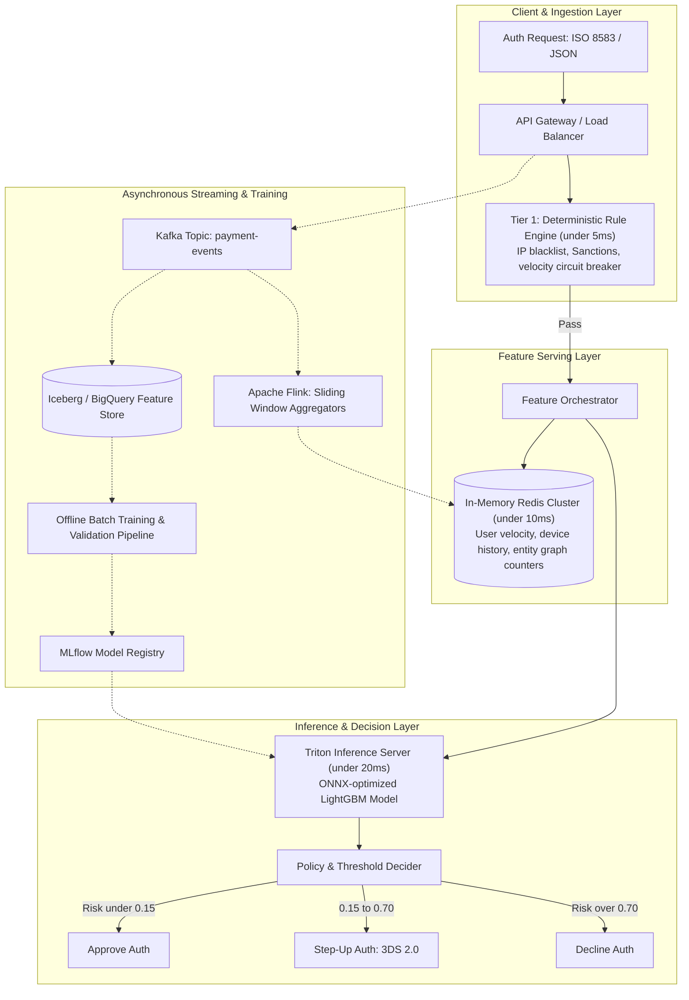

# Case Study 01: Real-Time Fraud Detection System Design

## 1. Problem Statement
Design an end-to-end Machine Learning System to evaluate payment authorization requests in real-time for an international payment processor.
- **Traffic**: Peak 15,000 Transactions Per Second (TPS).
- **Latency SLA**: Total ML decision must return within **40 milliseconds** (P99).
- **Baseline Fraud Rate**: ~0.08% of transaction volume.
- **Objective**: Maximize fraud capture (Recall) while maintaining False Positive Rate (customer insult rate) $< 0.1\%$.

---

## 2. System Architecture & Component Design

---

## 3. Real-Time Feature Store Schema & Signals

### Entity Identifiers
- `user_id`, `card_fingerprint` (salted SHA256 of PAN), `device_id`, `ip_address`, `merchant_id`.

### In-Memory Redis Feature Set (< 10ms lookup)
| Feature Name | Storage Type | Aggregation Window | Description |
| :--- | :--- | :--- | :--- |
| `card_velocity_10m` | Redis Sliding Window (ZSET) | Last 10 minutes | Count of auth attempts on card |
| `card_velocity_24h` | Redis String (INCRBY / TTL) | Trailing 24 hours | Total auth count in 24 hours |
| `user_avg_amount_30d` | Redis Hash | Trailing 30 days | Historical rolling mean amount |
| `user_amount_ratio` | Calculated in-flight | $\frac{\text{amount}}{\text{user\_avg\_amount\_30d}}$ | Ratio of current txn to usual spend |
| `device_distinct_users_7d` | Redis HyperLogLog (PFADD) | Trailing 7 days | Unique accounts seen on this physical device |
| `geo_speed_kmh` | Haversine distance | Time delta to last txn | Velocity of physical movement between transactions |

---

## 4. Modeling Strategy & Imbalance Handling

### Model Architecture
- **Primary Model**: Optimized **LightGBM** compiled to **ONNX Runtime** with multithreading on C++ microservice (average inference latency ~2.8ms on 4 CPU cores).
- **Secondary (Async) Deep Learning / GNN Model**: Runs in background (200ms budget) for larger ticket sizes ($> \$1,000$) or manual review queues to evaluate graph connectivity.

### Handling Severe Class Imbalance (0.08% positive rate)
1. **Focal Loss Formulation**:
   $$FL(p_t) = -\alpha_t (1 - p_t)^\gamma \log(p_t)$$
   Down-weights well-classified easy negatives and focuses gradient updates on hard borderline transactions.
2. **Negative Downsampling with Probability Recalibration**:
   - Downsample negatives by factor of 10 to speed up training iteration.
   - Recalibrate raw output probabilities $p_s$ back to true scale $p$ via Bayes' Rule:
     $$p = \frac{p_s}{p_s + \frac{1 - p_s}{\beta}}$$
     where $\beta = \frac{N_{downsampled}}{N_{original}} = 0.1$.

---

## 5. Decision Threshold & Expected Loss Optimization

Do not use default $0.5$ threshold! Instead, optimize the decision threshold $\theta^*$ to minimize overall expected financial and user friction cost:

$$\theta^* = \arg\min_{\theta} \left[ \sum_{\text{Txn}} C_{\text{FN}} \cdot \mathbb{I}(p > \theta, y=1) + C_{\text{FP}} \cdot \mathbb{I}(p \le \theta, y=0) + C_{\text{3DS}} \cdot \mathbb{I}(\theta_{\text{low}} < p \le \theta_{\text{high}}) \right]$$

- **$C_{\text{FN}}$ (Fraud Slip-through)**: Transaction Amount + Chargeback Fee ($15) + Scheme Monitoring Penalty.
- **$C_{\text{FP}}$ (False Positive / Customer Insult)**: Lost Interchange Margin ($~2\%$) + Estimated Customer LTV churn risk (~$45).
- **$C_{\text{3DS}}$ (Challenge Friction)**: ~8% cart abandonment rate on 3DS challenge.

---

## 6. Feedback Delay & Label Maturation

- **Challenge**: Chargeback dispute feedback takes 30–90 days to arrive from Visa/Mastercard.
- **Mitigation**:
  - Maintain a **90-day training buffer**: Training sets exclude transactions younger than 90 days to ensure ground-truth labels are fully mature.
  - For rapid adaptation to emerging attacks, train a **Short-Horizon Target Model** using early proxy signals (e.g., automated fraud report, customer support call inquiries, early decline patterns).
