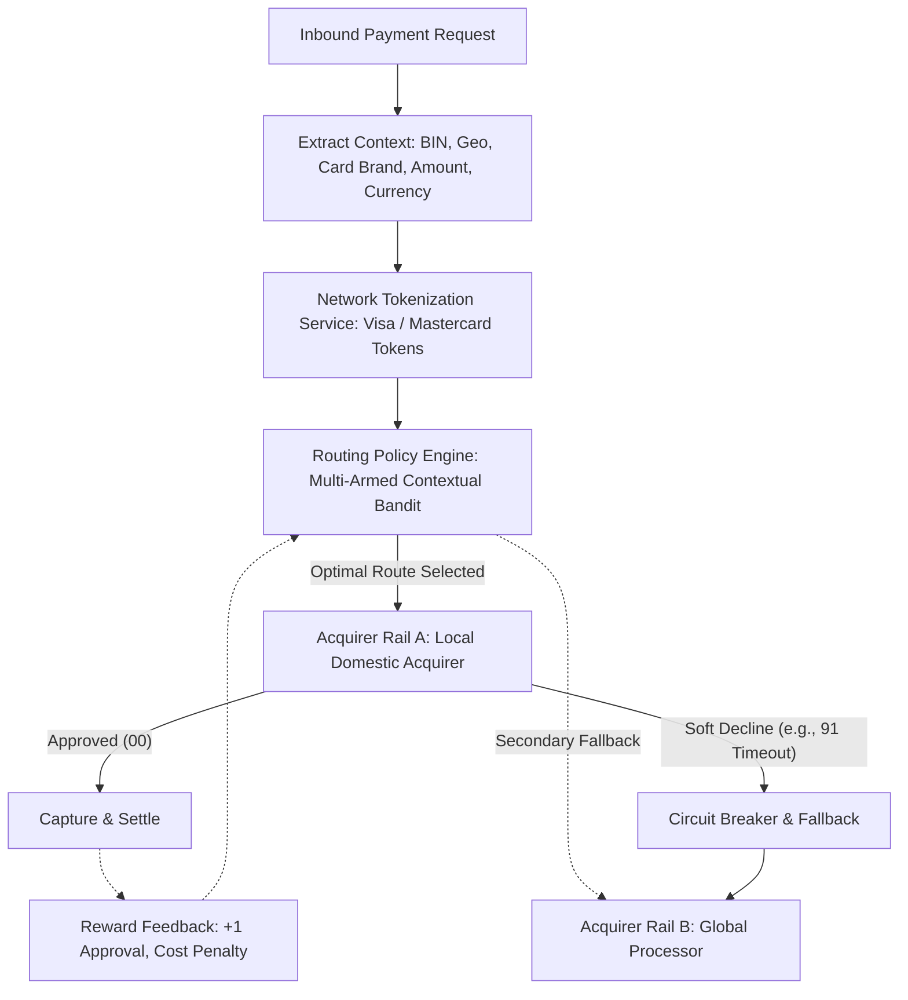
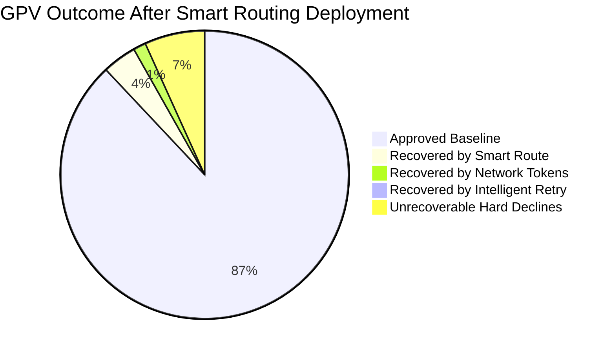

# Case Study 02: Payment Routing & Authorization Optimization

## 1. Problem Statement
A global e-commerce merchant processes $10 Billion in annual Gross Payment Volume (GPV) across 15 countries. Currently, all transactions are routed through a single primary acquirer with an average Authorization Rate of **87.2%**.
- **Industry Benchmark**: 91.5% for comparable merchants.
- **Financial Impact**: Each 1.0% (100 basis points) increase in authorization rate unlocks **$100M** in incremental settled GMV.
- **Objective**: Design a Smart Payment Routing & Decline Retry Engine that maximizes approval rates while minimizing processor fees and latency.

---

## 2. Decomposition of Declines: Hard vs. Soft Declines

Not all declines are permanent. Smart routing systems segment decline response codes:

| Category | Typical ISO 8583 Codes | Meaning | Optimal Strategy |
| :--- | :--- | :--- | :--- |
| **Hard Declines** | `04` (Pick-up card), `14` (Invalid card number), `41` (Lost card), `43` (Stolen card) | Card permanently invalid or stolen. | **Do NOT retry.** Prompt user immediately for alternative payment method. Retrying incurs network penalties. |
| **Soft Declines (System)** | `19` (Re-enter txn), `91` (Issuer system unavailable), `96` (System malfunction) | Temporary infrastructure failure or timeout at card scheme/issuer. | **Immediate Smart Reroute**: Route to secondary acquirer rail or retry in 500ms. |
| **Soft Declines (Risk/Balance)** | `05` (Do not honor), `51` (Insufficient funds), `65` (Exceeds withdrawal limit) | Generic decline from issuer risk engine or lack of balance. | **Asynchronous / Scheduled Retry**: For subscriptions, retry on paydays (1st / 15th of month, or 9:00 AM local time). For one-off, trigger 3DS step-up. |

---

## 3. Smart Routing Architecture (Contextual Bandits)

---

## 4. Algorithmic Formulation: Contextual Thompson Sampling

The routing engine faces an **Exploration vs. Exploitation** dilemma:
- If Acquirer A has a 92% approval rate for Chase debit cards, we want to exploit it.
- However, Acquirer B may have recently upgraded its direct connection to Chase; we need to allocate a small percentage of traffic to explore its performance.

### Formulation
For each transaction with context vector $x_t \in \mathbb{R}^d$ (encoding card scheme, issuing country, BIN tier, ticket size bucket, currency):
1. Sample parameter vector $\tilde{\theta}_a \sim \mathcal{N}(\hat{\theta}_a, \Sigma_a)$ for each available acquirer rail $a$.
2. Select arm $a^* = \arg\max_{a} \left[ x_t^T \tilde{\theta}_a - \lambda \cdot \text{Cost}(a) \right]$.
3. Observe outcome $r_t \in \{0, 1\}$ (Approval or Decline).
4. Update Bayesian posterior $(\hat{\theta}_{a^*}, \Sigma_{a^*})$.

---

## 5. Network Tokenization & Account Updater

- **Network Tokens**: Converting PANs into tokens issued directly by Visa (VTS) or Mastercard (MDES).
  - Issuer recognizes that the token is merchant-bound $\rightarrow$ lowers fraud risk $\rightarrow$ yields **2–3% higher authorization rate**.
  - Expiration dates and replacement card numbers are automatically updated by the network in real-time when physical cards are replaced or reissued.

---

## 6. Business Impact & Measurement

- **Net Auth Rate Uplift**: 87.2% $\rightarrow$ **93.3%** (+610 bps).
- **Annual Incremental Revenue**: $610M in incremental processed volume.
