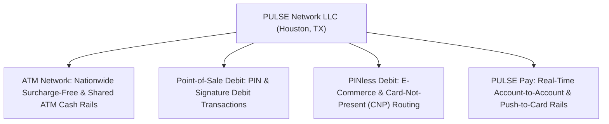

# PULSE (Capital One / Discover) — Company Research & Network Intel

> **Overview**: PULSE is a premier US electronic funds transfer (EFT) and debit payment network, founded in 1981, acquired by Discover Financial Services in 2005, and now a crown jewel payment rail within **Capital One Financial Corp.**  
> **Headquarters**: Houston, TX | **Network Scope**: Millions of ATM & POS merchant locations, thousands of issuing financial institutions.

---

## 📂 Research Files in this Section

- **[Senior Business Manager, Fraud Operations Strategy Dossier](file:///Users/vincent_yuan/GitHub/career_repos/cof_interview_prep/company_research/pulse_capital_one/senior_business_manager_fraud_operations_strategy.md)**:
  - Deep-dive into the role ($182k–$208k base + incentives), team leadership of ~8 risk/analytics specialists, debit network fraud operations, 150+ ISO 8583 authorization data elements, and interview questions.

---

## 🏛️ The Debit Network Ecosystem & Strategic Significance

### 1. Capital One's Transformational Acquisition
With the acquisition of Discover Financial Services, Capital One gains control over:
1. **Discover Credit Network** (competing with Amex, Visa, Mastercard).
2. **PULSE Debit Network** (competing directly with Visa Interlink and Mastercard Maestro/Cirrus).
3. **Vertical Integration**: Capital One can route hundreds of billions of dollars of its own consumer checking and debit card transactions over PULSE, keeping network assessment fees and interchange economics within the firm.

---

## 💡 Uniqueness of Debit Networks & Fraud Fundamentals

| Feature | Credit Networks | Debit Networks (PULSE) |
| :--- | :--- | :--- |
| **Source of Funds** | Bank credit line (uncollateralized loan). | **Demand Deposit Account (DDA)**: Real consumer checking cash. |
| **Clearing Speed** | Dual-message (batch settlement 24–48h). | **Single-message (real-time settlement)** for PIN debit. |
| **Consumer Protection** | **Regulation Z** (Truth in Lending). | **Regulation E** (Electronic Fund Transfers Act). |
| **Economics** | Unregulated, high interchange (150–250 bps). | **Durbin Amendment (Reg II)**: Capped at 21¢ + 0.05% + 1¢. |
| **Network Fraud Engine** | Visa Advanced Authorization / Falcon. | **PULSE DebitProtect**: Real-time scoring across 150+ data elements. |
| **Primary Fraud Risks** | CNP card theft, synthetic identity. | **ATM cash-out, hardware skimming, DDA drain, PINless CNP abuse.** |
