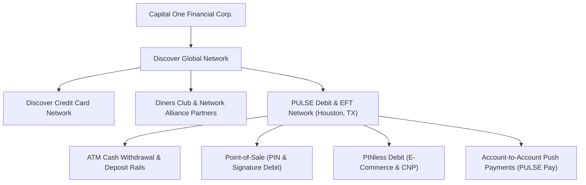
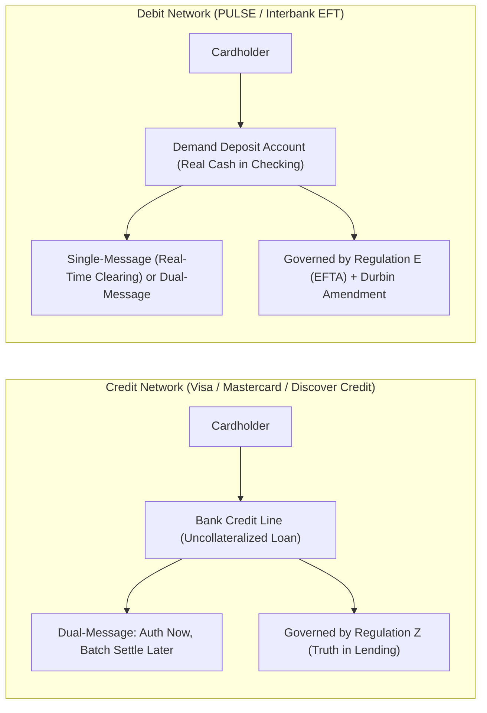
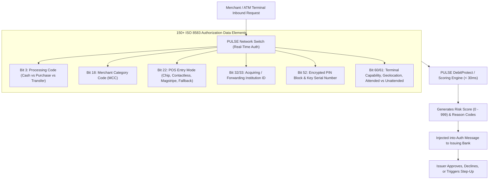

# PULSE / Capital One Dossier: Senior Business Manager, Fraud Operations Strategy

> **Role Title**: Senior Business Manager, Fraud Operations Strategy  
> **Company**: Capital One / PULSE Network LLC (Discover Financial Services)  
> **Location**: Houston, TX (PULSE HQ) / Deerfield, IL (Discover HQ)  
> **Salary Range**: $182,500 – $208,300 base per annum + Performance-based incentive compensation / bonus  
> **Team Size**: ~8 Data Analytics & Risk Professionals (including Principal Fraud Risk Specialists)  
> **Domain**: Debit Network Fraud Operations, Global Payment Network Protection, Transaction Intelligence  
> **Job Reference**: LinkedIn ID: 4454538043  
> **Job Link**: [LinkedIn Job Listing](https://www.linkedin.com/jobs/view/4454538043/)

---

## 1. Executive Summary: Capital One, Discover & The PULSE Debit Network

### Strategic Context: The Capital One + Discover / PULSE Acquisition
Capital One’s acquisition of **Discover Financial Services** fundamentally transformed Capital One from a bank that issues cards on Visa and Mastercard into a **vertically integrated global payment network**.
- **Discover Global Network** operates the Discover credit card brand, Diners Club International, and **PULSE**.
- **PULSE** is one of the leading electronic funds transfer (EFT) and debit networks in the United States, linking thousands of financial institutions, millions of ATM and POS merchant locations, and tens of millions of cardholders.
- **The Shift**: By owning PULSE, Capital One can route its own massive debit portfolio (and partner bank debit cards) over its proprietary rail, capturing network fees, reducing intermediary interchange leaks, and controlling end-to-end fraud scoring.

---

## 2. Uniqueness of a Debit Network vs. Credit Networks

Interviewing for a **debit network** requires understanding how debit differs fundamentally from credit across clearing architecture, economics, legal frameworks, and consumer psychology:

| Dimension | Credit Card Networks | Debit Networks (PULSE, NYCE, STAR) |
| :--- | :--- | :--- |
| **Source of Funds** | Bank line of credit. No immediate cash loss to the cardholder if defrauded. | **Demand Deposit Account (DDA)**. Fraud directly and instantly drains the consumer's real checking account cash! |
| **Consumer Impact of Fraud** | An inconvenient balance on a monthly statement; cardholder has 30 days to review before paying. | **Immediate financial shock**: Inability to pay rent, buy groceries, or cover checks; triggers overdraft fees and emotional panic. |
| **Clearing Architecture** | **Dual-Message System**: Authorization request at time of sale; separate clearing/settlement batch submitted 24–48 hours later. | **Single-Message System (PIN Debit)**: Authorization and financial clearing occur **simultaneously in real-time** (< 1 sec). Funds leave the DDA immediately. *(PINless / Signature debit can also run dual-message).* |
| **Regulatory Framework** | **Regulation Z** (Truth in Lending Act) & FCBA. Consumer liability capped at $50 (effectively $0 under network guarantees). | **Regulation E** (Electronic Fund Transfers Act): - Reported $\le 2$ days: Max $50 liability. - Reported 2–60 days: Up to $500 liability. - Reported $> 60$ days: **Unlimited consumer liability**. Issuers must provision provisional credit within 10 business days. |
| **Interchange Economics** | Unregulated, high interchange (1.50%–2.80% / 150–280 bps). Substantial margin to fund rewards and absorb fraud losses. | **Durbin Amendment (Fed Regulation II)**: For banks $> \$10\text{B}$ in assets, interchange is legally capped at **21¢ + 0.05% + 1¢ fraud adjustment** (~22¢–24¢ total per txn). Margin is razor-thin! |
| **Routing Freedom & Co-Badging** | Merchant must route Visa credit over Visa, Mastercard credit over Mastercard. | **Mandatory Routing Competition**: The Durbin Amendment legally mandates that debit cards must have at least **two unaffiliated networks** (e.g., Visa Debit + PULSE). Merchants choose the cheaper rail! |

---

## 3. Fraud Dynamics & Threat Vectors Unique to Debit Networks

Because debit networks touch checking accounts, ATMs, and point-of-sale terminals, they face distinct threat vectors:

### 1. Card-Not-Present (CNP) Debit Surge & PINless Debit
- **The Shift**: Historically, debit fraud was insulated by the 4-digit PIN. The Federal Reserve's Regulation II mandates that merchants must also have routing choice for online/e-commerce transactions, prompting massive adoption of **PINless Debit** on networks like PULSE.
- **The Vulnerability**: Without a PIN, debit card numbers are exposed to dark-web dumps, phishing, and credential stuffing just like credit cards—except the target is the victim’s life savings.

### 2. ATM Cash-Out & Hardware Skimming / Shimming
- **Deep-Insert Shimmers**: Fraudsters insert paper-thin shimming devices inside ATM motorized card readers to capture chip communication and magnetic stripe track data.
- **Coordinated Cash-Out Runs**: A syndicate clones 50 cards from compromised BINs and hits 30 ATMs across different states within a 20-minute window at 2:00 AM, draining $1,000 cash per card before automated velocity trips.

### 3. Account Takeover (ATO) & Digital Wallet Push-Provisioning
- Fraudsters use phishing or social engineering to compromise a victim’s online banking credentials.
- They push-provision the victim's PULSE-enabled debit card into an Apple Pay or Google Pay wallet on a burner iPhone.
- Once tokenized, they make high-ticket contactless purchases at electronics stores, bypassing traditional card-not-present CVV checks.

### 4. Card Testing & BIN Enumeration Attacks
- Automated scripts run brute-force PAN attacks (testing Luhn algorithm numbers with $1 authorization requests) through vulnerable merchant payment pages.
- **Network Consequence**: Can generate 50,000 auth queries per minute, degrading network switch latency and costing unrecovered transaction inquiry fees.

---

## 4. The Network Perspective: How PULSE Protects the Ecosystem

An issuing bank (e.g., a regional credit union) only sees transactions from its own cardholders. **PULSE, as the network switch, sees the entire macro-graph across all participants.**

### Key Technical Pillars of PULSE Network Fraud Strategy:
1. **PULSE DebitProtect**:
   - Proprietary real-time scoring engine that evaluates every transaction passing through the switch in under **30 milliseconds**.
   - Leverages behavioral anomaly models, consortium card-level velocity, terminal risk profiling, and IP telemetry.
2. **Analysis of 150+ Transaction Elements**:
   - Evaluating subtle risk interactions: e.g., **Chip Fallback** (Bit 22 indicates chip read failed, falling back to magstripe—a classic sign of counterfeit cloned card skimming).
   - Terminal Unattended Indicators (gas pump vs ATM vs cashier POS).
3. **Cross-Issuer Network Consortium Intelligence**:
   - Spotting a rogue merchant terminal that attacks cards belonging to 40 different credit unions within 10 minutes. An individual credit union sees only 1 transaction and approves; PULSE detects the cross-institutional pattern and kills the stream.
4. **Balancing False Declines vs. Consumer Trust**:
   - On debit, a false decline at a grocery store checkout or pharmacy causes acute consumer embarrassment and customer service calls.
   - Strategy models must maximize fraud capture while keeping the False Positive Ratio (FPR) strictly below industry benchmarks (typically $< 0.1\%$).

---

## 5. The Role: Senior Business Manager, Fraud Operations Strategy

### Key Responsibilities
- **Team Leadership & Mentorship**: Lead and develop a high-performing squad of ~8 data analytics and risk professionals (including Principal Fraud Risk Specialists).
- **Network-Level Fraud Strategy Formulation**: Design, backtest, and deploy fraud prevention rules and predictive machine learning models that screen billions in debit transactions across the PULSE switch.
- **Deep-Dive Data Analytics**: Mine multi-terabyte transactional datasets analyzing over 150 unique data elements per record to identify emerging fraud vectors, skimming waves, and ATO spikes.
- **Stakeholder Orchestration**: Align fraud strategy with Capital One enterprise corporate security, partner financial institutions, acquiring processors, and merchant trade groups.
- **Operational Cadence & Tooling**: Optimize SQL, Python, Snowflake/AWS Big Data pipelines to accelerate strategy deployment cycles from weeks down to hours during active zero-day attacks.

---

## 6. High-Frequency Interview Questions & Strategic Answers

### Question 1: "Debit cards are tied directly to consumer checking accounts. How does this reality alter your fraud risk strategy compared to credit card operations?"
> **Strong Answer Framework**:
> - **Immediate Liquidity Drain vs. Balance Sheet Float**: In credit, fraud represents an uncollateralized line of credit loss; the customer hasn’t lost physical money. In debit, every fraudulent dollar directly depletes the consumer’s Demand Deposit Account (DDA). This leads to bounced checks, mortgage payment failures, overdraft fees, and severe consumer distress.
> - **Regulation E Strict Timelines**: Under Reg E, the bank must provide provisional credit within 10 business days if the investigation cannot be concluded. Slow detection directly costs the institution liquidity.
> - **Single-Message Real-Time Clearing**: PIN debit clears in real-time. There is no end-of-day batch window to stop settlement. Therefore, **network-level intervention must happen pre-authorization (< 30ms)**.
> - **The False Decline Dilemma**: While we must protect DDA cash, false declines at point-of-sale (gas stations, groceries) trigger intense customer insult. The strategy must use multi-layered risk tiers: challenge with step-up authentication or PIN prompts rather than immediate hard declines.

---

### Question 2: "With the expansion of the Durbin Amendment to online transactions, PINless debit has grown dramatically. What new fraud risks does PINless debit introduce to PULSE, and how do you mitigate them?"
> **Strong Answer Framework**:
> - **Erosion of Two-Factor Hardware Security**: PIN debit was traditionally secured by something you have (chip/card) and something you know (PIN). PINless debit strips away the PIN to facilitate frictionless e-commerce checkout.
> - **Adversarial Vector**: Fraudsters deliberately route stolen card dumps through merchants configured for PINless debit to avoid PIN prompts.
> - **Mitigation Architecture**:
>   1. *Enhanced Data Feeds*: Ingest e-commerce telemetry (device fingerprinting, IP proxy indicators, shipping-billing address verification).
>   2. *Network Velocity Windows*: Track digital token velocity and cross-merchant card usage within 5-minute and 1-hour sliding windows.
>   3. *Network Risk Scoring*: Deliver a heightened risk score on PINless routes where device fingerprint novelty is elevated, prompting the issuer to decline or trigger 3-D Secure.

---

### Question 3: "How do you evaluate and deploy a new fraud rule across 150+ transaction data elements without creating massive merchant fallout?"
> **Strong Answer Framework**:
> - **Offline Simulation on Mature Datasets**: Never deploy a rule live without backtesting. Run the candidate rule against 30–60 days of historical network transaction logs (hundreds of millions of records).
> - **Measure Marginal Trade-offs**:
>   $$\text{Efficiency Ratio} = \frac{\text{Fraud Dollars Captured}}{\text{Legitimate Dollars Declined}}$$
>   Target an efficiency ratio $\ge 5:1$ or $10:1$ depending on the ticket band.
> - **Shadow / Passive Deployment**: Run the rule in "shadow mode" for 7 days where transactions are scored and logged, but no authorization is actually blocked. Verify the empirical False Positive Rate against production traffic.
> - **Canary Rollout by MCC / BIN**: Roll out to high-risk merchant category codes (e.g., MCC 5732 Electronics, MCC 5944 Jewelry) or specific high-risk merchant IDs before network-wide activation.

---

### Question 4: "You lead a team of 8 data analytics and risk specialists. How do you balance urgent, reactive fraud attack triage with long-term predictive model development?"
> **Strong Answer Framework**:
> - **The 70/20/10 Capacity Allocation**:
>   - *60–70% Core Strategic & Predictive Modeling*: Building next-generation machine learning scorecards, feature store automation, and structural network intelligence.
>   - *20% Incident Response & Zero-Day Triage*: Rapid rule formulation, blitz post-mortems, and emergency rule patching for active fraud runs.
>   - *10% Skill & Tooling Investment*: Upskilling analysts in Python, advanced SQL, Snowflake, and cloud data engineering.
> - **Separation of Roles via Incident Rotations**: Assign a rotating "Fraud Duty Lead" each week to handle real-time alarms, merchant escalations, and tactical rule adjustments, shielding the rest of the team to focus uninterrupted on strategic predictive modeling.
> - **Closed-Loop Post-Mortems**: Every tactical rule deployed during an emergency must be reviewed within 14 days to either sunset, optimize, or integrate into the core statistical model.

---

## 7. High-Impact Questions to Ask Capital One / PULSE Interviewers

1. *"Following Capital One’s acquisition of Discover and PULSE, what is the roadmap for transitioning Capital One’s massive debit card issuing portfolio onto the proprietary PULSE rail, and how is the fraud team preparing for that volume surge?"*
2. *"How does PULSE’s fraud operations strategy collaborate between the Houston network engineering center and Capital One’s enterprise machine learning teams in McLean, VA?"*
3. *"With the Federal Reserve's updated Regulation II rules mandating dual-network routing for e-commerce and CNP transactions, what new behavioral signals in PINless debit are providing the highest predictive lift?"*
