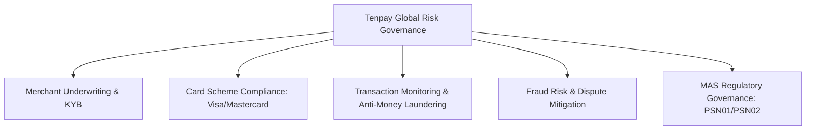

# Tencent (Tenpay Global) — Company Research & Interview Hub

> **Overview**: Tencent's Financial Technology (FiT) division operates **Tenpay / Weixin Pay** and powers global cross-border payments, merchant acquiring, and international remittances through **Tenpay Global Pte. Ltd.** in Singapore.  
> **Headquarters**: Shenzhen, China | **APAC & International Fintech Hub**: Singapore | **Public Ticker**: HKEX: 0700

---

## 📂 Research Files in this Section

- **[Financial Crime Risk Control Manager (Payments) Dossier](file:///Users/vincent_yuan/GitHub/career_repos/cof_interview_prep/company_research/tencent/financial_crime_risk_control_manager_payments.md)**:
  - Deep-dive into Tenpay Global's overseas acquiring business, merchant lifecycle risk framework, card scheme compliance (Visa VAMP / Mastercard ECP), MAS regulatory requirements, AML/CFT transaction monitoring, and technical interview frameworks.

---

## 🏛️ Company Architecture & Core Fintech Footprint

### 1. Tencent Financial Technology (FiT) & Tenpay Global
Tencent FiT operates:
1. **Weixin Pay / WeChat Pay**: Over 1 billion daily active users in domestic China.
2. **Tenpay Global**: The international payment arm licensed in Singapore by the **Monetary Authority of Singapore (MAS)** under the Payment Services Act.
3. **Cross-Border Acquiring**: Enables international merchants (airlines, luxury, e-commerce, digital gaming) to accept Weixin Pay from Chinese tourists and cross-border shoppers.
4. **Overseas Merchant Acquiring**: Direct processing and acquiring of international credit card schemes (Visa, Mastercard, JCB, Amex, UnionPay) for international e-commerce platforms and digital content merchants.
5. **WeRemit**: Cross-border consumer remittance and business payout rails connecting Asia-Pacific, Europe, and Latin America.

---

## 🛡️ Core Risk Disciplines for Tenpay Global

- **Merchant Lifecycle Risk**: KYB verification, Ultimate Beneficial Owner (UBO) screening, business model risk, rolling reserves, and delayed settlement terms.
- **Card Scheme Programs**: Defending against excessive chargeback programs (Visa VAMP / VFMP; Mastercard ECP / BRAM) to avoid portfolio penalties.
- **Financial Crime & AML**: Detecting smurfing, structuring, transaction laundering, and filing Suspicious Transaction Reports (STRs) with Singapore's Commercial Affairs Department (CAD).
