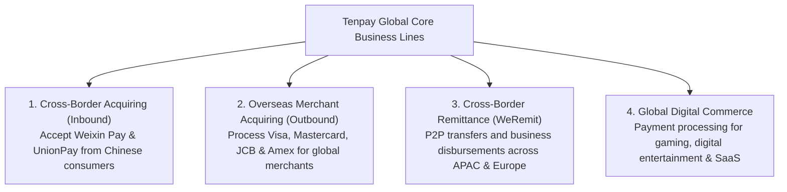
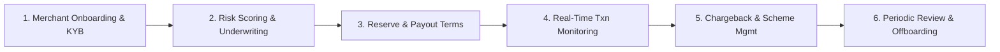

# Tencent Dossier: Financial Crime Risk Control Manager (Payments)

> **Role Title**: Financial Crime Risk Control Manager (Payments)  
> **Company**: Tencent / Tenpay Global Pte. Ltd.  
> **Business Group**: Corporate Development Group (CDG) — Financial Technology (FiT)  
> **Location**: Singapore  
> **Scope**: Overseas Acquiring Business, Cross-Border Payments, and International Merchant Risk  
> **Job Reference**: LinkedIn ID: 4473729104  
> **Job Link**: [LinkedIn Job Listing](https://sg.linkedin.com/jobs/view/financial-crime-risk-control-manager-payments-at-tencent-4473729104)

---

## 1. Executive Summary & Business Unit Context

### Tencent Financial Technology (FiT) & Tenpay Global
While Tencent is globally renowned for WeChat, gaming, and cloud services, its **Financial Technology (FiT)** division operates one of the largest payment infrastructures in the world (**Tenpay / Weixin Pay**). 

**Tenpay Global Pte. Ltd.** (headquartered in Singapore) is Tencent's primary vehicle for international payment expansion, licensed under the **Monetary Authority of Singapore (MAS)** Payment Services Act.

### The Strategic Mission of the Role
As Tencent accelerates its international acquiring footprint across Southeast Asia, Europe, and Latin America, it takes on direct **acquirer liability**:
- If an acquired merchant goes bankrupt, commits bust-out fraud, or runs illegal gambling/counterfeit goods schemes, **Tenpay Global is financially liable to the card schemes (Visa/Mastercard) and regulators (MAS)**.
- This role owns the end-to-end **merchant risk lifecycle**, **card scheme compliance**, **transaction fraud monitoring**, and **AML/CFT risk controls** for international payments.

---

## 2. End-to-End Overseas Merchant Acquiring Risk Lifecycle

In payment acquiring, risk control spans the entire lifecycle of a merchant:

### Phase 1: Merchant Onboarding & KYB (Know Your Business)
- **Ultimate Beneficial Owner (UBO)** identification (threshold: $\ge 25\%$ ownership).
- **Sanctions & PEP Screening**: Screening corporate entities and directors against OFAC, UN, EU, and MAS sanction lists.
- **Website & Business Model Due Diligence**: Validating terms of service, refund policy, pricing consistency, and intellectual property (avoiding counterfeit goods/infringing brands).
- **Merchant Category Code (MCC) Assignment**: Assigning precise MCCs (e.g., 5732 Electronics vs 7995 Gambling) to prevent transaction laundering.

### Phase 2: Underwriting & Financial Exposure Assessment
- **Credit Risk / Solvency Check**: Reviewing financial statements, processing history, and bank statements.
- **Fulfillment Lag Exposure**: Calculating the duration between consumer payment and goods delivery. Long delivery horizons (e.g., airlines, custom furniture, annual SaaS) create high unfulfilled delivery liability if the merchant fails.

### Phase 3: Mitigation Terms & Collateralization
- **Rolling Reserves**: Withholding a percentage of daily gross processing volume (e.g., 5–10% for 180 days) to buffer against potential future chargebacks.
- **Settlement Delay (T+N)**: Payout schedules set based on merchant risk tier (e.g., T+2 vs T+7 vs T+14).
- **Processing Volume Caps**: Enforcing monthly volume limits to detect sudden surges indicative of bust-out attacks.

### Phase 4: Ongoing Transaction Monitoring & Anomaly Detection
- **Velocity Rules**: Unusual spikes in transaction count or average order value (AOV).
- **Cross-Border Geo Mismatch**: Merchant registered in Singapore processing 95% of card transactions from Ukrainian cards at 3:00 AM.
- **Transaction Laundering / Aggregation Detection**: Detecting unauthorized sub-merchants funneling illegal payments through an approved shell merchant.

### Phase 5: Card Scheme Compliance & Dispute Management
- **Visa & Mastercard Monitoring Thresholds**:
  - **Visa Acquirer Monitoring Program (VAMP)** / **VFMP** (Fraud): Thresholds triggered if dispute or fraud ratios exceed $0.9\%$ (90–100 bps).
  - **Mastercard Excessive Chargeback Program (ECP)** / **BRAM** (Brand Risk Management) / **ANOP** (Audit Non-Compliance).
- **Excessive Chargeback Remediation Plans**: Managing fines ($25,000–$100,000+ per scheme tier) and merchant termination if thresholds are breached.

---

## 3. Deep Dive: Chargeback Risk, Acquirer Liability & Card Scheme Penalties

In payment acquiring, **risk control is fundamentally an uncollateralized credit underwriting business**. When Tenpay Global acquires an overseas merchant, it acts as the **unconditional financial guarantor** to the card networks (Visa, Mastercard, Amex, JCB).

### 1. The Fundamental Law of Acquiring: Acquirer as Ultimate Guarantor
- **The Liability Chain**: If a cardholder disputes a purchase, the card network **immediately and unconditionally debits Tenpay Global's scheme settlement account**. Tenpay Global must then attempt to collect those funds from the merchant.
- **The Negative Balance Problem**: If the merchant has already received its payouts and subsequently goes bankrupt, abandons its entity, or flees (Bust-Out), **Tenpay Global is left holding the bag**. The debt cannot be passed back to the cardholder or scheme.
- **The Long Exposure Tail**: While normal authorization happens in milliseconds, the chargeback window is **120 calendar days** from the transaction date—and up to **540 calendar days** for delayed fulfillment services (e.g., flight cancellations, event bookings). Tenpay Global holds credit exposure on every dollar processed for up to 18 months!

---

### 2. Connecting Merchant Risk Behaviors to Acquirer Consequences

| Merchant Risk Behavior | Mechanism & Pattern | Primary Scheme Reason Codes | Direct Consequence on Tenpay Global |
| :--- | :--- | :--- | :--- |
| **Bust-Out Fraud / Runaway Merchant** | Fraudster acquires clean processing history with low ticket items; suddenly stages high-volume flash sales ($2M-$5M in 72 hours), requests expedited settlement, withdraws all funds, and vanishes. | Visa `10.4` (Other Fraud: Card-Absent Environment) MC `4837` (No Cardholder Authorization) | **Direct Capital Loss**: Tenpay Global must pay 100% of chargebacks from its balance sheet, plus $15-$50 per-dispute administrative fees, exhausting merchant reserves instantly. |
| **Fulfillment Lag & Future Insolvency** | High-lag merchants (airlines, travel, custom furniture, pre-order hardware) collect funds months before delivery. Operating cash flow dries up $\rightarrow$ merchant declares bankruptcy. | Visa `13.1` (Merchandise/Services Not Received) MC `4853` (Goods or Services Not Provided) | **Catastrophic Cumulative Exposure**: Tens of thousands of consumers file disputes simultaneously. Acquirer must reimburse millions of dollars in unfulfilled customer liabilities. |
| **Transaction Laundering / Aggregation** | An approved benign merchant (e.g., an online stationery store) rents its payment credentials to illicit merchants (unlicensed gambling, counterfeit goods, pirated IPTV). | Visa `10.5` (Visa Fraud Monitoring) Mastercard BRAM violations | **Network Fines of $100k-$250k+ per violation**: Direct violation of acquiring rules; potential suspension of acquiring license; blacklisting. |
| **Card Testing / Account Enumeration** | Botnets use the merchant's checkout page to brute-force validate 100,000 stolen card credentials with $1 authorization requests. | Visa `10.5` Excessive auth declines | **Network Authorization Fines**: Networks levy inquiry fees ($0.05-$0.15/attempt) totaling thousands in minutes; merchant gateway IP blocked across global issuer firewalls. |
| **Friendly / First-Party Fraud** | Legitimate consumer receives the product, then falsely claims non-receipt or unauthorized charge to obtain free goods. | Visa `13.1` Visa `10.4` MC `4837` | **Margin Erosion & Operational Overhead**: High representment overhead, evidence curation costs, and erosion of portfolio dispute ratios toward scheme monitoring thresholds. |

---

### 3. Card Scheme Monitoring Programs & Exact Fine Matrices

Card schemes operate automated monitoring programs that track the ratio of chargebacks and fraud relative to sales. Breaching these thresholds incurs severe financial and operational penalties on the acquirer:

#### A. Visa Programs: VAMP, VFMP, and VDMP
Visa calculates ratios on a monthly basis:
$$\text{Dispute Ratio} = \frac{\text{Count of Disputes Received in Month } M}{\text{Count of Settled Transactions in Month } M} \times 100\%$$
$$\text{Fraud Ratio} = \frac{\text{Fraud Gross Dollar Volume in Month } M}{\text{Total Sales Dollar Volume in Month } M} \times 100\%$$

| Tier | Dispute / Fraud Threshold | Minimum Count / Volume | Penalties Levied on Acquirer |
| :--- | :--- | :--- | :--- |
| **Early Warning** | $\ge 0.65\%$ (65 bps) | 75 disputes / $50,000 fraud | Notification to Acquirer; mandatory investigation and remediation plan. |
| **Standard Program** | $\ge 0.90\%$ (90 bps) | 100 disputes / $75,000 fraud | **Month 1–3**: Remediation period ($0 fine, formal report). **Month 4**: **$25,000** fine + $10/dispute assessment fee. **Month 5–6**: **$50,000/month**. **Month 7+**: **$75,000–$100,000/month** until ratio drops below 0.90% for 3 consecutive months. |
| **Excessive Program** | $\ge 1.80\%$ (180 bps) | 1,000 disputes / $250,000 fraud | Immediate **$50,000–$100,000/month** fines; mandatory merchant termination; acquirer on-site compliance audit. |

#### B. Mastercard Programs: ECP and BRAM
- **Excessive Chargeback Program (ECP)**:
  - *Tier 1 (ECM)*: Chargeback-to-Transaction ratio $\ge 1.0\%$ (100 bps) and 100+ chargebacks. Fines escalate from **$1,000 in Month 1** to **$10,000 (Month 3)**, **$25,000 (Month 4)**, and **$50,000 (Month 6+)**.
  - *Tier 2 (EFM - Excessive Fraud Merchant)*: Fraud-to-sales ratio $\ge 0.50\%$ (50 bps), $50,000+ fraud volume, and 3DS adoption $< 50\%$. Fines reach **up to $100,000/month**.
- **Business Risk Assessment and Mitigation (BRAM)**:
  - Covers illegal drugs, unlicensed gambling, counterfeit apparel, intellectual property theft, and child exploitation.
  - Penalties are punitive: **$100,000 for the first violation**, escalating to **$250,000 for the second violation** directly against the acquirer.

#### C. Existential Business Consequences for Tenpay Global
1. **Revocation of Principal Acquiring Membership**: Repeated or unaddressed scheme violations can lead to Visa or Mastercard suspending or terminating Tenpay Global's acquiring license, crippling Tencent's overseas payment business.
2. **Mandatory Security Collateral**: Schemes can force Tenpay Global to post millions in cash collateral or irrevocable letters of credit (ILOC) in scheme settlement accounts.
3. **MAS Regulatory Intervention**: Under Singapore's Payment Services Act, systemic risk management failures reported by card schemes trigger mandatory inspection and potential revocation of the Major Payment Institution license.

---

### 4. The Chargeback Recovery & Mitigation Playbook

To safeguard Tenpay Global from insolvency losses and scheme fines, the Risk Control Manager executes a 4-layered defense:

```mermaid
flowchart TD
    subgraph Layer1 ["Layer 1: Pre-Dispute Elimination (Real-Time)"]
        Alert["Visa Verifi (RDR / CDRN) & Mastercard Ethoca Alerts"] --> AutoRefund["Auto-Issue Merchant Refund within 24 Hours<br/>Prevents Dispute from Registering on Scheme Ratios"]
    end

    subgraph Layer2 ["Layer 2: Collateral & Mathematical Reserve Sizing"]
        Formula["Dynamic Rolling Reserve = Monthly GPV * (Loss Rate + Fulfillment Buffer) * Multiplier"]
        Formula --> Hold["Hold 5%-10% of Daily Volume for 180 Days"]
        Escrow["Upfront Cash Escrow / Irrevocable Letters of Credit for Travel/High-Lag"]
    end

    subgraph Layer3 ["Layer 3: Representment & Visa CE 3.0"]
        FriendlyFraud["Customer Claims Fraudulent / Non-Receipt"]
        FriendlyFraud --> CE3["Visa Compelling Evidence 3.0 (CE 3.0):<br/>Submit 2 Prior Undisputed Orders with Matching IP / Device Fingerprint"]
        CE3 --> Win["Liability Automatically Reverses to Issuer"]
    end

    subgraph Layer4 ["Layer 4: Post-Default Recovery & Legal Recourse"]
        Default["Merchant Balance Enters Negative"]
        Default --> Offsetting["Cross-Account Offsetting (Clawback from Other Accounts / Payouts)"]
        Offsetting --> Guarantee["Enforce Personal / Corporate Director Guarantees"]
        Guarantee --> Blacklist["Submit Merchant & UBO to MATCH / VMAS Blacklist"]
    end
```

1. **Pre-Dispute Interception (Ethoca & Verifi RDR)**:
   - When an issuer raises a fraud complaint, it enters the Verifi/Ethoca network before clearing as a formal chargeback.
   - If pre-configured rules trigger, Tenpay Global automatically issues a customer refund within 24 hours. **Crucial Advantage**: The cardholder gets refunded, but **zero chargeback is recorded with Visa/Mastercard**, shielding the merchant from the $0.90\%$ threshold!
2. **Dynamic Rolling Reserve Formulation**:
   - Instead of static 5% reserves, calculate exposure dynamically:
     $$\text{Reserve Required} = \text{Monthly Volume} \times \left( \text{Dispute Rate}_{\text{p95}} + \text{Fulfillment Lag Factor} \right) \times \text{Buffer Multiplier}$$
     where $\text{Fulfillment Lag Factor} = \frac{\text{Days from Payment to Delivery}}{30} \times \text{Historical Cancellation Rate}$.
3. **Visa Compelling Evidence 3.0 (CE 3.0)**:
   - For friendly fraud disputes (Reason Code `10.4`), if the acquirer proves the cardholder made **2 prior undisputed transactions** at least 120 days old using the same IP, device fingerprint, or delivery address, **the scheme automatically reverses the chargeback without manual arbitration**.
4. **Post-Default Enforcement (MATCH / VMAS Listing)**:
   - If a merchant defaults with negative balance or engages in fraud, Tenpay Global registers the entity, directors, and UBOs on the **MATCH (Mastercard Member Alert to Control High-Risk Merchants)** and **VMAS (Visa Merchant Alert Service)** databases, permanently blocking them from acquiring processing across global banks.

---

## 4. Financial Crime & Regulatory Compliance in Singapore (MAS)

Because Tenpay Global operates under MAS oversight in Singapore, the Risk Control Manager must master:

| Regulatory Area | Key Requirement | Application to Tencent Payments |
| :--- | :--- | :--- |
| **MAS Notice PSN01** | AML / Counter-Financing of Terrorism for Payment Services | Mandatory customer due diligence (CDD), transaction screening, and high-risk country risk rating. |
| **MAS Notice PSN02** | Prevention of Money Laundering for Digital Payment Token / Cross-border | Risk mitigation for cross-border fund transfers and remittances. |
| **Suspicious Transaction Reporting (STR)** | Mandatory filing with CAD (Commercial Affairs Department) | Flagging anomalous patterns: structuring / smurfing, sudden high-value velocity, inconsistent business rationale. |
| **Travel Rule** | FATF Recommendation 16 | Originator and beneficiary details must travel alongside cross-border fund transfers exceeding statutory thresholds. |

---

## 5. Key Responsibilities & Problem Statements

### 1. Risk Framework Design & Implementation
- Formulate dynamic merchant risk policies tailored for different international markets (APAC, Europe, LATAM) balancing onboarding conversion against loss prevention.
- Build portfolio-level **Key Risk Indicators (KRIs)**: Portfolio Chargeback Rate, Fraud Loss Rate (bps), High-Risk Merchant Exposure %, Delayed Settlement Collateral Coverage.

### 2. Detection Logic & Model Strategy
- Collaborate with tech teams to configure rule engines and risk scoring models (decision trees, LightGBM, anomaly clustering).
- Build automated alerts for transaction laundering, rapid refund surges, and card testing scripts.

### 3. Investigation & Incident Management
- Conduct deep-dive investigations on suspicious merchants, frozen funds, and coordinated fraud syndicates.
- Lead closed-loop post-mortems: When an unexpected loss or scheme warning occurs, identify root-cause vulnerabilities, update rules, and re-underwrite similar merchants in the portfolio.

### 4. Cross-Functional & Cross-Regional Collaboration
- Act as the bridge between **Singapore local compliance/product teams** and **Headquarters (Shenzhen/Hong Kong) technology and risk operations teams**.
- Bilingual fluency (English & Mandarin) is critical to communicate regulatory demands to engineering and executive leadership.

---

## 6. Interview Preparation: High-Frequency Questions & Frameworks

### Category 1: Merchant Acquiring & Underwriting Risk
> **Question**: *"A fast-growing cross-border e-commerce merchant applies to accept international credit cards. Their projected volume is $5M/month, selling electronics with 3-week global shipping. How do you underwrite and structure their risk terms?"*

**Answer Framework**:
1. **Identify the Inherent Risk Profile**: Electronics have high resale value $\rightarrow$ high target for stolen cards (CNP fraud). 3-week fulfillment lag means that if the merchant fails or ships empty boxes, chargebacks will flood in 30–60 days later.
2. **KYB & Verification**:
   - Check corporate registry, verify UBOs, review 6 months of historical processing statements, chargeback rates, and refund ratios with prior acquirers.
   - Mystery shopping / site inspection: verify shipping fulfillment contracts, return policies, and stock availability.
3. **Mitigation Terms**:
   - **Rolling Reserve**: 10% rolling reserve for 180 days (covering the 120-day card scheme dispute window).
   - **Settlement Terms**: T+5 or T+7 delayed settlement to ensure initial tracking numbers are validated.
   - **Volume Cap**: Initial cap of $1M for the first 60 days; ramp up only after observing mature chargeback rates $< 0.5\%$.
   - **Mandatory 3DS 2.0**: Require step-up authentication on transactions above $150 to shift fraud liability to issuers.

---

### Category 2: Transaction Laundering / Aggregation
> **Question**: *"How do you detect if an approved online travel agency merchant is secretly acting as a payment aggregator for unauthorized high-risk merchants (e.g., online gaming, adult, or IPTV subscriptions)?"*

**Answer Framework**:
1. **Transaction Amount Anomaly**: Travel tickets usually have round or specific price bands ($200–$800) with low transaction frequency per user. Transaction laundering displays micro-transactions ($5–$20) at high velocity, or repeated charges on the same card in minutes.
2. **MCC & Descriptor Discrepancies**: Cardholders dispute charges with descriptor mismatch ("I didn't buy airline tickets; I bought gaming tokens").
3. **Traffic & Web Analytics**: Use web crawling tools (e.g., Web Shield, LegitScript) to check if payment gateway tokens from the approved merchant site appear on unauthorized third-party URLs.
4. **Action**: Immediate payout freeze, forensic audit, and offboarding under Mastercard BRAM / Visa rules.

---

### Category 3: Card Scheme Fines & Remediation
> **Question**: *"Our acquiring portfolio’s chargeback ratio for Visa transactions spikes to 1.15% in month 1. What immediate actions do you take to avoid formal Visa Acquirer Monitoring Program (VAMP) fines?"*

**Answer Framework**:
1. **Portfolio Decomposition**:
   - Calculate ratio: $\text{Dispute Ratio} = \frac{\text{Disputed Txns}}{\text{Settled Txns}}$.
   - Segment by merchant: Identify the top 5 merchants driving 80% of the chargebacks (the Pareto principle in risk).
2. **Immediate Remediation on Bad Actors**:
   - Immediately pause processing or enable strict 3DS 2.0 / fraud scoring rules on offending merchants.
   - Issue automated refunds for transactions flagged with early fraud warnings (Visa TC40 / Mastercard SAFE signals) before they turn into formal chargebacks.
3. **Engage the Card Scheme**:
   - Proactively submit an Acquirer Remediation Plan to Visa showing merchant containment actions, updated risk filters, and expected downward trajectory below 0.90% within 30 days.

---

### Category 4: AML / Sanctions & MAS Compliance
> **Question**: *"Under MAS regulations, how do you handle an overseas merchant payout when the beneficial owner has a partial name match against an OFAC or MAS sanction list?"*

**Answer Framework**:
1. **Immediate Payout Hold**: Place an automatic system hold on outgoing settlements without alerting the customer (avoiding 'tipping off' under AML law).
2. **Secondary Level Screening**:
   - Check unique identifiers: Date of birth (DOB), nationality, national ID/passport number, and corporate incorporation country against the sanction notice metadata.
3. **False Positive Resolution vs Escalation**:
   - If proven false positive (common name, different DOB/nationality): Document audit trail and release hold.
   - If confirmed true match or partial high-confidence match: Escalate to MLRO (Money Laundering Reporting Officer), file a Suspicious Transaction Report (STR) with Singapore CAD, and freeze assets as legally mandated.

---

## 7. High-Impact Questions to Ask Tencent Interviewers

1. *"How is the risk architecture structured between Tencent’s Shenzhen FiT core risk engine and Tenpay Global’s local Singapore infrastructure to meet MAS data localization and real-time processing requirements?"*
2. *"With the international rollout of Weixin Pay cross-border acquiring for foreign merchants, what has been the biggest challenge in balancing localized payment customs with Tencent's centralized fraud models?"*
3. *"How does Tenpay Global leverage AI and graph analytics to uncover complex transaction laundering syndicates operating across multiple offshore shell corporations?"*
