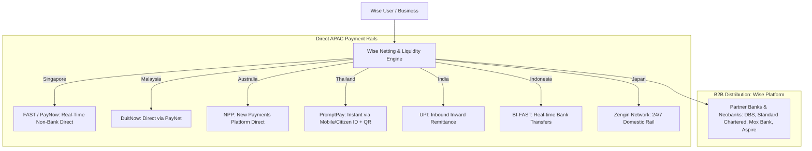
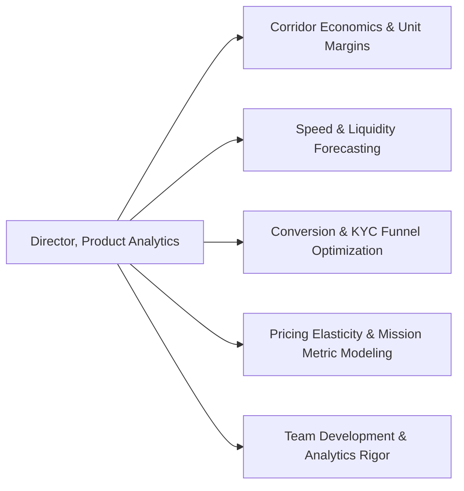
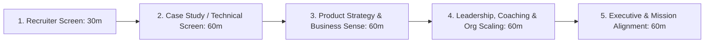

# Wise Dossier: Director, Product Analytics (APAC - Singapore)

> **Role Title**: Director, Product Analytics (APAC)  
> **Company**: Wise (formerly TransferWise)  
> **Location**: Singapore (APAC Regional Hub)  
> **Salary**: SGD 230,000 – 318,000 base per annum + RSUs  
> **Squad**: APAC Regional Squad / Regional Expansion  
> **Reporting To**: Global Senior Analytics Director for Regional Expansion  
> **Key Partners**: APAC Leadership Quad (Product Lead, Banking/Partnerships Lead, Engineering Lead)  
> **Team Size**: ~10 Product Analysts  
> **Job Link**: [Wise Jobs - Director, Product Analytics APAC](https://wise.jobs/job/director-product-analytics-apac-in-singapore-jid-3333?_atxsrc=linkedin_via_wise_jobs&utm_source=linkedin_via_wise_jobs)

---

## 1. Executive Summary & Company Context

### Wise Mission & Core Philosophy
Wise’s mission is **"Money Without Borders — instant, convenient, transparent and eventually free."**
Unlike traditional banks that profit from opaque foreign exchange (FX) markups and SWIFT intermediary fees, Wise uses a peer-to-peer netting and local clearing infrastructure. 

### The 4 North Star Mission Pillars
Every feature, product roadmap, and analytic evaluation at Wise is tied to these 4 pillars:
1. **Price (Target: Zero Fee)**: Continually driving down transaction fees as scale efficiencies increase. Current global average fee is ~0.60% (Wise publicly publishes quarterly mission updates breaking down fees).
2. **Speed (Target: Instant / < 20 seconds)**: >60% of global transfers complete instantly (< 20 seconds); >85% complete in under 24 hours.
3. **Convenience**: Frictionless customer onboarding, instant KYC (e.g., Singpass integration), mobile-first UX, self-service error handling, and high Net Promoter Score (NPS).
4. **Coverage & Transparency**: Mid-market exchange rate without hidden spreads, expanding currency pairs across difficult emerging markets.

### The Wise Product Suite
- **Wise Personal Account**: Multi-currency digital balance (hold 40+ currencies), Wise debit card, travel payments, international remittances.
- **Wise Business**: Enterprise multi-currency treasury, multi-user role management, batch payroll across borders, accounting integrations (Xero, QuickBooks).
- **Wise Platform**: B2B infrastructure allowing partner banks, neobanks, and fintechs (e.g., DBS, Standard Chartered, Tiger Brokers, Aspire, Google Pay, Monzo) to embed Wise's real-time international rails directly into their native apps.

---

## 2. The APAC Strategic Landscape & Payment Rails

Wise’s Singapore office acts as the **central operational, product, and engineering hub for the Asia-Pacific region**. APAC is Wise’s highest-growth and most complex operating theater due to regulatory fragmentation, capital controls, and hyper-localized domestic payment networks.

### Key APAC Market Integrations & Dynamics
1. **Singapore (MAS Regulated)**:
   - Wise is licensed as a **Major Payment Institution (MPI)** under the Monetary Authority of Singapore (MAS).
   - One of the first non-bank financial institutions granted direct access to **FAST** (Fast and Secure Transfers) and **PayNow**.
   - Tourist & merchant QR integration: Users can scan Singapore PayNow SGQR codes directly from the Wise app.
2. **Malaysia (PayNet / BNM)**:
   - Direct participant in **DuitNow**, allowing real-time transfers and national QR payments.
3. **Australia (RBA / APRA)**:
   - First foreign fintech to obtain direct participation in the **New Payments Platform (NPP)** via an Exchange Settlement Account.
4. **India (RBI / UPI)**:
   - Deep integration with **UPI** for inward remittances; navigates strict Reserve Bank of India foreign inward remittance guidelines and tax (TCS) rules.
5. **Cross-Border QR & Linkages**:
   - ASEAN bilateral payment linkages (e.g., Singapore PayNow $\leftrightarrow$ Thailand PromptPay, Singapore $\leftrightarrow$ Malaysia DuitNow). Wise leverages and competes with these central-bank corridors.

---

## 3. The Role: Director, Product Analytics (APAC)

### Key Responsibilities
- **Cross-Functional Quad Leadership**: Partner daily with the **Product Lead, Banking/Partnerships Lead, and Engineering Lead** to co-own the strategic product roadmap for APAC.
- **Team Leadership & Coaching**: Lead, mentor, and grow a team of **~10 Product Analysts** embedded across regional squads. Unblock their influence, instill rigorous experimentation standards, and develop career paths.
- **Regional Strategy to Global Impact**: Define the analytical vision and KPI framework for APAC, and contribute to the Global Regional Expansion analytics strategy.
- **Data Storytelling & Influence**: Translate intricate data, regulatory frictions, and corridor unit economics into clear, actionable product decisions.
- **Hands-on Technical Leadership**: Maintain technical credibility in **SQL, Python/R, statistical experimentation, and machine learning/predictive models**.

### Where Analytics Drives Value in the APAC Squad

1. **Corridor Economics & Margin Modeling**:
   - Balancing Wise's mission of fee reduction against local banking partner costs (e.g., clearing costs, liquidity float, currency hedging spread).
2. **Payment Speed & Liquidity Optimization**:
   - Predicting corridor liquidity bottlenecks to prevent delayed transfers. If local currency reserves run dry in Manila or Jakarta on a weekend, transfers fall back to batch SWIFT $\rightarrow$ Speed degrades.
3. **Onboarding & KYC Funnel Conversion**:
   - Measuring drop-offs during identity verification across different regulatory regimes (e.g., Singpass in Singapore vs. MyKad in Malaysia vs. Aadhaar/PAN in India).
4. **Price Elasticity & Volume Lift**:
   - Designing experiments to measure volume elasticity: If we cut fees by 15 bps on SGD $\rightarrow$ INR, does volume grow by 30%, resulting in higher net savings passed to consumers?

---

## 4. Wise Company Culture: The "Autonomous Squads" Model

To succeed in an interview at Wise, you **must understand their unique organizational culture**:

### 1. Radical Autonomy ("Context, Not Control")
- Inspired by Spotify's model, but pushed to an extreme: **Squads are self-directed units**.
- Leadership does not dictate feature roadmaps from the top down. Instead, leadership provides **context** (mission goals, company KPIs), and squads independently formulate hypotheses, roadmaps, and execution plans.
- **What this means for the Analytics Director**: You are not a manager delegating tasks from above. You must empower your analysts to be proactive strategic leaders within their squads who challenge Product Managers with data.

### 2. "Customer > Team > Ego"
- Decisions are made strictly around customer benefit (the 4 mission pillars), not internal politics, team prestige, or empire-building.
- If a decision lowers revenue in the short term but saves customers money and accelerates the mission, Wise celebrates it.

### 3. Radical Transparency
- Wise shares detailed financial and operational data internally and externally.
- Post-mortems are blameless and public; teams share their failures as openly as their successes.

---

## 5. Interview Process for Director, Product Analytics

Based on Wise's executive hiring process, expect 5 core stages:

### Stage 1: Recruiter Screen (30 mins)
- Background, motivations for moving to Wise in Singapore, experience leading teams of 10+ analysts.
- High-level salary expectations (SGD 230k–318k base + equity) and notice period.

### Stage 2: Technical & Analytics Case Study (60 mins)
- Live problem-solving or take-home presentation reviewing a real fintech dataset or expansion scenario.
- Topics: Designing an experimentation framework for payment corridor rollout, measuring cannibalization, diagnosing metric drops, SQL/Python query intuition.

### Stage 3: Product Strategy & Business Sense (60 mins)
- Meeting with APAC Product Lead or Regional Expansion VP.
- Focus: How to prioritize between competing product initiatives (e.g., adding local QR payment rails vs. optimizing B2B treasury tools for SMEs vs. entering a new Southeast Asian market).

### Stage 4: People Leadership & Team Scaling (60 mins)
- Meeting with Senior Analytics Leads / Peer Directors.
- Focus: How you hire, coach, and retain senior and junior analysts. Handling underperformance. Fostering psychological safety while maintaining high analytical rigor in autonomous squads.

### Stage 5: Executive & Mission Alignment (60 mins)
- Meeting with the **Global Senior Analytics Director for Regional Expansion** and/or C-level executive.
- Focus: Long-term strategic vision for APAC analytics, scaling data infrastructure, and living the "Money Without Borders" ethos.

---

## 6. High-Frequency Interview Questions & Strategic Answers

### Question 1: "Wise aims to bring fees down to zero over time. How would you as Analytics Director model the trade-off between reducing fees and funding regional expansion in APAC?"
> **Strong Answer Framework**:
> - **Acknowledge the Mission**: Fee reduction is not a loss-leader marketing stunt; it is our core moat. Scale creates cost efficiencies, which are passed back to the customer, driving further volume (the Flywheel).
> - **Cost Component Breakdown**:
>   $$\text{Fee} = \text{Variable Cost (Banking partner + FX risk + Fraud/Compliance)} + \text{Fixed Cost Allocation} + \text{Margin}$$
> - **Elasticity Modeling**: Measure price elasticity of demand ($\epsilon = \frac{\%\Delta \text{Volume}}{\%\Delta \text{Price}}$) by corridor. High-elasticity corridors (e.g., remittances where customers are price-sensitive) experience exponential volume lift when fees drop, bringing down unit fixed costs.
> - **Cross-Subsidization & Product Mix**: Differentiate between high-frequency consumer corridors and higher-margin business products (Wise Business, batch payments, interchange from cards).
> - **Guardrail Metric**: Ensure customer lifetime volume and unit contribution margin remain sufficient to cover capital adequacy and local regulatory reserve requirements.

---

### Question 2: "APAC is highly fragmented across currencies, regulations, and payment behaviors. How do you set a unified KPI framework for 10 analysts working across different squads?"
> **Strong Answer Framework**:
> - **Adopt the 'North Star + Input Metrics' Tree**:
>   - **North Star**: Volume transferred on mission (Instant, Zero hidden fee, High customer savings).
>   - **Input Metrics tailored per squad**:
>     - *Market Access Squad (e.g., Indonesia / Vietnam)*: Direct rail connection milestone, cost-per-transfer reduction, local bank partner SLA uptime.
>     - *Growth & Conversion Squad (e.g., Singapore / Australia)*: Organic signup growth, KYC pass-through rate, time-to-first-transfer.
>     - *Experience & Speed Squad*: Percentage of transfers completed in $< 20$ seconds, refund turnaround time, inbound support contact rate.
> - **Standardized Measurement Framework**: Create centralized analytical standards across the team for:
>   - Experimentation rigor (A/B testing guidelines, sample ratio mismatch detection, CUPED variance reduction).
>   - Pre-computation of mature metrics (accounting for multi-day settlement delays).
> - **Cross-Pollination**: Implement weekly 'Insight Showcases' where analysts across the 10-person team share corridor learnings, ensuring breakthroughs in Singapore PayNow can be adapted for Malaysia DuitNow or Thailand PromptPay.

---

### Question 3: "A Product Manager wants to roll out a new payment method with higher fees because it is faster. How do you advise them?"
> **Strong Answer Framework**:
> - **Rooted in Customer Choice & Transparency**: Wise believes in radical transparency. If a customer needs money delivered in 5 seconds for an emergency medical bill, they might willingly pay a slightly higher fee; however, Wise should never force higher fees or hide the trade-off.
> - **Design a Dual-Option Flow Experiment**: Measure customer preference when presenting both options side-by-side: Option A (Instant, 0.45% fee) vs. Option B (Next Day, 0.20% fee).
> - **Analyze Cannibalization & Retention**: Observe 30-day and 90-day retention. If higher fees cause long-term churn or erode trust, the short-term volume gain is a false positive.
> - **Work with Banking Squad**: Task the banking partnerships team to negotiate lower fees on the instant rail, aiming to eliminate the price gap entirely.

---

### Question 4: "How do you evaluate and develop an analytics team of 10 people in an autonomous squad environment where you don't dictate their daily tasks?"
> **Strong Answer Framework**:
> - **Lead Through Coaching, Not Task Assignment**: Use 1-on-1s to focus on *critical thinking, stakeholder influence, and methodology*, rather than checking JIRA tickets.
> - **The 'Impact over Activity' Rubric**: Evaluate analysts on:
>   1. *Strategic Influence*: Did the analyst change the squad's roadmap or prevent bad bets from being built?
>   2. *Analytical Rigor*: Are their causal inference, data modeling, and KPI definitions sound?
>   3. *Storytelling*: Can they present complex regression/survival models in 3 clear bullet points that an engineering lead or PM can act on immediately?
> - **Individual Growth Plans**: Tailor paths depending on individual aspirations (deep technical/AI modeling track vs. product analytics leadership track).

---

## 7. Deep-Dive Case Scenarios for Practice

### Scenario A: Launching the Wise Account in a New APAC Market (e.g., Philippines)
- **Context**: High remittances from overseas Filipino workers (OFWs) in Singapore, US, Middle East. Traditional channels charge 4–7% fees via cash pick-up.
- **Analytics Strategy**:
  1. *Acquisition*: CAC across channels, word-of-mouth referral viral coefficient ($k$-factor).
  2. *Corridor Speed*: Tracking bottlenecks across local rails (InstaPay real-time vs. PESONet batch).
  3. *Unit Economics*: Inbound processing cost + FX hedging cost + local payout fee.
  4. *Risk*: Assessing synthetic identity and money mule risk in new corridors.

### Scenario B: Diagnosing a Sudden Drop in Singapore PayNow Auth / Completion Rate
- **Diagnostic Framework**:
  1. *Decompose the Funnel*: App open $\rightarrow$ Recipient select $\rightarrow$ QR scan $\rightarrow$ Bank redirect / API call $\rightarrow$ Confirmation.
  2. *Segment by Dimensions*: iOS vs Android app version, payment value bands (< $50 vs > $1,000), issuing bank of sender (DBS vs OCBC vs UOB), new vs returning user.
  3. *System Telemetry*: Check response codes from the PayNow gateway / FAST switch for timeout spikes or degraded partner bank health.

---

## 8. Impressive Questions to Ask the Interviewers

1. **For the Global Senior Analytics Director**:
   - *"How does Wise balance local analytics autonomy in APAC squads with centralized global data engineering and metric governance in London and Tallinn?"*
   - *"As Wise Platform accelerates partnerships with Tier-1 APAC banks, how is the analytics team evolving to measure enterprise B2B partner health compared to consumer remittance?"*
2. **For the APAC Product / Banking Leads**:
   - *"Given the rapid expansion of ASEAN bilateral central bank QR linkages (PayNow-PromptPay-DuitNow), how does the APAC squad position Wise's value proposition against zero-fee sovereign payment rails?"*
   - *"What has been the biggest challenge for the APAC squad when trying to balance localized compliance/KYC requirements with Wise’s standard frictionless UX?"*
3. **For Analytics Leads / Peers**:
   - *"What does an analyst need to demonstrate at Wise to be recognized as truly driving org-level change rather than just executing data requests?"*
