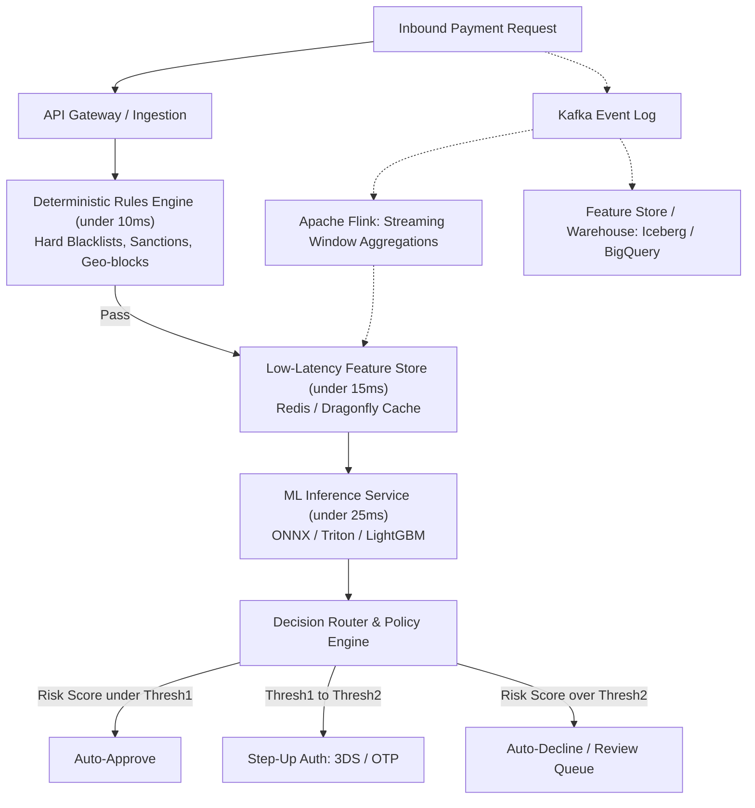
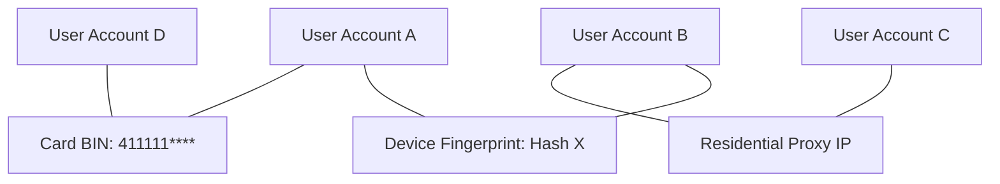

# 02. Fraud Detection & Risk Management

In-depth technical guide to fraud detection architectures, machine learning methodologies, streaming feature pipelines, and risk operations in payment processing and financial services.

---

## 1. Taxonomy of Payment & Financial Fraud

| Fraud Type | Mechanism | Detection Signals | Primary Mitigation |
| :--- | :--- | :--- | :--- |
| **Card-Not-Present (CNP)** | Stolen card details used for online e-commerce transactions. | Velocity spikes, new shipping address, IP $\neq$ billing geo, device spoofing. | 3D Secure 2.0 (SCA), CVV checks, AVS (Address Verification), ML risk score. |
| **Account Takeover (ATO)** | Credential stuffing, phishing, or SIM swapping to hijack existing user accounts. | Password change followed immediately by fund transfer, sudden new device ID. | Behavioral biometrics, Step-up Multi-Factor Auth (FIDO2/SMS OTP), IP reputation. |
| **Synthetic Identity** | Fraudster combines real SSN (often children or deceased) with fake name and DOB to build credit score. | Credit file depth inconsistent with age, thin bureau history followed by rapid credit line increases. | Alternative identity data, bureau credit inquiry anomaly models, KYC document verification. |
| **Bust-Out Fraud** | Fraudster builds seemingly normal credit profile over months, maxes out all credit lines, then disappears. | Sudden spike in credit utilization, cross-lender inquiries, sudden payment reversal checks. | Early warning behavioral models, cross-institution telemetry, velocity limits. |
| **Friendly / First-Party Fraud** | Legitimate cardholder buys item, receives it, then files a false chargeback claiming unauthorized charge. | Repeat dispute history, digital proof of delivery, recurring merchant relationship. | Compelling evidence submission (Visa CE 3.0), order delivery tracking integration. |
| **Fraud Rings & Syndicates** | Coordinated groups sharing devices, bank drops, IP subnets, or proxy networks. | Graph connectivity across disparate accounts, shared device fingerprints, clustering. | Graph databases (Neo4j, TigerGraph), Connected Components, Graph Neural Networks (GNN). |

---

## 2. Real-Time Fraud Engine Architecture

In payment authorization, the entire round-trip decision must execute within **50–100 milliseconds**.

### Latency Budget Allocation (Total Target: ~80ms)
- Network Transport & TLS termination: 20ms
- Hard rules & Sanction screening: 10ms
- Feature Store lookup (P99): 15ms
- ML Model inference (ensemble score): 25ms
- Action decisioning & logging: 10ms

---

## 3. Streaming Feature Engineering for Fraud

Real-time fraud models rely heavily on **velocity** and **behavioral delta** features computed on sliding windows:

### 1. Velocity Counters
- `cnt_txns_last_5m`, `cnt_txns_last_1h`, `cnt_txns_last_24h`
- `sum_amount_last_1h`, `sum_amount_last_24h`
- `cnt_distinct_cards_per_device_last_24h`
- `cnt_distinct_ips_per_account_last_7d`

### 2. Behavioral Distance & Ratio Features
- Ratio of current transaction amount to customer's historical 30-day average:
  $$\text{Amount Ratio} = \frac{\text{Amount}_{current}}{\mu_{\text{30d}} + \epsilon}$$
- Deviation from usual time of day / day of week.
- Merchant Category Code (MCC) entropy / novelty score.

### 3. Geolocation & Impossible Travel
- Geodesic distance between current transaction IP and last known login/transaction location.
- **Speed of Travel**:
  $$\text{Velocity}_{\text{geo}} = \frac{\text{Distance}(Lat_1, Lon_1, Lat_2, Lon_2)}{\Delta t}$$
  If velocity > 900 km/h, flag as impossible physical travel.

---

## 4. Modeling Methodologies & Challenges

### 1. Extreme Class Imbalance (0.01% - 0.5% fraud rate)
- **Do NOT rely on accuracy**: A model predicting all 0s has 99.9% accuracy but 0 utility.
- **Resampling Trade-offs**:
  - Downsampling negatives: Speeds up training, but alters baseline predicted probabilities → requires Platt scaling / probability recalibration:
    $$p = \frac{p_s}{p_s + \frac{1 - p_s}{\beta}}$$
    where $\beta$ is downsampling ratio, $p_s$ is sampled probability.
  - SMOTE / ADASYN: Often introduces noise in high-dimensional tabular data.
- **Cost-Sensitive Learning**: Penalize False Negatives (fraud slip-through = monetary loss + chargeback fee) significantly more than False Positives (customer insult / friction):
  $$L = - \sum \left( C_{FN} \cdot y \log(p) + C_{FP} \cdot (1-y) \log(1-p) \right)$$

### 2. The Delayed Label Problem (Mature vs. Immature Labels)
- Fraud takes **30 to 90 days** to be reported via cardholder disputes and chargeback cycles.
- **Danger**: Recent transactions labeled `0` might actually be fraud that hasn't been reported yet.
- **Solution**: Use an observation buffer / performance window (e.g., train models on data older than 60-90 days, or apply survival analysis and semi-supervised label estimation).

### 3. Evaluation Metrics That Matter
- **PR-AUC (Precision-Recall AUC)**: Far superior to ROC-AUC under extreme imbalance.
- **Recall at Fixed False Positive Rate**: e.g., "What is our Recall when FPR ≤ 0.1%?"
- **Expected Value Optimization**:
  $$\mathbb{E}[\text{Profit}] = \sum (\text{Revenue}_{\text{legit}} \cdot \text{TN}) - \sum (\text{Fraud Loss} \cdot \text{FN}) - \sum (\text{Review Cost} + \text{Friction Cost}) \cdot \text{FP}$$

---

## 5. Graph Analytics for Fraud Ring Detection

Fraud syndicates attempt to disguise identities by varying names, emails, and cards, but inevitably share hardware IDs, phone numbers, or delivery locations.

### Key Graph Algorithms:
1. **Connected Components / Bipartite Projection**: Cluster entities that share $k \ge 2$ identifiers.
2. **PageRank / Random Walk with Restart**: Measure proximity of an unknown node to known bad seed nodes.
3. **Graph Neural Networks (GNNs)**: E.g., Relational Graph Convolutional Networks (R-GCN) or GraphSAGE to aggregate neighborhood embeddings for node classification.

---

## 6. Interview Quick Fire: Common Risk Questions

1. **How do you trade off False Positives vs. False Negatives?**
   - *Answer*: Compute dollar impact. FN cost = transaction amount + chargeback fee ($15-$25) + operational handling + risk of network fines (if dispute rate exceeds 0.9% / 100 bps). FP cost = lost interchange margin + customer lifetime value (LTV) drop due to customer insult. Set decision thresholds using cost curves.
2. **How do you address concept drift and adversarial fraud patterns?**
   - *Answer*: Continuous shadow deployment of challenger models, daily population stability index (PSI) tracking on features, online rule adjustments for zero-day attack vectors, and automated retraining pipelines with mature label windows.
