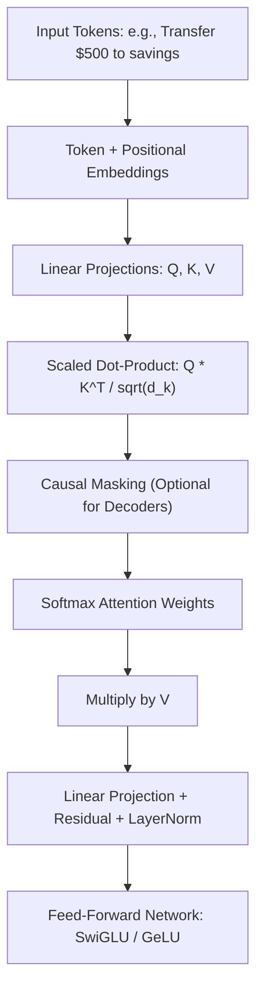
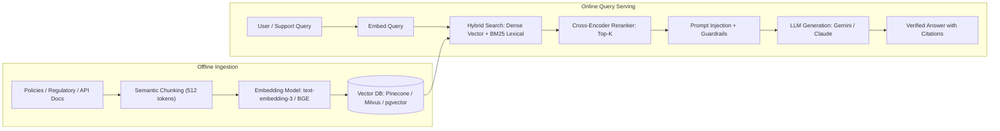

# 04. AI Fundamentals & GenAI Architectures

Technical foundation covering modern Deep Learning, Large Language Models (LLMs), Retrieval-Augmented Generation (RAG), AI Agent systems, and financial AI governance/explainability.

---

## 1. Transformer Architecture & Self-Attention

The core mechanism powering modern foundation models:

$$\operatorname{Attention}(Q, K, V) = \operatorname{softmax}\left(\frac{Q K^T}{\sqrt{d_k}}\right) V$$



### Key Variations:
- **Encoder-Only (BERT, RoBERTa)**: Bidirectional context. Ideal for classification, fraud sentence embeddings, named entity recognition (NER).
- **Decoder-Only (Llama 3, Gemini, Claude, GPT-4)**: Autoregressive causal masking. Dominates generative tasks, code generation, reasoning.
- **Mixture of Experts (MoE)**: Sparse routing activates only top-$k$ expert sub-networks per token, dramatically lowering FLOPs while retaining parameter capacity.

---

## 2. Enterprise Retrieval-Augmented Generation (RAG) for Financial Systems

In financial services and payment networks, hallucination cannot be tolerated. RAG grounds LLMs in deterministic knowledge stores.



### Essential RAG Techniques for Production:
1. **Hybrid Retrieval**: Combine dense semantic embeddings (cosine similarity over HNSW index) with sparse keyword search (BM25) via Reciprocal Rank Fusion (RRF) to capture exact transaction codes and account IDs.
2. **Cross-Encoder Reranking**: Vector retrieval fetches top 50 candidates; a lightweight cross-encoder (e.g., BGE-reranker) computes joint token attention to narrow to top 5 highly relevant chunks.
3. **Evaluation Framework (The RAG Triad)**:
   - **Context Relevance**: Does the retrieved context actually address the query?
   - **Groundedness / Faithfulness**: Is the generated response strictly supported by the context without hallucination?
   - **Answer Relevance**: Does the generated answer directly fulfill the user's prompt?

---

## 3. Autonomous AI Agents & Tool Calling

AI Agents extend LLMs from passive responders into active problem-solvers that execute workflows in payment systems (e.g., querying ledgers, issuing refunds, resolving chargebacks).

### The ReAct Pattern (Reasoning + Acting)
$$\text{Thought} \rightarrow \text{Action (Tool Call)} \rightarrow \text{Observation (Tool Output)} \rightarrow \text{Final Answer}$$

```json
// Example Tool Schema for Payment Refund Agent
{
  "name": "issue_refund",
  "description": "Initiates a refund for an authorized transaction after validating policy rules.",
  "parameters": {
    "type": "object",
    "properties": {
      "transaction_id": { "type": "string" },
      "amount_cents": { "type": "integer" },
      "reason": { "type": "string", "enum": ["FRAUD", "CUSTOMER_REQUEST", "DUPLICATE"] }
    },
    "required": ["transaction_id", "amount_cents", "reason"]
  }
}
```

### Agent Reliability & Safety Controls:
- **Deterministic Sandboxes**: LLMs propose tool calls via structured JSON schema, but execution happens in a validated backend service.
- **Human-in-the-Loop (HITL)**: Actions with financial risk exceeding a threshold (e.g., refund > $200) require human approval.
- **State Checkpointing**: Using state graphs (like LangGraph) for deterministic retries and rollback.

---

## 4. Model Explainability & Financial Compliance

Under consumer protection laws (e.g., the US **Equal Credit Opportunity Act (ECOA)** and **Fair Credit Reporting Act (FCRA)**), automated systems denying credit or blocking transactions must generate **Adverse Action Notices** stating the key reasons.

### 1. SHAP (SHapley Additive exPlanations)
Based on cooperative game theory, calculating the marginal contribution of feature $i$ across all possible subsets $S$:

$$\phi_i = \sum_{S \subseteq F \setminus \{i\}} \frac{|S|! (|F| - |S| - 1)!}{|F|!} [f(S \cup \{i\}) - f(S)]$$

- **TreeSHAP**: Exact, polynomial-time algorithm for tree models (XGBoost/LightGBM).
- **Top Reason Codes**: The top negative SHAP features directly translate to the Adverse Action Notice factors (e.g., "high credit card utilization", "delinquency in last 6 months").

### 2. Disparate Impact & Fairness Metrics
- **Disparate Impact Ratio (DIR)**:
  $$\text{DIR} = \frac{P(\hat{Y} = 1 \mid \text{Protected Group})}{P(\hat{Y} = 1 \mid \text{Reference Group})}$$
  Must typically satisfy the 80% (4/5ths) rule to ensure non-discrimination.
- **Equal Opportunity**: True Positive Rates should be equal across demographic protected classes.
