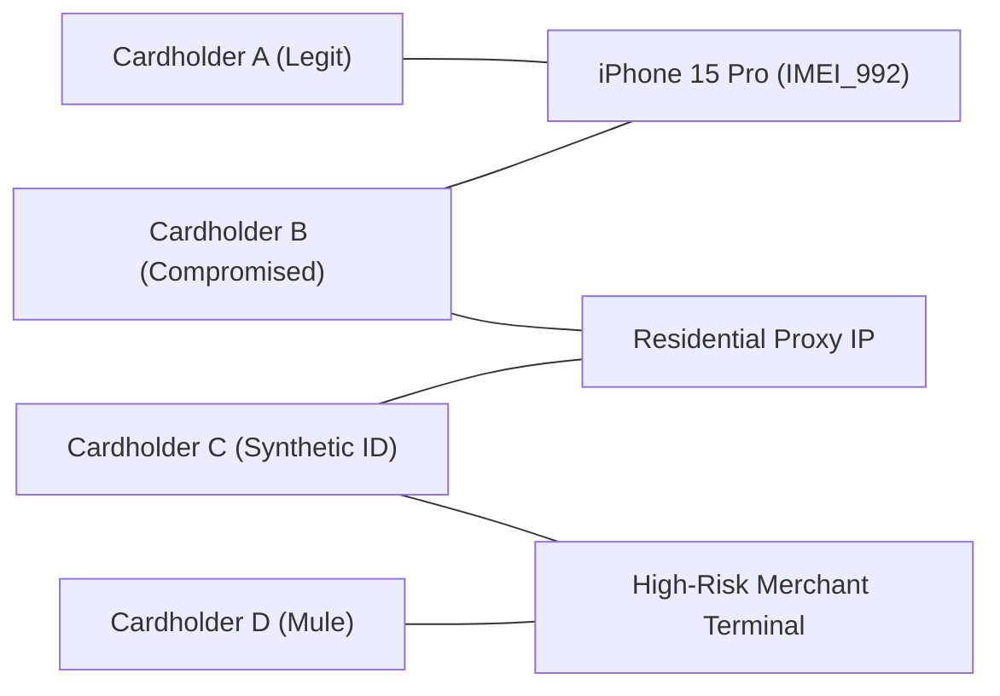

# Commonly Used Machine Learning Models in Financial Services

A rigorous, production-focused deep dive into the mathematical formulations, architectural trade-offs, regulatory constraints, and business applications of the core machine learning and statistical models used across Banking, Fintech, Payments, and Risk Management.

---

## 1. Traditional Credit Scorecards: Logistic Regression + WOE

Despite the proliferation of deep learning and gradient boosted trees, **Weight of Evidence (WOE) transformed Logistic Regression remains the gold standard in regulated consumer credit underwriting** (credit cards, auto loans, mortgages) at tier-1 banks like Capital One, JPMorgan Chase, and American Express.

```
Raw Bureau & Financial Attributes (FICO, Inquiries, Revolving Utilization)
       │
       ▼
1. Fine Classing (Quantile Binning: 20–50 bins)
       │
       ▼
2. Coarse Classing (Merging bins: Monotonic default rate, min 5% sample per bin)
       │
       ▼
3. Weight of Evidence (WOE) Transformation (Linearizes log-odds relationship)
       │
       ▼
4. Information Value (IV) & Multicollinearity Screening (VIF < 3.0)
       │
       ▼
5. L1/L2 Regularized Logistic Regression (All positive coefficients)
       │
       ▼
6. Scorecard Points Scaling (Base Points + PDO × ln(Odds))
       │
       ▼
Auditable FICO-Style Consumer Score (300 to 850) + Adverse Action Reason Codes
```

### Mathematical Foundations

#### 1. Weight of Evidence (WOE)
For each bin $i$ of a feature $X$:

> **WOE_i = ln( (% Good_i) / (% Bad_i) ) = ln( (G_i / G_total) / (B_i / B_total) )**

- **Good**: Non-defaulting borrowers (favorable outcome).
- **Bad**: Defaulting borrowers (e.g., 90+ days past due or charge-off).
- **Interpretation**:
  - `WOE_i > 0`: Bin contains a higher proportion of good borrowers than bad borrowers (lower credit risk).
  - `WOE_i < 0`: Bin contains a higher proportion of bad borrowers than good borrowers (higher credit risk).
  - `WOE_i = 0`: Bin has identical risk to the overall population.

#### 2. Information Value (IV)
Measures the overall predictive separation power of the variable across all bins:

> **IV = Σ [ (G_i / G_total) - (B_i / B_total) ] × WOE_i**

| Information Value (IV) | Predictive Power Classification | Action in Underwriting Model |
| :--- | :--- | :--- |
| **< 0.02** | Unpredictive | Drop feature immediately |
| **0.02 – 0.10** | Weak Predictor | Retain only if business-critical |
| **0.10 – 0.30** | Medium Predictor | Strong candidate for core model |
| **0.30 – 0.50** | Strong Predictor | Primary driver in credit decisioning |
| **≥ 0.50** | Suspicious / Over-predictive | **Investigate target leakage or look-ahead bias!** |

#### 3. Log-Odds to FICO-Style Points Transformation
To convert logistic regression output into a consumer-facing credit score:

1. Let log-odds be: **ln(Odds) = ln( P(Good) / P(Bad) ) = β_0 + Σ (β_j × WOE_j)**
2. Desired score formula: **Score = Offset + Factor × ln(Odds)**
3. Parameters determined by two business constraints:
   - **Target Score** (e.g., 600) at **Target Odds** (e.g., 50:1 good-to-bad).
   - **Points to Double the Odds (PDO)** (e.g., 20 points for odds to double from 50:1 to 100:1).

> **Factor = PDO / ln(2)**  
> **Offset = Target Score - [Factor × ln(Target Odds)]**

Every single feature bin translates into exact additive points on the credit report, allowing instant calculation of:
- **Base Score Points** = Offset + Factor × β_0
- **Attribute Bin Points** = Factor × β_j × WOE_ij

### Why Banks Use Scorecards Over XGBoost
1. **Adverse Action Notice (FCRA & Reg B Compliance)**: Under the Fair Credit Reporting Act, if an applicant is denied, the lender is legally required to provide the **top 4 principal reasons** (e.g., "Proportion of balances to credit limits is too high"). Scorecards provide mathematically exact, monotonic reason codes derived directly from the lowest point-deduction attributes.
2. **Guaranteed Monotonicity**: Binning enforces that higher revolving credit card utilization *must always* decrease credit score. Tree models without explicit constraints can experience non-monotonic localized flips due to small-sample splits.
3. **Regulatory Audit Defense (SR 11-7)**: Full algebraic transparency allows bank examiners (OCC, Fed, CFPB) to inspect every coefficient and bin cutoff.

---

## 2. Explainable Boosting Machines (EBM / GA2M)

Explainable Boosting Machines (EBM) represent the modern evolution of Generalized Additive Models (GAMs), developed by Microsoft Research. EBM bridges the performance gap between classical scorecards and gradient boosted trees while preserving full interpretability.

```
Prediction = Intercept + f_1(Credit_Score) + f_2(Debt_to_Income) + ... + f_12(Credit_Score, DTI)
```

### Mathematical Formulation
EBM fits a **GA2M (Generalized Additive Model with pairwise interactions)**:

> **g(E[Y]) = β_0 + Σ f_i(x_i) + Σ f_ij(x_i, x_j)**

Where:
- `g(·)` is the link function (logit for binary classification).
- `f_i(x_i)` is a non-linear shape function learned for single feature $x_i$ via round-robin shallow tree boosting.
- `f_ij(x_i, x_j)` captures pairwise interaction effects between selected features.

### Why EBM is Gaining Adoption in Fintech:
1. **Performance Parity with XGBoost**: Captures complex non-linear curves without manual feature binning or spline engineering.
2. **Exact Feature Contribution Lookup**: Each single-variable function `f_i(x_i)` can be extracted as a 1D lookup table or curve. Feature contributions are purely additive, making adverse action reason code generation as simple as a scorecard.
3. **No Target Leakage across Features**: Because trees are trained round-robin on one feature at a time with a very low learning rate, features cannot mask or confound each other during base training.

---

## 3. High-Throughput Gradient Boosted Decision Trees (GBDT)

In non-regulated or operationally flexible risk domains—especially **Real-Time Fraud Detection, Merchant Risk Scoring, Anti-Money Laundering (AML), and Cardholder Churn**—GBDTs (XGBoost, LightGBM, CatBoost) are the undisputed state-of-the-art.

### Algorithm Comparison: XGBoost vs. LightGBM vs. CatBoost

| Feature Dimension | XGBoost | LightGBM | CatBoost |
| :--- | :--- | :--- | :--- |
| **Tree Growth Strategy** | Level-wise (Depth-wise) | **Leaf-wise (Best-first)** | Symmetric / Oblivious trees |
| **Splitting Mechanism** | Pre-sorted / Exact or Histogram | **Histogram-based (GOSS)** | Histogram-based (Ordered Target Statistics) |
| **Categorical Handling** | One-Hot / Target encoding | Numerical binning | **Online target encoding with permutations** |
| **Training Speed** | Moderate | **Fastest** | Moderate (Slow on large CPU, fast on GPU) |
| **Inference Latency** | Very Fast (< 2ms) | **Extremely Fast (< 1ms)** | Extremely Fast (< 1ms compiled) |
| **Best FinTech Use Case** | Benchmark fraud models | Real-time transaction fraud (<10ms SLA) | Rich categorical data (MCC, ZIP, device ID) |

### Custom Asymmetric Loss Formulation for Fraud
Standard binary cross-entropy treats False Positives (declining a legitimate cardholder) and False Negatives (allowing a fraudulent transaction) equally. In payments, a missed $5,000 fraud attack is orders of magnitude costlier than sending an SMS verification OTP to a legitimate customer.

To incorporate asymmetric business costs into GBDT training:

> **Loss_cost = Σ [ - c_FN × y_i × ln(p_i) - c_FP × (1 - y_i) × ln(1 - p_i) ]**

Where:
- `c_FN`: Dollar cost of chargeback + scheme fine + fraud write-off (e.g., $100+).
- `c_FP`: Operational review cost + customer friction penalty (e.g., $2–$5).
- First and second order gradients ($g_i$ and $h_i$) are analytically derived and passed to XGBoost/LightGBM's custom objective function.

### Real-Time Low-Latency Deployment Architecture
To meet payment scheme network timeouts (< 50ms total budget, with ML scoring allocated < 5ms):
- **Treelite / ONNX Compilation**: Converts trained decision trees into branchless C code or byte-code arrays, eliminating tree traversal overhead and achieving sub-millisecond inference on commodity CPUs.
- **Monotonic Constraints**: When training GBDTs for underwriting or limit-setting, monotonic constraints (`monotone_constraints = (1, -1, ...)`) ensure that higher income strictly increases approval probability, preventing local over-fitting anomalies.

---

## 4. Graph Neural Networks (GNN) & Graph Analytics

Single-transaction tabular models evaluate transactions in isolation. However, sophisticated financial crime syndicates operate across interconnected networks:
- **Synthetic Identity Rings**: Multiple synthetic personas sharing the same physical address, phone number, or authorized-user tradelines.
- **Card Bust-Out Fraud**: Compromised accounts transacting at the same fraudulent merchant POS terminals within seconds.
- **AML Layering & Mule Accounts**: Fast dispersion of funds across layered chains of intermediate accounts to disguise illicit origins.



### Graph Architectures in Fraud & AML

#### 1. Relational Graph Convolutional Networks (RGCN)
Financial graphs are **heterogeneous** with multiple node types (Cards, Users, Devices, Bank Accounts, Merchants) and multiple edge types (transacted_with, shared_device, transferred_to).

> **h_i^(l+1) = σ( W_0 · h_i^(l) + Σ_{r ∈ R} Σ_{j ∈ N_i^r} (1 / c_{i,r}) · W_r · h_j^(l) )**

Where:
- `h_i^(l)` is the representation vector of entity $i$ at layer $l$.
- `R` is the set of relations (e.g., `has_card`, `shared_phone`, `sent_p2p`).
- `W_r` is a relation-specific transformation matrix learning the distinct risk signal of that connection type.

#### 2. GraphSAGE (Sample and Aggregate)
Standard GCNs require full-graph Laplacian computation, which is computationally intractable on massive banking transaction graphs with billions of edges. GraphSAGE samples a fixed-size local neighborhood, allowing **mini-batch training and inductive inference on unseen new accounts**.

#### 3. Graph Community Detection (Louvain & Cycle Detection)
- **Louvain Modularity Optimization**: Unsupervised partitioning of the graph to detect dense subgraphs (fraud clusters) operating in isolation from the broader economic network.
- **Directed Cycle Detection**: Uncovers circular layering schemes where funds hop through 5+ accounts and return to the original sender to inflate credit scores or wash funds.

---

## 5. Survival Analysis & Delinquency Roll Rates

In credit risk, asking *"Will this borrower default?"* (binary classification) is often the wrong question. What matters to bank capital planning (CECL, IFRS 9) is:
1. **When will the borrower default?** (Time-to-event)
2. **What is the cumulative loss over a multi-year economic lifetime?**
3. **Will the borrower prepay early, stripping out expected interest margin?**

### Survival Analysis Formulations

#### 1. Kaplan-Meier Estimator (Non-parametric baseline)
Estimates the probability that a loan survives beyond time $t$ in the presence of right-censoring (active loans that have not yet reached maturity or default):

> **S(t) = Π_{t_i ≤ t} [ 1 - (d_i / n_i) ]**

Where:
- `d_i`: Number of default events observed at time $t_i$.
- `n_i`: Number of active loans at risk just prior to time $t_i$.

#### 2. Cox Proportional Hazards Model (Semi-parametric)
Models borrower-specific risk factors (FICO, DTI, macroeconomic unemployment rate) as multiplicative shifts to a baseline hazard:

> **λ(t | X) = λ_0(t) × exp( β_1 X_1 + β_2 X_2 + ... + β_k X_k )**

- **Hazard Ratio**: `exp(β_j)`. If $X_1$ is DTI (Debt-to-Income), `exp(β_1) = 1.05` implies a 1-unit increase in DTI increases instantaneous default hazard by 5% at any point in the loan lifecycle.
- Handles **right-censored data** without throwing out active, performing loans.

### Markov Chain Delinquency Roll-Rate Models

In portfolio risk management, delinquent accounts transition between severity states (buckets) each billing cycle.

```
[ Current ] ──► [ 30 DPD ] ──► [ 60 DPD ] ──► [ 90 DPD ] ──► [ Charge-Off (Default) ]
    ▲               │              │              │
    └───────────────┴──────────────┴──────────────┘
               (Cure / Roll-Back to Current)
```

#### Transition Probability Matrix ($P$)
Each entry $p_{ij}$ represents the empirical or modeled probability that an account in state $i$ moves to state $j$ next month:

| From / To | Current | 30 DPD | 60 DPD | 90 DPD | Charge-Off | Paid Off |
| :--- | :--- | :--- | :--- | :--- | :--- | :--- |
| **Current** | 92.5% | 5.0% | 0.0% | 0.0% | 0.0% | 2.5% |
| **30 DPD** | 45.0% (Cure) | 25.0% | 30.0% (Roll) | 0.0% | 0.0% | 0.0% |
| **60 DPD** | 15.0% (Cure) | 10.0% | 20.0% | 55.0% (Roll) | 0.0% | 0.0% |
| **90 DPD** | 5.0% (Cure) | 5.0% | 10.0% | 15.0% | **65.0% (Charge-Off)** | 0.0% |
| **Charge-Off** | 0.0% | 0.0% | 0.0% | 0.0% | **100.0% (Absorbing)** | 0.0% |

- **Multi-Period Forecasting**: The expected portfolio distribution $k$ months ahead is computed via matrix exponentiation: **Distribution_k = Distribution_0 × P^k**.
- **Absorbing States**: Charge-Off and Paid Off are absorbing states ($p_{ii} = 1.0$), allowing closed-form calculation of lifetime loss reserves under CECL.

---

## 6. Unsupervised Anomaly Detection

Supervised models cannot detect novel fraud vectors ("zero-day fraud", account takeovers with new bypass techniques, or internal employee embezzlement) because labelled training samples do not yet exist.

### 1. Isolation Forest
- **Mechanism**: Randomly selects a feature and a random split value between the min and max of that feature.
- **Core Principle**: Anomalous transactions are isolated with far fewer recursive splits than normal transaction clusters.
- **Anomaly Score**:
  > **Score(x, n) = 2^( - E[h(x)] / c(n) )**
  Where `h(x)` is path length in the tree, and `c(n)` is average path length of unsuccessful binary tree searches:
  > **c(n) = 2 [ ln(n - 1) + 0.5772156649 ] - [ 2(n - 1) / n ]**
- **Threshold**: Scores approaching 1.0 indicate severe anomalies; scores < 0.5 are standard legitimate activity.

### 2. Autoencoders (Deep Reconstruction Anomaly)
- **Architecture**: A bottleneck neural network trained strictly on legitimate non-fraud historical transactions.
- **Reconstruction Error**:
  > **Reconstruction Loss = || x - x_hat ||^2**
- Legitimate transactions reconstruct with minimal loss. When a zero-day fraud transaction with an abnormal attribute combination passes through, the autoencoder fails to reconstruct it accurately, triggering an anomaly flag.

---

## 7. Model Governance, Validation & Regulatory Frameworks

In financial institutions, deploying a model requires passing formal **Model Risk Management (MRM)** audits under federal regulations.

```
       ┌───────────────────────────────────────────────────────────┐
       │             Federal Reserve SR 11-7 / OCC 2011-12         │
       └─────────────────────────────┬─────────────────────────────┘
                                     │
         ┌───────────────────────────┼───────────────────────────┐
         ▼                           ▼                           ▼
1. Conceptual Soundness     2. Ongoing Monitoring       3. Outcomes Analysis
  - Economic theory           - PSI (Population Drift)    - Backtesting
  - Model design validation   - CSI (Feature Drift)       - Benchmark comparison
  - Feature selection audit   - Performance degradation   - Stress testing
```

### 1. Population Stability Index (PSI)
The regulatory standard metric used to detect population shift and data drift in credit and risk models:

> **PSI = Σ [ (% Actual_i - % Expected_i) × ln( % Actual_i / % Expected_i ) ]**

Where:
- **Expected**: Baseline development/validation population distribution across score bins.
- **Actual**: Current production population distribution in a given month.

| PSI Value | Interpretation | Regulatory Action Required |
| :--- | :--- | :--- |
| **< 0.10** | Minimal Shift / Stable | No action; model operating as designed |
| **0.10 – 0.25** | Moderate Drift | Increase monitoring frequency; investigate feature-level CSI |
| **≥ 0.25** | Severe Population Shift | **Trigger model review, recalibration, or emergency fallback rule** |

### 2. CECL & Basel III Credit Loss Accounting
Under Current Expected Credit Losses (CECL) and Basel III/IV frameworks:

> **Expected Credit Loss (ECL) = Probability of Default (PD) × Loss Given Default (LGD) × Exposure at Default (EAD)**

- **PD**: Probability that the borrower defaults within the horizon (modeled via Scorecards / Survival analysis).
- **LGD**: Percentage of balance lost after post-default recovery collections: `LGD = 1 - Recovery Rate`.
- **EAD**: Estimated total dollar balance outstanding when default occurs (includes drawn balance plus credit line draw-down conversion).

### 3. Fair Lending Compliance: Four-Fifths (80%) Rule & ECOA
Under the Equal Credit Opportunity Act (ECOA) and Consumer Financial Protection Bureau (CFPB) oversight, models cannot discriminate against protected classes (race, gender, age, marital status).

> **Adverse Impact Ratio (AIR) = Selection Rate of Protected Class / Selection Rate of Reference Class**

- **The Four-Fifths Rule**: If the selection rate (approval rate) for a protected demographic is **less than 80% (4/5)** of the rate for the group with the highest selection rate, the model is flagged for **Disparate Impact**.
- **Proxy Variable Detection**: Regulators prohibit proxy variables (e.g., ZIP code, college attended) that correlate strongly with protected attributes even if the protected attribute itself is excluded from model training.
