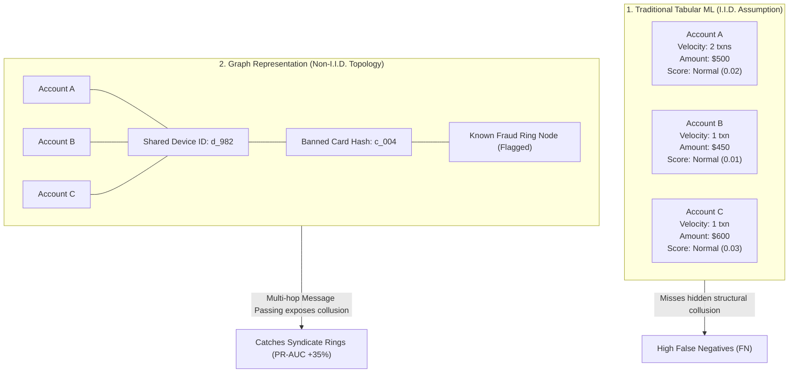
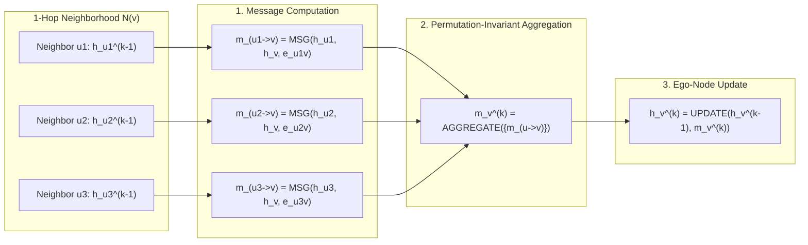
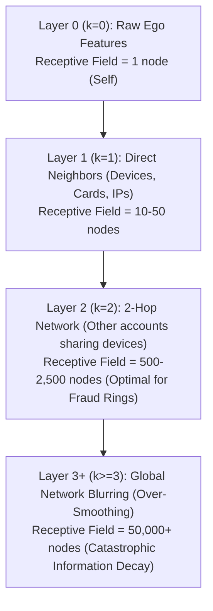
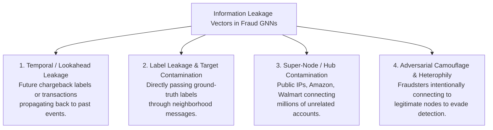
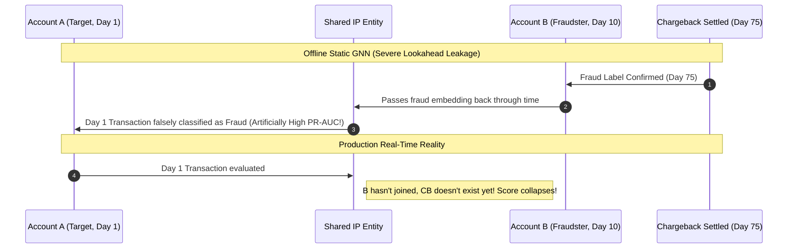
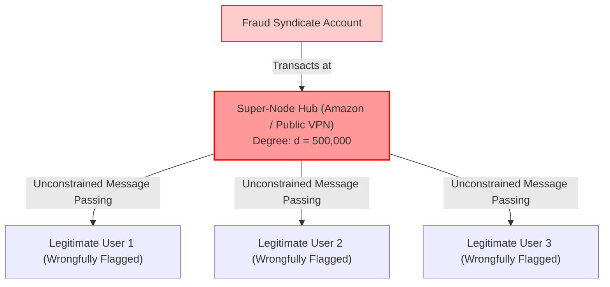
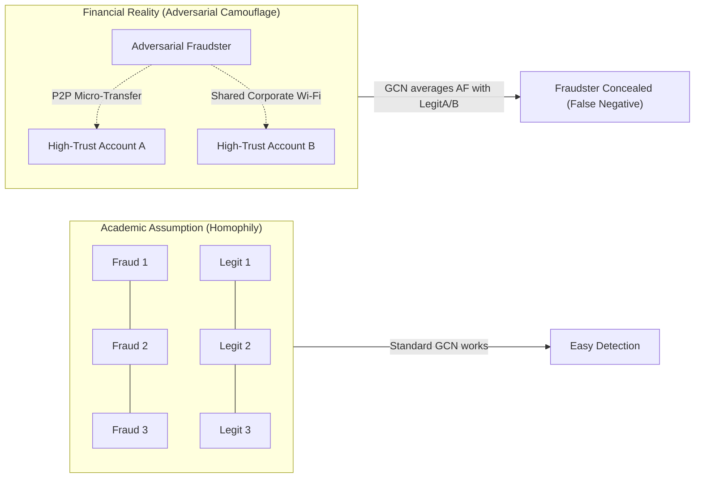
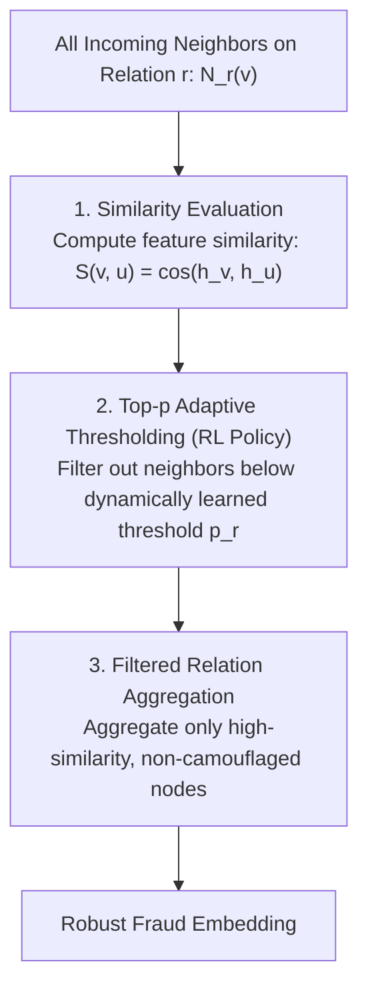
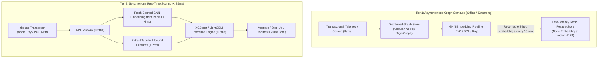

# 04. Graph Neural Networks (GNNs) for Financial Fraud & Anti-Money Laundering

> **Domain**: Graph Machine Learning, Financial Fraud Detection, Anti-Money Laundering (AML), Network Science, Synthetic Identity Detection  
> **Key Architectures**: Message Passing Neural Networks (MPNN), GraphSAGE, Graph Attention Networks (GAT), Relational GCN (RGCN), Heterogeneous Graph Transformers (HGT), Care-GNN  
> **Core Concepts**: Information Propagation Mechanics, Over-Smoothing, Temporal Leakage & Lookahead Bias, Super-Node / Hub Contamination, Label Leakage, Adversarial Camouflage & Heterophily  

---

## 1. Executive Overview & The Graph Advantage in Fraud

In traditional tabular machine learning (XGBoost, LightGBM), each transaction or account is modeled as an **independent and identically distributed (I.I.D.)** sample in vector space $\mathbb{R}^d$:

$$\mathbf{x}_i \in \mathbb{R}^d \implies \hat{y}_i = f(\mathbf{x}_i)$$

However, organized financial crime is fundamentally **relational, multi-hop, and non-I.I.D.**:
* **Carding Syndicates**: Hundreds of burner accounts sharing the same physical iPhone device hash or subnet.
* **First-Party Synthetic Identity Rings**: Fraudsters combining real SSNs, fabricated names, and shared mailing addresses or phone numbers.
* **Money Laundering Mules (AML)**: Complex layering networks structuring funds across cycles, fan-outs, and multi-hop hops before cashing out.



While tree-based models can only access hand-engineered graph aggregations (e.g., `count_distinct_accounts_per_device_24h`), **Graph Neural Networks (GNNs)** jointly optimize node attributes, multi-relational edge semantics, and non-linear neighborhood topology in an end-to-end differentiable framework.

---

## 2. Mathematical Foundations of Information Propagation: The MPNN Paradigm

Virtually all modern GNNs operate under the **Message Passing Neural Network (MPNN)** abstraction (Gilmer et al., 2017). 

Let a financial graph be denoted as $\mathcal{G} = (\mathcal{V}, \mathcal{E}, \mathcal{R})$, where $\mathcal{V}$ is the set of nodes (accounts, devices, cards), $\mathcal{E}$ is the set of edges (transacted, logged into, linked to), and $\mathcal{R}$ is the set of relation types.

Each layer $k \in \{1, \dots, K\}$ of a GNN updates the hidden representation $\mathbf{h}_v^{(k)}$ of target node $v$ through three sequential mathematical operators: **MESSAGE**, **AGGREGATE**, and **UPDATE**.



---

### Step 1: The Message Function ($\text{MSG}$)
For every incoming edge $(u, v) \in \mathcal{E}$, compute a directed message vector $\mathbf{m}_{u \to v}^{(k)}$ from neighbor $u$ to target $v$:

$$\mathbf{m}_{u \to v}^{(k)} = \text{MESSAGE}^{(k)}\left(\mathbf{h}_u^{(k-1)}, \mathbf{h}_v^{(k-1)}, \mathbf{e}_{uv}\right)$$

Where:
* $\mathbf{h}_u^{(k-1)} \in \mathbb{R}^{d_{k-1}}$: State of source neighbor node $u$ at previous layer.
* $\mathbf{h}_v^{(k-1)} \in \mathbb{R}^{d_{k-1}}$: State of target ego node $v$ at previous layer.
* $\mathbf{e}_{uv} \in \mathbb{R}^{d_e}$: Edge attribute vector (e.g., transaction dollar amount, timestamp, payment rail).

---

### Step 2: The Aggregation Function ($\text{AGG}$)
Because graph neighborhoods are unordered and vary in degree ($\deg(v) \in [1, 10^5]$), the aggregator **must be permutation-invariant** to the ordering of neighbors:

$$\mathbf{m}_v^{(k)} = \text{AGGREGATE}^{(k)}\left( \left\{ \mathbf{m}_{u \to v}^{(k)} : u \in \mathcal{N}(v) \right\} \right)$$

Standard aggregation operators:
* **Sum Aggregator**: $\mathbf{m}_v^{(k)} = \sum_{u \in \mathcal{N}(v)} \mathbf{m}_{u \to v}^{(k)}$ (Preserves volume/degree signals; sensitive to super-nodes).
* **Mean Aggregator**: $\mathbf{m}_v^{(k)} = \frac{1}{|\mathcal{N}(v)|} \sum_{u \in \mathcal{N}(v)} \mathbf{m}_{u \to v}^{(k)}$ (Scale-invariant; captures average neighborhood behavior).
* **Max-Pooling**: $\mathbf{m}_v^{(k)} = \max_{u \in \mathcal{N}(v)} \left( \sigma(\mathbf{W}_{\text{pool}} \mathbf{m}_{u \to v}^{(k)} + \mathbf{b}) \right)$ (Isolates most extreme adversarial signals).

---

### Step 3: The Ego-Node Update Function ($\text{UPDATE}$)
Combine the incoming aggregated neighborhood context $\mathbf{m}_v^{(k)}$ with the ego-node's previous representation $\mathbf{h}_v^{(k-1)}$:

$$\mathbf{h}_v^{(k)} = \text{UPDATE}^{(k)}\left(\mathbf{h}_v^{(k-1)}, \mathbf{m}_v^{(k)}\right) = \sigma\left( \mathbf{W}_{\text{self}}^{(k)} \mathbf{h}_v^{(k-1)} + \mathbf{W}_{\text{neigh}}^{(k)} \mathbf{m}_v^{(k)} + \mathbf{b}^{(k)} \right)$$

---

## 3. Propagation Flavors Compared for Financial Fraud

| Architecture | Message Passing Formulation | Strengths in Fraud Detection | Limitations / Vulnerabilities in Finance |
| :--- | :--- | :--- | :--- |
| **GCN** (Kipf & Welling) | $\mathbf{H}^{(k)} = \sigma\left(\mathbf{\tilde{D}}^{-\frac{1}{2}} \mathbf{\tilde{A}} \mathbf{\tilde{D}}^{-\frac{1}{2}} \mathbf{H}^{(k-1)} \mathbf{W}^{(k)}\right)$ | Simple, fast matrix operations. | Transductive only (cannot handle new unseen nodes); uniform isotropic weighting drowns out minority fraud signals. |
| **GraphSAGE** (Hamilton et al.) | $\mathbf{h}_v^{(k)} = \sigma\left(\mathbf{W} \cdot \left[\mathbf{h}_v^{(k-1)} \,\|\, \text{AGG}\left(\{\mathbf{h}_u^{(k-1)} : u \in \mathcal{N}_S(v)\}\right)\right]\right)$ | **Inductive**: samples fixed-size subgraphs $\mathcal{N}_S(v)$; handles incoming streaming accounts seamlessly. | Uniform neighbor sampling can miss subtle 1-in-10,000 fraudster connections. |
| **GAT** (Veličković et al.) | $\mathbf{h}_v^{(k)} = \sigma\left(\sum_{u \in \mathcal{N}(v)} \alpha_{uv}^{(k)} \mathbf{W}^{(k)} \mathbf{h}_u^{(k-1)}\right)$ | **Anisotropic**: learns attention weights $\alpha_{uv}$; automatically downweights noisy neighbors. | Quadratic memory complexity with neighborhood size; vulnerable to camouflage. |
| **RGCN** (Schlichtkrull et al.) | $\mathbf{h}_v^{(k)} = \sigma\left(\mathbf{W}_0 \mathbf{h}_v^{(k-1)} + \sum_{r \in \mathcal{R}} \sum_{u \in \mathcal{N}_r(v)} \frac{1}{c_{v,r}} \mathbf{W}_r \mathbf{h}_u^{(k-1)}\right)$ | Explicitly distinguishes heterogeneous edges (`LOGGED_FROM_IP` vs `TRANSFERRED_TO`). | Parameter-heavy; prone to overfitting on sparse edge types. |
| **Care-GNN** (Dou et al.) | Label-aware adaptive filtering via Reinforcement Learning | **Engineered specifically for fraud**: dynamically prunes adversarial camouflage. | Higher training complexity; requires reinforcement learning policy optimization. |

---

## 4. Multi-Hop Receptive Fields & The Over-Smoothing Catastrophe

In a $K$-layer GNN, the representation of node $v$ incorporates information from all nodes within its **$K$-hop neighborhood**:

$$\text{Receptive Field}(v, K) = \{ u \in \mathcal{V} : \text{shortest\_path}(v, u) \le K \}$$



### The Over-Smoothing Theorem:
As the number of propagation layers $K \to \infty$, the graph convolution operator acts as a low-pass Laplacian filter. The node representations across any connected component converge to the stationary distribution of a random walk:

$$\lim_{K \to \infty} \mathbf{h}_v^{(K)} = \mathbf{h}_u^{(K)} = \mathbf{c} \quad \forall u, v \in \mathcal{V}_{\text{component}}$$

> **Why Over-Smoothing is Fatal in Fraud Detection**:  
> In financial risk, fraud prevalence is typically $0.05\%$ ($1$ fraudster per $2,000$ legitimate users). If a GNN averages across $K \ge 3$ layers, the rare anomalous signal of the fraudster is exponentially diluted by legitimate neighborhood averages, causing **complete loss of discriminative power**!

### Mitigating Over-Smoothing in Risk Production:
1. **Shallow Depth Standard ($K=2$)**: In financial fraud, $K=2$ is virtually always optimal (catching *"accounts sharing an entity with a known bad actor"* without expanding into global graphs).
2. **Residual & Skip Connections (Jumping Knowledge Networks)**: Concatenate intermediate embeddings across all layers before the final classification head:
   $$\mathbf{h}_v^{\text{final}} = \text{CONCAT}\left(\mathbf{h}_v^{(0)}, \mathbf{h}_v^{(1)}, \mathbf{h}_v^{(2)}\right) \mathbf{W}_{\text{classifier}}$$
3. **PairNorm / NodeNorm Regularization**: Enforce variance across node embeddings after every message-passing step to prevent collapse into a single point.

---

## 5. Information Leakage in Financial Graphs: Taxonomy & Root Causes

While standard academic graph benchmarks (Cora, Citeseer) assume static, closed-world graphs, **financial production graphs suffer from severe information leakage** that renders models deceptively accurate offline but useless in production.



---

## 6. Vector 1: Temporal Information Leakage (Lookahead Bias)

### The Problem
In financial systems, edges and labels arrive asynchronously over time:
* Transaction $T_1$ occurs on **Day 1**.
* Account $B$ connects to Account $A$'s IP on **Day 10**.
* Account $B$ commits fraud on **Day 15**.
* The chargeback label arrives on **Day 75**.

If an analyst constructs a static graph combining all events over a 90-day window, **information from Day 75 propagates backwards along Day 10 edges to inform the Day 1 classification of Account $A$**! In offline validation, the model achieves a stellar $0.98$ PR-AUC, but fails catastrophically in production when future edges do not yet exist.



### The Engineering Solution: Strict Causal Temporal Neighborhood Masking
To prevent lookahead leakage, enforce a strict **Time-Respecting Dynamic Graph**:

1. **Temporal Edge Filtering**: An edge $e = (u, v, t_e)$ can only participate in message passing to score an event at time $t_{\text{query}}$ if:
   $$t_e < t_{\text{query}}$$
2. **Delayed Label Quarantine (Observation Gap)**: Because chargebacks take 60–90 days to settle, transactions in the dynamic graph within $[t_{\text{query}} - 60\text{ days}, t_{\text{query}}]$ must be treated as **strictly unlabeled** ($y = \text{NULL}$).
3. **Temporal Graph Networks (TGN)**: Maintain a running node memory vector $\mathbf{s}_v(t)$ that updates strictly sequentially as events occur:
   $$\mathbf{s}_v(t) = \text{RNN}\left(\mathbf{s}_v(t^-), \mathbf{m}_v(t)\right)$$

---

## 7. Vector 2: Super-Node / Hub Contamination (High-Degree Entities)

### The Problem
In payment networks, certain entities possess massive out-degrees:
* **Public Utility Billers**: Millions of customers pay ConEdison or Pacific Gas & Electric.
* **Mass Merchants**: Amazon, Walmart, Apple.com, Uber.
* **Public IPs & VPN Subnets**: Airport Wi-Fi, Starbucks networks, iCloud Private Relay.

If an unconstrained GNN propagates messages through an `Amazon_Merchant_ID` or `Starbucks_WiFi_IP` node, **that hub aggregates embeddings from thousands of fraudsters and redistributes fraud risk to millions of completely innocent cardholders**!



### The Engineering Solutions:

#### 1. Topology Construction Rules (Entity Pruning by Specificity)
Never connect transactions or accounts via low-entropy attributes. Enforce strict graph schema filtering:

$$\text{Allowable Graph Edge} \iff \text{Entropy}(Entity) \ge \tau_{\text{entropy}}$$

* **Allowed Edges (High Specificity)**: `Device_Fingerprint_Hash`, `Physical_Address_Unit_ID`, `Bank_Account_Number`, `SSN_Hash`.
* **Disallowed Edges (Low Specificity / Hubs)**: Merchant ID, City, Postal Code, Public VPN Subnet, Browser User-Agent.

#### 2. Inverse-Degree / TF-IDF Message Discounting
If an edge to a common entity must exist, scale down its message weight proportionally to its degree:

$$\mathbf{m}_{u \to v}^{(k)} = \frac{1}{\log(1 + \deg(u))} \mathbf{W} \mathbf{h}_u^{(k-1)}$$

#### 3. Hub-Dropout During Neighbor Sampling
During mini-batch generation (e.g., via GraphSAGE NeighborSampler), set a hard degree ceiling $\deg_{\max} \approx 100$. Any node with degree exceeding $\deg_{\max}$ is excluded from neighbor sampling routines.

---

## 8. Vector 3: Label Leakage & Neighbor Target Contamination

### The Problem
In semi-supervised node classification, researchers frequently include neighbor label indicators (e.g., `"fraction of neighbors with confirmed fraud"`) as features in the node feature vector $\mathbf{x}_u$.

* **The Shortcut Trap**: During training, the GNN discovers a trivial local minimum:
  $$\hat{y}_v \approx \max_{u \in \mathcal{N}(v)} y_u$$
* **The Production Crash**: In production, when a new synthetic identity or ATO attack occurs, **$0\%$ of their neighbors have been labeled yet** due to the 60-day chargeback lag. The model, having learned to rely on neighbor labels rather than structural/behavioral patterns, fails completely.

### The Engineering Solution: Ego-Masking & Label Dropping
1. **Strict Feature / Target Separation**: Under no circumstances should ground-truth labels ($y \in \{0, 1\}$) or historical chargeback statuses be fed into node feature stores accessible by neighbor nodes.
2. **Masked Auto-Encoder Pre-Training (GraphMAE)**: Train the GNN backbone using self-supervised link prediction or feature reconstruction without access to class labels. Fine-tune strictly on the downstream classification head.
3. **Latent Risk Belief Propagation (Soft Labeling)**: If historical risk must be propagated, propagate the **prior model's predicted probability** $\hat{p}_u \in [0, 1]$ rather than hard labels, applying heavy temporal decay:
   $$\text{Propagated Risk}(u, t) = \hat{p}_u \times \exp\left(-\lambda (t_{\text{now}} - t_u)\right)$$

---

## 9. Vector 4: Adversarial Camouflage & Network Heterophily

### The Problem
Sophisticated fraudsters actively study fraud detection rules and deliberately execute **Adversarial Camouflage**:
* **Feature Camouflage**: Fraudsters mimic normal users by maintaining consistent profile data, browsing legitimate pages, and making small normal purchases.
* **Relation Camouflage (Heterophily)**: Fraudsters intentionally interact with highly trusted, legitimate accounts (e.g., sending $1 P2P payments to legitimate friends or transacting at high-reputation merchants) to blend into legitimate subgraphs.

Standard GNNs operate under the **Homophily Assumption** (*"nodes of the same class tend to connect to each other"*). In fraud graphs, **Heterophily dominates** ($\mathcal{H} < 0.3$), meaning fraudsters actively connect to non-fraudulent nodes.



### The Engineering Solution: Care-GNN (Adaptive Neighbor Filtering)
Developed by Dou et al. (CIKM 2020), **Care-GNN** explicitly tackles camouflage through a 3-stage adaptive mechanism:



1. **Label-Aware Similarity Measure**: Compute Cosine/MLP similarity between target node $v$ and neighbor $u$:
   $$S^{(k)}(v, u) = \sigma\left(\mathbf{w}_{\text{sim}}^T |\mathbf{h}_v^{(k-1)} - \mathbf{h}_u^{(k-1)}|\right)$$
2. **Adaptive Neighbor Filtering (Top-$p$ Sampling)**: Rather than averaging all neighbors in $\mathcal{N}_r(v)$, sort neighbors by $S(v, u)$ and retain only the top $p_r^{(k)}$ percentile.
3. **Reinforcement Learning Threshold Control**: Use a multi-armed bandit or policy gradient network to dynamically adjust $p_r^{(k)}$ per relation type, learning to aggressively filter relations where camouflage is rampant.

---

## 10. Production Implementation: Causal Dynamic GraphSAGE in PyTorch Geometric

Below is a production-grade implementation of an inductive, temporal-safe Graph Neural Network equipped with **degree-based hub suppression** and **ego-skip connections**:

```python
"""
Production-Grade Causal Fraud GNN Layer in PyTorch Geometric (PyG).
Features:
- Inductive Message Passing
- Degree-based Hub Attenuation
- Ego-Node Skip Connections (Anti-Over-Smoothing)
- Anisotropic Feature Gating
"""

import torch
import torch.nn as nn
import torch.nn.functional as F
from torch_geometric.nn import MessagePassing
from torch_geometric.utils import degree

class CausalFraudGNNConv(MessagePassing):
    def __init__(self, in_channels: int, out_channels: int, max_degree_cap: int = 200):
        # Use 'add' aggregation for volume awareness, but normalize by penalized degree
        super().__init__(aggr='add', node_dim=0)
        self.max_degree_cap = max_degree_cap
        
        # Message transformation weights
        self.lin_msg = nn.Linear(in_channels * 2, out_channels, bias=False)
        self.gate_msg = nn.Linear(in_channels * 2, 1, bias=True)
        
        # Ego-node update weights (Skip Connection)
        self.lin_self = nn.Linear(in_channels, out_channels, bias=True)
        self.lin_neigh = nn.Linear(out_channels, out_channels, bias=False)
        
        self.norm = nn.BatchNorm1d(out_channels)
        self.dropout = nn.Dropout(p=0.15)

    def forward(self, x: torch.Tensor, edge_index: torch.Tensor, edge_time: torch.Tensor = None, query_time: float = None) -> torch.Tensor:
        """
        x: [N, in_channels] Node feature matrix
        edge_index: [2, E] Graph edge connectivity
        edge_time: [E] Timestamps of edges (for temporal causal masking)
        query_time: Current evaluation timestamp
        """
        # Step 1: Enforce Strict Causal Masking (Prevent Lookahead Leakage)
        if edge_time is not None and query_time is not None:
            causal_mask = edge_time < query_time
            edge_index = edge_index[:, causal_mask]

        # Step 2: Compute Degree for Hub Suppression
        row, col = edge_index
        deg = degree(col, x.size(0), dtype=x.dtype)
        
        # Hub suppression factor: 1 / log(e + degree)
        deg_inv = 1.0 / torch.log(2.71828 + deg)
        deg_inv[deg > self.max_degree_cap] = 0.0  # Hard clip extreme super-nodes
        
        # Propagate messages
        out_neigh = self.propagate(edge_index, x=x, deg_inv=deg_inv)
        
        # Step 3: Ego Update with Residual Skip Connection (Anti-Over-Smoothing)
        out = self.lin_self(x) + self.lin_neigh(out_neigh)
        out = self.norm(out)
        out = F.leaky_relu(out, negative_slope=0.1)
        out = self.dropout(out)
        
        return out

    def message(self, x_i: torch.Tensor, x_j: torch.Tensor, deg_inv_j: torch.Tensor) -> torch.Tensor:
        """
        x_i: Target ego nodes [E, in_channels]
        x_j: Source neighbor nodes [E, in_channels]
        deg_inv_j: Degree attenuation factor for neighbor node
        """
        concat_feat = torch.cat([x_i, x_j], dim=-1)
        
        # Anisotropic Gating (Learn which neighbors to listen to)
        gate = torch.sigmoid(self.gate_msg(concat_feat))
        raw_msg = self.lin_msg(concat_feat)
        
        # Attenuate message by hub discount factor and attention gate
        attenuated_msg = raw_msg * gate * deg_inv_j.view(-1, 1)
        return attenuated_msg


class FullFraudGNNClassifier(nn.Module):
    """
    2-Layer Hierarchical Fraud Detector with Jumping Knowledge Connections.
    """
    def __init__(self, raw_dim: int, hidden_dim: int = 128):
        super().__init__()
        self.conv1 = CausalFraudGNNConv(raw_dim, hidden_dim)
        self.conv2 = CausalFraudGNNConv(hidden_dim, hidden_dim)
        
        # Jumping Knowledge Head (Concatenate Layer 0, 1, and 2)
        self.classifier = nn.Sequential(
            nn.Linear(raw_dim + hidden_dim + hidden_dim, 64),
            nn.ReLU(),
            nn.Dropout(0.2),
            nn.Linear(64, 1)  # Binary Logit (Fraud vs Legit)
        )

    def forward(self, x: torch.Tensor, edge_index: torch.Tensor) -> torch.Tensor:
        h0 = x
        h1 = self.conv1(h0, edge_index)
        h2 = self.conv2(h1, edge_index)
        
        # Concatenate multi-scale representations
        h_all = torch.cat([h0, h1, h2], dim=-1)
        logits = self.classifier(h_all)
        return torch.sigmoid(logits)
```

---

## 11. Production Architecture & Sub-50ms Serving Latency

A common interview hurdle: *"GNN message passing requires gathering multi-hop neighbors. How can you score a credit card transaction in under 50ms at point-of-sale?"*

Financial institutions solve this by decoupling **Asynchronous Graph Embedding Generation** from **Synchronous Point-of-Sale Decisioning**:



### The Hybrid Pipeline Strategy:
1. **Never run multi-hop GNN convolutions synchronously in the transaction authorization path**: Querying a 2-hop graph over a network introduces 80–250ms of network I/O and tail latency jitter (P99 spikes).
2. **Pre-compute and materialize static/semi-dynamic graph embeddings** into a key-value store (Redis, Aerospike, DynamoDB) keyed by `Account_ID` and `Device_ID`.
3. **Feed the 128-dimensional GNN embedding vector directly into a downstream LightGBM / CatBoost model** alongside raw transactional features (e.g., amount, MCC, distance).
4. **On-the-Fly Dynamic Delta**: If an account connects to a new device during checkout, compute a single **1-hop dot product** between the pre-cached device embedding and account embedding in under 2ms.

---

## 12. Interview Defense: 5 High-Yield GNN Risk Questions

### Q1: *"Why not simply use Graph Centrality features (PageRank, Degree, Triangle Counts) inside XGBoost instead of deploying a complex GNN?"*
> **Candidate Answer**:  
> Graph centrality metrics are purely structural—they measure *how connected* a node is, but are blind to *who* the node is connected to and *what* they are doing. An account connected to 10 known fraudsters and an account connected to 10 verified payroll employers have the exact same degree ($d=10$) and similar PageRank. GNNs simultaneously optimize topological structure and high-dimensional semantic attributes, capturing the specific *risk profile* of the neighborhood rather than generic graph density.

---

### Q2: *"How do you evaluate an inductive GNN offline without suffering from data leakage?"*
> **Candidate Answer**:  
> Traditional $k$-fold cross-validation or random train-test splitting is completely invalid on graphs because test nodes will leak into training neighborhoods during message passing (Transductive Leakage).  
> The only valid methodology is **Strict Temporal Graph Splitting**:
> 1. Form the training graph strictly using events from $[T_0, T_1]$.
> 2. Form the validation/test graph from $[T_1 + \Delta_{\text{quarantine}}, T_2]$, where $\Delta_{\text{quarantine}}$ is a 60–90 day label settlement window.
> 3. Discard all edges connecting past nodes to future nodes during evaluation.

---

### Q3: *"In a financial graph, what node types and edge types would you define to catch First-Party Synthetic Identity Fraud?"*
> **Candidate Answer**:  
> We construct a **Heterogeneous Bipartite Graph**:
> * **Node Types**: `Applicant_Account`, `SSN_Hash`, `Phone_Number`, `Physical_Address_Unit`, `Device_Fingerprint`, `Bank_Routing_Account`.
> * **Edge Types**: `APPLIED_WITH_SSN`, `ASSOCIATED_WITH_PHONE`, `RESIDES_AT`, `ORIGINATED_FROM_DEVICE`.
> Synthetic identity rings typically combine fragmented PII (e.g., SSN from Child A, address from House B, phone from Burner C). In a heterogeneous graph, this manifests as dense cyclic subgraphs and high-degree sharing of soft identifiers (`Phone`, `Address`) across disparate `Applicant` nodes, easily captured by a 2-layer Relational GCN (RGCN).

---

### Q4: *"What is Adversarial Camouflage, and how do you prevent your model from being fooled by it?"*
> **Candidate Answer**:  
> Adversarial camouflage occurs when fraudsters intentionally interact with benign entities (e.g., sending micro-payments to reputable merchants or transacting at public Wi-Fi spots) to blend their neighborhood embedding with legitimate cardholders (exploiting the GNN's homophily assumption).  
> We mitigate this using **Care-GNN / RioGNN**:
> 1. Compute cosine similarity between the ego-node and neighbors.
> 2. Implement an adaptive threshold that drops dissimilar neighbors before aggregation.
> 3. Enforce separate transformation matrices for self-embeddings and neighbor embeddings ($\mathbf{W}_{\text{self}} \mathbf{h}_v \neq \mathbf{W}_{\text{neigh}} \mathbf{m}_v$) so an account's own fraudulent behavior cannot be completely overwritten by benign neighbor messages.

---

### Q5: *"How do you explain a GNN's fraud prediction to regulatory auditors (Federal Reserve SR 11-7 / Fair Lending ECOA)?"*
> **Candidate Answer**:  
> While standard tree models use TreeSHAP, GNNs require **GNNExplainer** or **SubGraphX**:
> 1. GNNExplainer solves an optimization problem to identify the minimal subgraph $\mathcal{G}_{\text{sub}} \subseteq \mathcal{G}$ and feature mask $\mathbf{M}$ that maximizes mutual information with the model's prediction:
>    $$\max_{\mathcal{G}_{\text{sub}}, \mathbf{M}} \text{MI}\left(Y, (\mathcal{G}_{\text{sub}}, \mathbf{X} \odot \mathbf{M})\right)$$
> 2. The output is a human-interpretable visual evidence chain: *"Account X was flagged because it shares Device D_982 with Account Y (flagged for bust-out fraud 3 days ago) and shares Mailing Address A_101 with 8 rapid applications."* This satisfies adverse action notice requirements under the Equal Credit Opportunity Act (ECOA).
