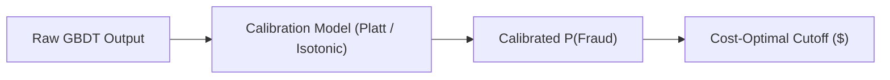

# 05. Machine Learning & Credit Scorecards in Finance

Executive guide to machine learning algorithms, credit risk scorecards, real-time fraud engines, and regulatory model risk governance across financial services.

---

## 📖 Recommended Reading Order & Modules

This directory is organized into a sequential learning curriculum tailored for Quantitative Risk, Data Science, and Machine Learning Engineering interviews at tier-1 financial institutions (**Capital One, JPMorgan Chase, American Express, Stripe, Visa, Wise, Apple Pay**):

<div class="grid cards" markdown>

-   :material-numeric-1-box: **[01. Financial Models Deep Dive](01_financial_models_deep_dive.md)**

    ---

    **Core Banking, Credit & Regulatory Models**:
    - Traditional Credit Scorecards (WOE, IV, Logistic Regression, PDO Scaling)
    - Modern Interpretable ML (Explainable Boosting Machines - EBM / GA2M)
    - Survival Analysis & Markov Chain Delinquency Roll Rates
    - Regulatory Governance (Federal Reserve SR 11-7, CECL Reserves, Fair Lending 80% Rule)

-   :material-numeric-2-box: **[02. Fraud Detection ML Implementation](02_fraud_detection_ml_implementation.md)**

    ---

    **Production Engineering & Optimization for Fraud**:
    - Feature engineering (velocity, haversine speed, graph degree) & 4-stage feature selection
    - Hyperparameter tuning deep dive for extreme class imbalance (XGBoost, LightGBM, CatBoost)
    - Asymmetric cost-sensitive loss & dollar-optimal threshold derivation
    - Sub-5ms C++ low-latency inference serving via Treelite & ONNX compilation
    - Handling 30–90 day label lag, PU learning, and production circuit breakers

-   :material-numeric-3-box: **[03. Data Science Interview Q&A](03_data_science_interview_qa.md)**

    ---

    **15 High-Yield Quantitative & Risk Interview Questions**:
    - Why banks still use Scorecards over XGBoost (Adverse Action, FCRA)
    - Extreme class imbalance (0.01% fraud) & why SMOTE fails in payments
    - Population Stability Index (PSI) and Characteristic Stability Index (CSI)
    - TreeSHAP vs. GBDT Feature Importance (Gain/Split bias)
    - Probability Calibration (Platt Scaling vs. Isotonic Regression)
    - Reject Inference, Algorithmic Recourse & Purged TimeSeriesSplit

</div>

---

## 1. Algorithm Comparison Matrix in Financial Services

| Algorithm Family | Primary Fintech Use Case | Interpretability | Latency (Inference) | Regulatory Compliance (SR 11-7) |
| :--- | :--- | :--- | :--- | :--- |
| **Logistic Regression + WOE** | Credit scoring, Card underwriting | ⭐⭐⭐⭐⭐ (Full auditability) | Sub-millisecond (< 1ms) | **Regulator Standard (FICO / OCC)** |
| **Explainable Boosting (EBM)** | Risk pricing, Non-linear underwriting | ⭐⭐⭐⭐ (Additive lookup curves) | Fast (1–3ms) | Approved with monotonicity constraints |
| **LightGBM / XGBoost** | Real-time fraud detection, Churn | ⭐⭐⭐ (via TreeSHAP) | Very Fast (1–5ms compiled) | Standard for non-underwriting risk |
| **Graph Neural Networks (GNN)** | Fraud rings, Synthetic ID, AML | ⭐⭐ (Subgraph explainers) | Async / Batch (20–100ms) | Internal intelligence & investigations |
| **Survival Analysis (Cox / KM)** | Delinquency timing, Prepayment | ⭐⭐⭐⭐ (Hazard ratios) | Batch / Horizon scoring | **Standard for CECL & IFRS 9** |
| **Isolation Forest / Autoencoders**| Zero-day fraud & anomaly detection | ⭐⭐ (Path / Reconstruction loss) | Fast (< 10ms) | Auxiliary alerting / Suspicious activity |

---

## 2. Gradient Boosted Decision Trees (GBDT) in Risk & Payments

GBDTs iteratively train shallow decision trees to predict the negative gradient (pseudo-residuals) of the loss function:

> **F_m(x) = F_{m-1}(x) + γ_m · h_m(x)**

### Why GBDT Dominates Tabular Risk Modeling:
1. **Handles Heterogeneous Data**: Mixes continuous transaction amounts, categorical MCC merchant codes, and sparse binary flags without requiring uniform scaling.
2. **Robust to Outliers**: Splitting operates on feature rank order rather than raw metric distance.
3. **Automated Null Handling**: Learns default split branch directions for missing bureau attributes.

### Key Algorithmic Distinctions:
- **XGBoost**: Traditionally uses level-wise (depth-wise) tree growth and exact or approximate histogram binning.
- **LightGBM**: Uses **leaf-wise (best-first)** growth with depth constraints, combined with **GOSS (Gradient-based One-Side Sampling)** and histogram binning ($K=255$), achieving the fastest training and inference throughput.
- **CatBoost**: Uses oblivious (symmetric) trees and online ordered target statistics, eliminating target leakage in high-cardinality categorical attributes.

---

## 3. Traditional Credit Scorecards: WOE & Scaling Math

Under the Fair Credit Reporting Act (FCRA) and Federal Reserve SR 11-7 guidance, retail credit underwriting models must produce auditable, monotonic adverse action reason codes.

```
Raw Attribute ──► Quantile Binning ──► Monotonic Coarse Binning ──► WOE ──► Log-Odds ──► FICO Score (300-850)
```

### Weight of Evidence (WOE)
For each bin $i$ of an attribute:

> **WOE_i = ln( (% Good_i) / (% Bad_i) ) = ln( (G_i / G_total) / (B_i / B_total) )**

### Information Value (IV)
Measures the overall predictive separation of the attribute:

> **IV = Σ [ (G_i / G_total) - (B_i / B_total) ] × WOE_i**

- **IV < 0.02**: Unpredictive (drop).
- **0.02 ≤ IV < 0.10**: Weak predictor.
- **0.10 ≤ IV < 0.30**: Medium predictor.
- **0.30 ≤ IV < 0.50**: Strong predictor (core model candidate).
- **IV ≥ 0.50**: **Target leakage alert!** Investigate immediately.

### Scorecard Scaling (Log-Odds to Points)
Transforms raw logistic regression log-odds into a consumer-friendly score:

> **Score = Offset + Factor × ln(Odds)**

Where parameters are derived from two business constants:
- **Target Score** ($S_0$) at **Target Odds** ($O_0$) (e.g., Score = 600 at Odds = 50:1).
- **Points to Double the Odds (PDO)** (e.g., 20 points):

> **Factor = PDO / ln(2)**  
> **Offset = Target Score - [ Factor × ln(Target Odds) ]**

---

## 4. Unsupervised Anomaly Detection

### 1. Isolation Forest
- **Principle**: Anomalies are "few and different", requiring significantly fewer random splits to isolate in feature space.
- **Anomaly Score**:
  > **Score(x, n) = 2^( - E[h(x)] / c(n) )**
  Where `h(x)` is path length and `c(n)` is average path length of unsuccessful binary tree searches:
  > **c(n) = 2 [ ln(n - 1) + 0.5772156649 ] - [ 2(n - 1) / n ]**
- If `Score ≈ 1.0`, the transaction is a clear anomaly; if `Score < 0.5`, it is typical baseline behavior.

### 2. Autoencoder Reconstruction Loss
- Neural network bottleneck architecture trained strictly on legitimate historical transactions:
  > **Reconstruction Loss = || x - x_hat ||^2**
- Novel attack vectors produce elevated reconstruction error due to unseen attribute combinations.

---

## 5. Metric Evaluation & Probability Calibration

### ROC-AUC vs. PR-AUC
- **ROC-AUC**: Plots True Positive Rate vs False Positive Rate. When the negative class is massive (99.9% legitimate volume), FPR remains deceptively small even with thousands of false alerts.
- **PR-AUC**: Plots Precision vs Recall. Directly penalizes models that generate excessive false alarms. **Always prioritize PR-AUC for fraud and AML.**

### Probability Calibration & Expected Business Value
Decisioning in financial risk is based on **Expected Dollar P&L**:

> **Expected Profit = [ P(Legit) × Merchant_Fee ] - [ P(Fraud) × Fraud_Loss ]**



- **Platt Scaling**: Fits a univariate sigmoid to model logits; suitable for smaller datasets.
- **Isotonic Regression**: Non-parametric piecewise monotonic step function; ideal for large, non-linear calibration datasets.
- **Brier Score**:
  > **Brier Score = (1 / N) × Σ (p_i - y_i)^2**  
  Directly evaluates probabilistic calibration accuracy.

---

## 🔗 Next Steps & Reading Path
1. Read **[01. Financial Models Deep Dive](01_financial_models_deep_dive.md)** for credit scorecards, EBMs, survival analysis, and regulatory validation.
2. Read **[02. Fraud Detection ML Implementation](02_fraud_detection_ml_implementation.md)** for feature selection, hyperparameter tuning, and sub-5ms low-latency serving.
3. Review **[03. Data Science Interview Q&A](03_data_science_interview_qa.md)** to prepare executive interview answers for top financial firms.
