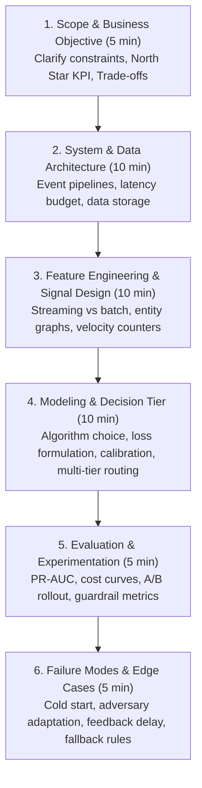
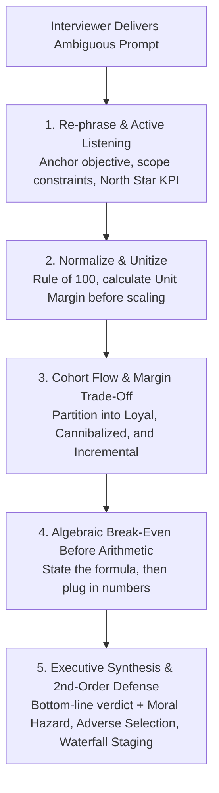

# 06. Case Studies & System Design for Payments & Risk

Structured repository of end-to-end case studies and system design interviews tailored for Fintech, Payment Processors, and Financial ML roles (Capital One, Stripe, Adyen, Visa, PayPal, Square).

---

## 1. The Fintech Case Interview Framework (The 6-Step Structure)

When given an ambiguous prompt like *"How would you reduce fraud losses on peer-to-peer payments?"* or *"Design an authorization optimization engine"*, follow this structured roadmap:

---

## 2. The Case Study Master Playbook: How to Crush Strategy & Quant Cases

Drawing from the recurring mathematical and strategic patterns in **Cases 01 through 09**, this playbook provides the exact techniques, mental models, and communication habits required to score in the top 1% of candidates for **Senior Business Manager (SBM), Business Analyst (BA), and Product Strategy** interviews (Capital One, Stripe, Visa, fintechs, and tier-1 tech).

---

### Pro-Tip 1: Re-Phrase & Anchor the Objective (Never Jump Straight to Math)
When an interviewer presents a scenario with numbers (e.g., *"15% pay in full, now we offer a 60% settlement, should we do it?"*), weak candidates immediately start multiplying numbers. **Top candidates pause and re-phrase:**
1. **Re-state the core trade-off**: *"To make sure I'm aligned: Capital One is considering offering a 40% haircut to accelerate recoveries. The core tension is whether the incremental cash collected from non-payers outweighs the revenue lost from cannibalizing full-payers. Is that right?"*
2. **Clarify the North Star metric**: Confirm if the objective is **Gross Cash Collected**, **Net Margin (after call center/collections costs)**, or **Customer Lifetime Value (retaining the cardholder)**.
3. **Confirm boundary conditions**: Ask whether this offer is extended across all delinquencies simultaneously or staged, and whether fixed collections overhead changes.

---

### Pro-Tip 2: The "Normalize & Unitize" Rule (Make Math Effortless)
Big numbers ($2,000,000 active accounts, $500 monthly spend, $40M portfolio deficit) are designed to trigger cognitive overload and arithmetic mistakes under pressure.
* **The Rule of 100 (Cases 06, 07, 09)**: When dealing with percentages ($15\%$, $10\%$, $60\%$), normalize the problem to **100 accounts / users**.
  * Working with $15$ customers, $10$ customers, and $5$ defectors is vastly faster and less error-prone than juggling millions.
* **Calculate Unit Revenue & Unit Cost First (Cases 03, 04, 06, 08)**:
  $$\text{Unit Margin} = \text{Unit Revenue} - \text{Unit Variable Cost}$$
  * In [Case 06](case_06_mobile_gaming_freemium_cannibalization.md): Calculate that a Paid user delivers **$12.00 net margin** and a Free user delivers **$2.00 net margin** before touching the 200,000 total user base.
  * In [Case 08](case_08_credit_card_tier_segmentation_database_glitch.md): Calculate the per-cardholder annual net profit (`+$35` Regular vs. `+$100` Premium) before modeling portfolio-level turnaround.
  * In [Case 09](case_09_debt_collections_cannibalization_breakeven.md): Calculate expected value per account ($15\% \times \$2,000 = \$300$ vs. $\$200 + \$120 = \$320$) to instantly establish the answer.

---

### Pro-Tip 3: The 4-Cohort Cannibalization Flow Model (Cases 03, 05, 06, 09)
Whenever a discount, season pass, subscription, or cheaper tier is introduced, **never view the population as a single monolithic block**. Always decompose the audience into 4 behavioral cohorts:

| Cohort Name | Who They Are | Behavioral Economic Impact | Financial Equation |
| :--- | :--- | :--- | :--- |
| **1. Loyal High-Tier** | Continue paying full price | Neutral (Protected revenue) | $N_{\text{loyal}} \times P_{\text{full}}$ |
| **2. Cannibalized / Defectors** | Would have paid full, but took discount | **Value Destruction** (Margin loss) | $N_{\text{cannibal}} \times (P_{\text{offer}} - P_{\text{full}})$ |
| **3. Incremental Converts** | Would have paid $0, but discount activated them | **Value Creation** (Margin gain) | $N_{\text{incr}} \times (P_{\text{offer}} - \$0)$ |
| **4. Incurable / Non-Adopters** | Do not pay under either model | Neutral ($0 impact) | $N_{\text{zero}} \times \$0$ |

> **The Golden Break-Even Condition**:  
> $$\text{Value Created from Incremental} \ge \text{Value Destroyed from Cannibalization}$$
> $$N_{\text{incremental}} \times P_{\text{offer}} \ge N_{\text{cannibalized}} \times (P_{\text{full}} - P_{\text{offer}})$$

* **The $P_{\text{offer}} / P_{\text{full}}$ Shortcut**: For zero-marginal-cost recovery or digital products, the maximum allowable cannibalization share of the promotional tier is **always equal to the price ratio** ($\frac{P_{\text{offer}}}{P_{\text{full}}}$). At a 60% settlement offer, at most **60%** of adopters can be cannibalized ([Case 09](case_09_debt_collections_cannibalization_breakeven.md#L187)).

---

### Pro-Tip 4: Watch for Behavioral Traps (Adverse Selection & Moral Hazard)
Top scores go to candidates who identify how humans strategically "game" policies:
* **Adverse Selection (Case 04: Co-Working)**: When transitioning from hourly to unlimited subscription, who buys the subscription first? The heaviest users who spend 40 hours/week. If you price using average historical usage, you guarantee massive operating losses.
* **Moral Hazard (Case 09: Collections)**: If borrowers know Capital One offers 40% discounts on default, strategic defaults increase, and full-paying customers will deliberately delay payments to receive the haircut.
* **Game-Theoretic Retaliation (Case 05: Power Auctions)**: If a generator attempts to exercise market power by withholding baseload capacity to spike the market clearing price, competitors' marginal units will clear instead, stranding your generation.

---

### Pro-Tip 5: Operationalize the Solution (Don't Just Report a Number)
Interviewers love when you design operational safeguards that eliminate cannibalization entirely:
* **Dynamic Waterfall Staging (Cases 02, 09)**: Never offer discounts immediately.
  * *Stage 1 (Days 1–60)*: Demand 100% full balance to harvest the solvent full-payers ($15\%$).
  * *Stage 2 (Days 90+)*: Offer the 60% settlement *only* to remaining delinquent accounts who failed Stage 1. This reduces cannibalization to near **zero**!
* **Product Feature Gating (Case 06)**: Don't give away the core value in the free tier; gate high-frequency features to protect the paid tier.
* **Controlled Experimentation (Champion-Challenger)**: Always propose an 80/20 A/B test with pre-defined guardrail metrics (e.g., full-payer defection rate $\le 40\%$, 12-month downstream re-default rates).

---

## 3. Directory of Detailed Case Studies

| Case Study | Domain / Focus | Key Challenges | Target Roles |
| :--- | :--- | :--- | :--- |
| **[Case 01: Real-Time Fraud Detection Engine](case_01_realtime_fraud_detection.md)** | Machine Learning System Design | 10k TPS, < 50ms latency, 0.05% imbalance, delayed labels | ML Engineer, Risk Data Scientist, Platform Architect |
| **[Case 02: Smart Payment Routing & Auth Optimization](case_02_payment_routing_authorization.md)** | Payments Product Analytics & RL | Dynamic acquirer routing, soft decline retry logic, interchange cost minimization | Product Analyst, ML Scientist, Payment Operations |
| **[Case 03: Amusement Park P&L, Season Pass & Auction Game Theory](case_03_amusement_park_business_case.md)** | Commercial Strategy & Business Case | Baseline P&L turnaround, pass cannibalization vs in-park spend lift, land expansion bidding game theory | Senior Business Manager, Business Analyst, Strategy Director |
| **[Case 04: Co-Working Space Unit Economics & Frontier](case_04_coworking_space_business_case.md)** | Pricing Strategy & Break-Even Modeling | Hourly to subscription shift, adverse selection diagnostic, 2D break-even frontier whiteboard graphing | Senior Business Manager, Business Analyst, Strategy Director |
| **[Case 05: Uniform-Price Auction & Merit Order Game Theory](case_05_power_market_uniform_price_auction.md)** | Microeconomics, Pricing & Auction Game Theory | Supply stack construction, pivotal supplier market power, portfolio bidding & cannibalization, principal-agent alignment | Senior Business Manager, Director of Strategy, Quantitative Product Manager |
| **[Case 06: Mobile Gaming App: Freemium vs. Paid & 3-Cohort Break-Even](case_06_mobile_gaming_freemium_cannibalization.md)** | Product Pricing & Cannibalization Modeling | Ad yield vs. IAP, 10% freemium conversion proof, 3-cohort behavioral defection, unified app architecture | Senior Business Manager, Business Analyst, Strategy Director |
| **[Case 07: Credit Card Streaming Video Ad Campaign: Skippable vs. Non-Skippable](case_07_streaming_ad_campaign_credit_card.md)** | Marketing Analytics & CAC Optimization | Acquisition funnel conversion math, skippable ad break-even hurdle rate, reach vs. intent trade-offs | Senior Business Manager, Growth Analyst, Marketing Data Scientist |
| **[Case 08: Credit Card P&L Turnaround, Tier Segmentation & Database Outage](case_08_credit_card_tier_segmentation_database_glitch.md)** | Portfolio Management & Incident Analytics | Monolithic -$40M P&L turnaround, 25% premium tier break-even migration, 3-month DB outage cohort leakage | Senior Business Manager, Business Analyst, Financial Analyst |
| **[Case 09: Default Collections: Settlement Offer Strategy & Cannibalization Break-Even](case_09_debt_collections_cannibalization_breakeven.md)** | Credit Risk & Portfolio Collections Strategy | 60% settlement offer unit economics, 33.3% defection rate, 40%/60% max break-even cannibalization proof, waterfall staging | Senior Business Manager, Business Analyst, Risk Strategy Manager |

---

## 4. High-Frequency Interview Prompts to Practice

1. **Card Testing Mitigation**: *"A merchant experiences an attack where 50,000 authorization attempts occur within 15 minutes with $1 amounts across stolen card numbers. How do you detect and stop this in real time without hurting legit checkout?"*
2. **Buy Now Pay Later (BNPL) Underwriting**: *"Design a real-time credit decisioning model for a new BNPL consumer with zero credit bureau history at point-of-sale in under 200ms."*
3. **P2P Scam / Authorized Push Payment (APP) Fraud**: *"How do you prevent elderly users from being coerced into wiring money to fraudulent accounts when the legitimate user themselves is authenticating the transfer?"*
4. **Dispute Rate Surge Recovery**: *"A key merchant's chargeback rate jumped from 0.4% to 1.2% this month, putting them at risk of Visa/Mastercard monitoring program fines. Formulate a diagnostic analysis and action plan."*
