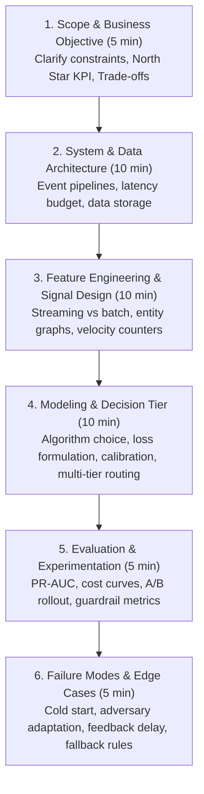

# 06. Case Studies & System Design for Payments & Risk

Structured repository of end-to-end case studies and system design interviews tailored for Fintech, Payment Processors, and Financial ML roles (Capital One, Stripe, Adyen, Visa, PayPal, Square).

---

## 1. The Fintech Case Interview Framework (The 6-Step Structure)

When given an ambiguous prompt like *"How would you reduce fraud losses on peer-to-peer payments?"* or *"Design an authorization optimization engine"*, follow this structured roadmap:

---

## 2. Directory of Detailed Case Studies

| Case Study | Domain / Focus | Key Challenges | Target Roles |
| :--- | :--- | :--- | :--- |
| **[Case 01: Real-Time Fraud Detection Engine](case_01_realtime_fraud_detection.md)** | Machine Learning System Design | 10k TPS, < 50ms latency, 0.05% imbalance, delayed labels | ML Engineer, Risk Data Scientist, Platform Architect |
| **[Case 02: Smart Payment Routing & Auth Optimization](case_02_payment_routing_authorization.md)** | Payments Product Analytics & RL | Dynamic acquirer routing, soft decline retry logic, interchange cost minimization | Product Analyst, ML Scientist, Payment Operations |
| **[Case 03: Amusement Park P&L, Season Pass & Auction Game Theory](case_03_amusement_park_business_case.md)** | Commercial Strategy & Business Case | Baseline P&L turnaround, pass cannibalization vs in-park spend lift, land expansion bidding game theory | Senior Business Manager, Business Analyst, Strategy Director |
| **[Case 04: Co-Working Space Unit Economics & Frontier](case_04_coworking_space_business_case.md)** | Pricing Strategy & Break-Even Modeling | Hourly to subscription shift, adverse selection diagnostic, 2D break-even frontier whiteboard graphing | Senior Business Manager, Business Analyst, Strategy Director |
| **[Case 05: Uniform-Price Auction & Merit Order Game Theory](case_05_power_market_uniform_price_auction.md)** | Microeconomics, Pricing & Auction Game Theory | Supply stack construction, pivotal supplier market power, portfolio bidding & cannibalization, principal-agent alignment | Senior Business Manager, Director of Strategy, Quantitative Product Manager |
| **[Case 06: Mobile Gaming App: Freemium vs. Paid & 3-Cohort Break-Even](case_06_mobile_gaming_freemium_cannibalization.md)** | Product Pricing & Cannibalization Modeling | Ad yield vs. IAP, 10% freemium conversion proof, 3-cohort behavioral defection, unified app architecture | Senior Business Manager, Business Analyst, Strategy Director |

---

## 3. High-Frequency Interview Prompts to Practice

1. **Card Testing Mitigation**: *"A merchant experiences an attack where 50,000 authorization attempts occur within 15 minutes with $1 amounts across stolen card numbers. How do you detect and stop this in real time without hurting legit checkout?"*
2. **Buy Now Pay Later (BNPL) Underwriting**: *"Design a real-time credit decisioning model for a new BNPL consumer with zero credit bureau history at point-of-sale in under 200ms."*
3. **P2P Scam / Authorized Push Payment (APP) Fraud**: *"How do you prevent elderly users from being coerced into wiring money to fraudulent accounts when the legitimate user themselves is authenticating the transfer?"*
4. **Dispute Rate Surge Recovery**: *"A key merchant's chargeback rate jumped from 0.4% to 1.2% this month, putting them at risk of Visa/Mastercard monitoring program fines. Formulate a diagnostic analysis and action plan."*
