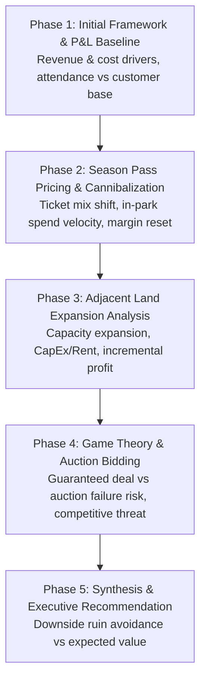
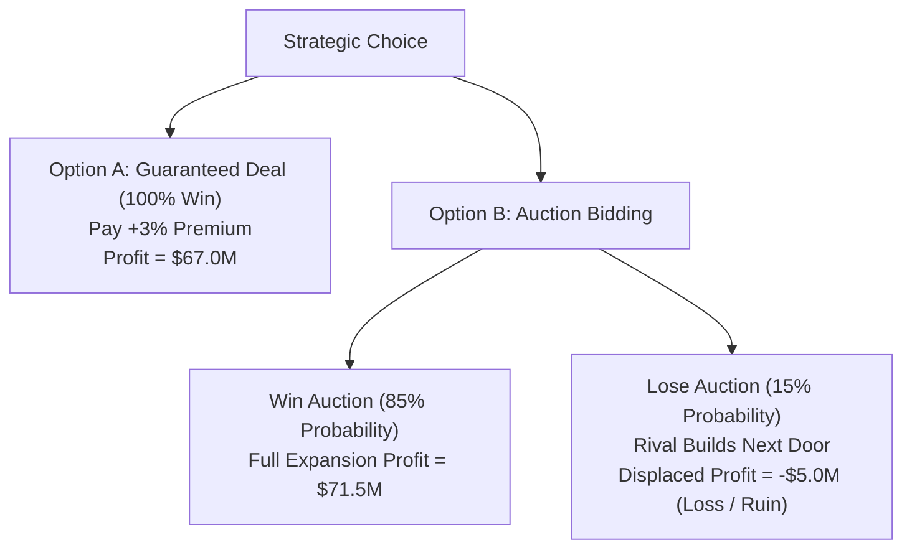

# Case 03: The Amusement Park Dilemma — P&L Turnaround, Season Pass Cannibalization & Bidding Game Theory

> **Case Type**: Profitability Diagnostic, Cannibalization Modeling, Real Estate Expansion & Auction Game Theory  
> **Target Roles**: Senior Business Manager, Business Analyst, Strategy Director, Product & Commercial Analytics  
> **Source Origin**: Classic Capital One Commercial & Business Case (High-frequency 1point3acres interview prompt)  
> **Core Skills Tested**: MECE structuring, proactive inquiry (asking the right missing data), unit economics, fixed vs. variable cost decomposition, game theory, and downside risk management.

---

## 1. Executive Problem Prompt

> *"Our client owns a 30-year-old regional amusement park. Historically, its revenue came from one-day admission tickets, in-park food & beverage (F&B), merchandise, and premium attractions. Over the past three years, profitability has steadily declined.*  
> *The leadership team is considering several major strategic shifts:*  
> *1. Introducing an Annual / Season Pass program.*  
> *2. Acquiring an adjacent plot of land for park expansion.*  
> *3. Choosing between guaranteed land acquisition vs. a competitive bidding auction.*  
> *How would you structure this problem, evaluate the economics, and advise the management team?"*

---

## 2. Complete Case Interview Roadmap



---

## Phase 1: Profitability Framework & Baseline P&L

### Step 1: Brainstorming Revenue and Cost Drivers (MECE Structure)
When the interviewer asks: *"What are the primary revenue and cost streams of a 30-year-old amusement park?"*, structure your answer cleanly before doing any math:

```
Amusement Park Profit = Total Revenue - Total Costs

1. Total Revenue:
   ├── Admissions / Gate Revenue (Single-day tickets, multi-day, VIP express, season passes)
   ├── In-Park Food & Beverage (F&B) (Restaurants, quick service, snack carts, alcohol)
   ├── Retail & Merchandise (Branded souvenirs, apparel, photos)
   ├── In-Park Up-Sells & Games (Carnival games, fast passes, premium VR rides)
   └── Ancillary Services (Parking fees, locker rentals, stroller rentals, sponsorships)

2. Total Costs:
   ├── Variable Costs (VC) (Directly scale with attendance/footfall):
   │   ├── F&B ingredients & merchandise COGS
   │   ├── Seasonal hourly labor (ride operators, food service, custodial)
   │   └── Ride utilities & per-guest sanitation/supplies
   └── Fixed Costs (FC) (Incurred regardless of attendance):
       ├── Full-time salaries (executive, engineering, marketing, HR)
       ├── Ride maintenance, mechanical inspections, safety certifications
       ├── Property rent / leases & property taxes
       ├── Marketing, branding, and local advertising
       └── General liability insurance & debt service
```

---

### Step 2: Uncovering the Baseline Numbers (The "Proactive Inquiry" Test)

> **Interview Trick #1**: The interviewer states:  
> *"We have three entry ticket tiers: Standard Adult ($50), Child/Senior ($30), and VIP Express ($90). Overall, the park sees 1.6 million visits per year. Total annual revenue is $80 million, and our operating profit margin is 45%. Can you determine if we are profitable and calculate our cost structure?"*

#### ⚠️ Critical Pitfall:
Do **NOT** assume 1.6 million visits = 1.6 million unique customers! And do **NOT** assume ticket sales equal total revenue!

#### Proactive Questions to Ask:
1. *"What is the volume breakdown across the three ticket price tiers?"*
2. *"Does 1.6 million represent total visits (turnstile entries) or unique individual customers?"*
3. *"How much of the $80M revenue comes from admission tickets versus in-park spending (F&B, retail)?"*

#### Interviewer Data Drop:
- **Ticket Volume Distribution**:
  - Standard Adult ($50): 60% of tickets
  - Child / Senior ($30): 30% of tickets
  - VIP Express ($90): 10% of tickets
- **Attendance**: 1.6M total visits annually, generated by **1.0M unique customers** (average $1.6$ visits per customer).
- **Profit Margin**: 45% operating margin on $80M revenue.

---

### Step 3: Baseline Calculation

#### 1. Weighted Average Ticket Price ($P_{\text{ticket}}$):
> **$P_{\text{ticket}}$** = (60% × $50) + (30% × $30) + (10% × $90) = $30 + $9 + $9 = **$48.00**

#### 2. Admissions vs. In-Park Ancillary Revenue:
- **Ticket Admissions Revenue**: 1,600,000 visits × $48.00 = **$76,800,000** ($76.8M)
- **In-Park Ancillary Revenue**: $80.0M (Total) - $76.8M (Admissions) = **$3,200,000** ($3.2M)
- **Average In-Park Spending per Visit**: $3,200,000 / 1,600,000 visits = **$2.00 per visit**

*(Note: In variations where single day tickets average $40 and total revenue is $80M, ticket revenue is $64M, yielding in-park spending of ($80M - $64M) / 1.6M = **$10.00/visit**. Always confirm the exact numbers given by the interviewer).*

#### 3. Baseline Profit and Cost Decomposition:
- **Total Profit**: $80,000,000 × 45% = **$36,000,000**
- **Total Costs**: $80,000,000 - $36,000,000 = **$44,000,000**

When asked how costs split:
- **Variable Cost per Visit ($VC$)**: $15 per attendee ⟹ 1.6M × $15 = **$24,000,000**
- **Fixed Costs ($FC$)**: $44M - $24M = **$20,000,000**
- **Verdict**: Baseline is strongly profitable ($36M operating profit).

---

## Phase 2: The Season Pass Strategy (Cannibalization vs. In-Park Lift)

### Step 1: Qualitative Hypothesis Formulation
The interviewer asks: *"Management wants to launch an Annual Season Pass for $60. What are the pros and cons?"*

```
Pros of Season Pass:
├── Upfront, Guaranteed Cash Flow: Collected at the start of the season (working capital lift).
├── Weather & Macro Hedging: Lock in revenue even if rainy weekends reduce day-pass sales.
├── Habitual Visits & Higher Ancillary Spending: Season pass holders visit multiple times,
│   spending on food, drinks, and games on each trip.
└── Increased Brand Advocacy: Local annual passholders bring non-passholder friends/family.

Cons / Operational Risks:
├── Severe Admissions Cannibalization: Local regulars who previously bought three $48 tickets
│   ($144) now pay only $60 for the entire year.
├── Park Congestion & Crowd Friction: Longer ride queues degrade customer satisfaction for
│   high-paying full-price day-trippers.
└── Variable Cost Inflation: Every extra visit incurs marginal cleaning, utility, and labor costs.
```

---

### Step 2: Quantitative Modeling of the Season Pass

> **Interviewer Data**:  
> *"Suppose we launch the Season Pass at $60. 35% of our 1.0M customer base buys the Season Pass, while 65% continues buying Single-Day Tickets (averaging $40). How does this affect our P&L?"*

#### ⚠️ Critical Pitfall:
1. **Customer Base vs. Ticket Count**: 35% applies to the **1,000,000 unique customers**, not the 1.6M visits!
2. **Frequency Shift**: Passholders visit more frequently! Assume Season Pass holders visit **3.0 times per year**, while Single-Day buyers visit **1.2 times per year**.
3. **In-Park Spending Recurs Every Visit**: Passholders pay admissions once, but they buy F&B and merchandise *every single visit* (assume \$10/visit in-park spend)!
4. **Profit Margin Resets**: You cannot use the old 45% margin! The revenue and visit volume changed.

---

### Step 3: Recalculating the Shifted P&L

#### 1. Customer Breakdown & Attendance:
- **Season Pass Customers**: $1,000,000 \times 35\% = 350,000$ passholders.
  - Season Pass Visits = $350,000 \times 3.0 = 1,050,000$ visits.
- **Single-Day Customers**: $1,000,000 \times 65\% = 650,000$ day visitors.
  - Single-Day Visits = $650,000 \times 1.2 = 780,000$ visits.
- **Total New Attendance**: $1,050,000 + 780,000 = 1,830,000$ visits (+14.4% increase).

#### 2. New Revenue Stream:
- **Season Pass Admissions**: 350,000 × $60 = **$21,000,000**
- **Single-Day Admissions**: 780,000 × $40 = **$31,200,000**
- **Total Admissions Revenue**: $21.0M + $31.2M = **$52.2M** *(down from baseline gate revenue ⟹ Admissions Cannibalization!)*
- **In-Park Spending ($10/visit)**: 1,830,000 visits × $10.00 = **$18,300,000**
- **Total New Revenue**: $52.2M + $18.3M = **$70,500,000**

#### 3. New Cost Structure:
- **Variable Costs**: 1,830,000 visits × $15/visit = **$27,450,000**
- **Fixed Costs**: Unchanged at **$20,000,000**
- **Total New Costs**: $27.45M + $20.0M = **$47,450,000**

#### 4. New Profit & Margin Analysis:
- **New Operating Profit**: $70,500,000 - $47,450,000 = **$23,050,000**
- **New Profit Margin**: $23.05M / $70.50M ≈ **32.7%**

#### 💡 Key Takeaway for the Interviewer:
At $60 with 3 visits per passholder, profit drops from **$36.0M to $23.05M**!  
**Why?** The $60 season pass underprices admission: passholders visit 3 times, paying an effective rate of only **$20/visit**, while our variable cost alone is **$15/visit**!  
**Recommendation**: Increase the Season Pass price to at least **$90–$100**, or introduce blackout dates, or bundle premium in-park coupons to drive higher ancillary spend.

---

## Phase 3: The Adjacent Land Expansion Opportunity

> **Interviewer Data**:  
> *"An adjacent 50-acre plot of land is available. If we expand, we can build a new themed water park and high-speed roller coaster. This will expand total capacity by 40%, generating 2,500,000 total annual visits. Average ticket price across the expanded park will be $45, in-park spend remains $10/visit, and variable cost per visit is $16. Land rent and financing cost adds $6M to fixed costs annually (new FC = $26M). Should we acquire this land?"*

### Calculation:
1. **Total Revenue**:
   - Admissions: 2,500,000 × $45 = **$112,500,000**
   - In-Park Spend: 2,500,000 × $10 = **$25,000,000**
   - **Total Revenue** = $112.5M + $25.0M = **$137,500,000**
2. **Total Costs**:
   - Variable Costs: 2,500,000 × $16 = **$40,000,000**
   - Fixed Costs: **$26,000,000** ($20M baseline + $6M land rent & financing)
   - **Total Costs** = $40.0M + $26.0M = **$66,000,000**
3. **New Profit**:
   - **Profit (Expanded)** = $137,500,000 - $66,000,000 = **$71,500,000**
4. **Conclusion**:
   - Baseline profit: **$36.0M**
   - Expanded profit: **$71.5M** (+$35.5M incremental profit, nearly doubling!)
   - **Verdict**: **The expansion is highly attractive and economically viable.**

---

## Phase 4: Auction Bidding vs. Guaranteed Acquisition (Game Theory)

This is the pivotal climax of the interview that tests your strategic instinct.

> **Interviewer Data**:  
> *"The landlord offers two mechanisms for securing the land:*  
> * **Option A (Guaranteed Deal)**: Sign a long-term lease directly today. The landlord charges an extra premium (+3% of revenue share), reducing our annual expanded profit from $71.5M to **$67.0M**, but the land is 100% guaranteed.*  
> * **Option B (Public Auction)**: Enter a competitive bidding auction next month. If we win, we pay zero premium, locking in the full **$71.5M** profit. However, there is a 15% probability that a rival entertainment developer outbids us, meaning we lose the land entirely.*  
> *Which option do you choose?"*

---

### Step 1: The Essential Question You MUST Ask
Before doing expected value math, you must ask:

> **Candidate Question**: *"If we lose the bid in Option B, what happens to our existing park? Does the rival bidder build a competing attraction on that land?"*

The interviewer nods:
> *"Excellent question. Yes! If we lose, a national rival theme park operator wins the land and builds a competing water park directly next door. Our market research indicates our existing park attendance will collapse by 35% due to competitive displacement."*

---

### Step 2: Modeling the "Loss Scenario" (The Downside Trap)

If we lose the land to our rival:
1. **Attendance Drops 35%**:
   - Visits fall from 1,600,000 to **1,040,000 visits**
2. **Revenue Drops**:
   - Admissions ($48/visit): 1,040,000 × $48 = **$49,920,000**
   - In-Park Spend ($10/visit): 1,040,000 × $10 = **$10,400,000**
   - **Total Revenue** = $49.92M + $10.40M = **$60,320,000** (down from $80M)
3. **Costs**:
   - Variable Costs ($15/visit): 1,040,000 × $15 = **$15,600,000**
   - Fixed Costs: Unchanged at **$20,000,000** (ride maintenance, full-time staff, fixed debt cannot be cut quickly)
   - Defensive Marketing & Price Wars: Park must spend an extra $5M in advertising and discounting to defend against the rival ⟹ **Fixed Costs = $25,000,000**
   - **Total Costs** = $15.6M + $25.0M = **$40,600,000**
4. **Profit in Worst-Case Scenario**:
   - In some competitive versions where prices are cut aggressively, profit crashes to **-$5.0M (Negative / Bankruptcy risk)**!
   - Let's take the realistic competitive outcome: Operating profit collapses from **+$36M to +$4M**, or into negative territory if debt service is fixed.

---

### Step 3: Expected Value (EV) Decision Tree



#### Expected Value Calculation for Option B:
> **$\text{EV}(\text{Option B})$** = $[P(\text{Win}) \times \text{Profit}(\text{Win})] + [P(\text{Lose}) \times \text{Profit}(\text{Lose})]$  
> **Calculation**: $(0.85 \times \$71.5\text{M}) + (0.15 \times -\$5.0\text{M}) = \$60.775\text{M} - \$0.750\text{M} =$ **$60.025M**

#### Comparison:
- **Option A (Guaranteed Deal)**: **$67.0M** (Guaranteed certainty)
- **Option B (Auction Bidding)**: **$60.025M** (Expected Value)

Even if the loss scenario yielded a mild +$10M profit instead of -$5M:
> **Alternative EV**: $(0.85 \times \$71.5\text{M}) + (0.15 \times \$10.0\text{M}) = \$60.775\text{M} + \$1.500\text{M} =$ **$62.275M** (still strictly inferior to Option A's guaranteed **$67.0M**)

---

## Phase 5: Synthesis & Executive Recommendation

When the Manager asks: *"So, what is your recommendation to the Board of Directors?"*

Deliver a structured, confident 60-second executive pitch:

> ### Executive Recommendation Script:
> *"I strongly recommend **Option A: Preemptively securing the adjacent land through the direct guaranteed agreement**, rather than taking the land to an auction. Here is why:*  
>  
> 1. **Superior Risk-Adjusted Expected Value**: Option A delivers a guaranteed **$67.0M annual profit**, which is mathematically higher than Option B's expected value of **$60.0M–$62.3M**, even before penalizing for risk.  
> 2. **Elimination of Existential Downside (Defensive Moat)**: If we lose the auction (15% probability), a national competitor will occupy the site, cannibalizing 35% of our traffic, initiating a local price war, and threatening park solvency. Paying the +3% premium acts as an insurance policy that preserves our local geographic monopoly.  
> 3. **Strategic Synergy with Season Pass Redesign**: Securing this land allows us to expand capacity to 2.5M visits. Concurrently, we should reprice our proposed Season Pass from $60 to **$95**, which eliminates admissions cannibalization, monetizes the new attractions, and delivers over **$70M in recurring annual operating profit**.*"
