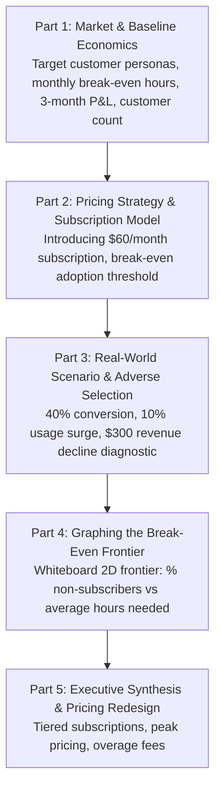

# Case 04: Co-Working Space Unit Economics, Subscription Cannibalization & Break-Even Frontier

> **Case Type**: Unit Economics, Pricing Strategy, Adverse Selection, Break-Even Frontier Graphing  
> **Target Roles**: Senior Business Manager, Business Analyst, Strategy Director, Product & Commercial Analytics  
> **Source Origin**: Classic Capital One Power Day Business Case
> **Core Skills Tested**: Fast mental math, break-even algebra, pricing model evaluation, adverse selection diagnostic, 2D frontier graphing.

---

## 1. Executive Problem Prompt

> *"A mobile app company has launched a new physical co-working space venture. As the lead business analyst, you are tasked with analyzing its market demand, baseline unit economics, the financial impact of shifting from hourly pay-as-you-go to a flat subscription model, and graphing the break-even operating frontier."*

---

## 2. Complete Case Interview Roadmap



---

## Part 1: Market & Baseline Economics

### Question 1: Who are the target customers for this business?
Structure your answer into three distinct market segments (MECE):

```
Target Customer Personas
├── 1. Early-Stage Startups & Entrepreneurs:
│   └── Need professional conference rooms and office amenities without long-term commercial lease liability.
├── 2. Established SMBs & Remote Corporate Teams:
│   └── Companies outsourcing satellite hubs, accommodating hybrid distributed teams, or project pods.
└── 3. Freelancers, Independent Contractors & Remote Knowledge Workers:
    └── Individuals seeking relief from home distractions, reliable high-speed Wi-Fi, and a networking community.
```

---

### Question 2: What is the monthly break-even point in hours?

#### Data Provided:
- **Rent**: $8,000 / month
- **Facility Maintenance & Utilities**: $8,000 / month
- **Hourly Pricing**: $5 / hour

#### Step-by-Step Calculation:
1. **Total Monthly Fixed Costs (FC)**: `$8,000` (Rent) + `$8,000` (Maintenance) = `$16,000/month`
2. **Break-Even Volume (Q_BE)**: Total Fixed Costs / Hourly Rate = `$16,000` / `$5.00` = **3,200 hours/month**

> **Takeaway**: The space must achieve at least **3,200 billable hours per month** across all desks to cover overhead.

---

### Question 3: If actual usage is 3,000 hours/month, what is the profitability over a 3-month period?

#### Step-by-Step Calculation:
1. **Monthly Revenue**: 3,000 hours × `$5/hour` = `$15,000`
2. **Monthly Operating Profit (Loss)**: `$15,000` (Revenue) - `$16,000` (Costs) = `-$1,000/month`
3. **Cumulative 3-Month Profitability**: `-$1,000` × 3 months = `-$3,000` *(A cumulative net loss of $3,000)*

---

### Question 4: If the average customer books 10 hours per month, how many total customers do we currently have?

#### Step-by-Step Calculation:
- **Active Customer Base**: Total Billable Hours / Average Hours per Customer = 3,000 hours / 10 hours/customer = **300 active customers**

---

## Part 2: Pricing Strategy & The Subscription Model

### Question 5: To improve profitability, the company introduces a $60/month subscription. How many customers must subscribe to break even (assuming the rest remain on the 10-hour / $5 model)?

#### Algebraic Setup:
- Total Customer Base: **300 customers**
- Let **X** = Number of customers converting to the `$60/month subscription`.
- Remaining Non-Subscribers = **(300 - X)** customers.
- Non-subscribers continue their baseline average behavior: **10 hours/month at $5/hour** = `$50/month per customer`.
- Target Revenue to Break Even: `$16,000`.

#### Equation Formulation:
- **Total Revenue** = Subscriber Revenue + Non-Subscriber Revenue = $16,000
- (`$60` × X) + [`$5` × 10 × (300 - X)] = `$16,000`
- `$60X` + `$50`(300 - X) = `$16,000`
- `$60X` + `$15,000` - `$50X` = `$16,000`
- `$10X` = `$1,000`
- **X = 100 subscribers**

#### Business Interpretation:
- Exactly **100 subscribers** (paying `$60` = `$6,000`) and **200 non-subscribers** (paying `$50` = `$10,000`) generate `$6,000` + `$10,000` = `$16,000`, achieving an exact zero-profit break-even state.
- **Conversion Rate Required**: 100 / 300 = **33.3%** adoption.

---

## Part 3: Real-World Scenario & Adverse Selection

### Question 6: In reality, 40% of the 300 customers converted to the subscription. Total booking hours increased by 10%, but total revenue actually declined by $300. Calculate the new average hours for non-subscribers and explain why revenue dropped.

#### Step A: Calculate the New Total Revenue
- **Baseline Revenue**: 3,000 hours × `$5` = `$15,000`
- **New Total Revenue**: `$15,000` - `$300` = `$14,700`

#### Step B: Segment the 300 Customers
- **Subscribers (40%)**: 300 × 40% = **120 customers**
    - Subscriber Revenue = 120 × `$60` = `$7,200`
- **Non-Subscribers (60%)**: 300 × 60% = **180 customers**

#### Step C: Calculate the New Average Hours for Non-Subscribers (H)
- **Total Revenue** = Subscriber Revenue + Non-Subscriber Revenue
- `$14,700` = `$7,200` + (180 × `$5` × H)
- `$14,700` - `$7,200` = 900 × H
- `$7,500` = 900H
- H = `$7,500` / 900 = **8.33 hours/month**

---

### 💡 Executive Insight (The "So What?" Diagnostic): Why did revenue drop despite higher usage?

When the interviewer asks: *"Total hours jumped 10% from 3,000 to 3,300 hours, yet revenue fell by $300. What economic phenomenon caused this?"*

Deliver this crisp 3-part diagnostic:

1. **Adverse Selection (Self-Selection Trap)**:
    - Customers who knew they were heavy users (e.g., working 15 to 25 hours/month) immediately opted into the $60 flat subscription.
    - Under the old model, a 20-hour user generated 20 hours × `$5` = `$100`. Under the subscription, their revenue contribution was capped at `$60`, stripping out `$40 of high-margin billable revenue per heavy user`.
2. **Zero Marginal Cost Consumption**:
    - The 10% increase in total hours (3,000 → 3,300 hours) was consumed entirely by subscribers who faced **zero marginal cost** for additional hours. This extra usage generated `$0 in incremental revenue` while accelerating wear-and-tear and utility costs.
3. **Diluted Non-Subscriber Cohort**:
    - The remaining 180 non-subscribers are light, infrequent users whose average usage dropped from 10 hours down to **8.33 hours/month** (180 × 8.33 hours × $5 = $7,500).
    - The $10 premium paid by moderate users ($60 vs. $50) was insufficient to offset the revenue lost from heavy users.

---

## Part 4: Graphing the Break-Even Frontier

### Question 7: Draw the break-even line on a whiteboard. The Y-axis represents the % of Non-subscribers, and the X-axis represents the Average Hours needed from those non-subscribers.

To plot this frontier rapidly during an interview, determine the **two boundary intercepts**:

```
                       Break-Even Operating Frontier
  % Non-Subscribers (Y)
       ▲
  100% ┼──────────────────────────────● Point B: (10.67 hrs, 100%)
       │                             /
   80% ┼                            /
       │                           /     PROFIT ZONE
   60% ┼                          /     (Right of Frontier)
       │                         /
   40% ┼                        /
       │                       /
   20% ┼                      /
       │                     /   LOSS ZONE (Left of Frontier)
    0% ●────────────────────┴─────────────────────────────►
     Point A: (0 hrs, 0%)  5 hrs    10 hrs   15 hrs   Average Hours/Non-Sub (X)
```

#### 1. Point A (Y-Intercept): 0% Non-Subscribers (100% Subscribers)
- All 300 customers are subscribers paying $60/month.
- Revenue = 300 × $60 = `$18,000`.
- Since $18,000 exceeds the $16,000 fixed costs, the business is profitable with **zero hours required from non-subscribers**.
- **Coordinate**: **(X = 0 hours, Y = 0%)**

#### 2. Point B (X-Intercept): 100% Non-Subscribers (0% Subscribers)
- All 300 customers are non-subscribers paying $5/hour.
- To cover $16,000 fixed costs:
    - **Total Billable Hours Needed**: $16,000 / $5/hour = **3,200 hours**
    - **Average Hours Needed per Customer**: 3,200 hours / 300 customers = **10.67 hours**
- **Coordinate**: **(X = 10.67 hours, Y = 100%)**

#### 3. General Break-Even Equation:
Let **y** = fraction of non-subscribers (0 ≤ y ≤ 1), and **H** = average hours per non-subscriber:
- **Revenue**: [300 × (1 - y) × $60] + [300 × y × $5 × H] = $16,000
- $18,000(1 - y) + 1,500 · y · H = $16,000
- 1,500 · y · H = $16,000 - $18,000(1 - y)
- 1,500 · y · H = $18,000y - $2,000
- **H = 12 - (1.33 / y)**

#### Interview Graphing Rule:
Connect **(0, 0%)** to **(10.67, 100%)**.  
- Any operating point to the **RIGHT** of the line generates profit.
- Any operating point to the **LEFT** of the line operates at a net loss.
- Our current actual operating state: **Y = 60%** non-subscribers, **H = 8.33 hours**.
    - At Y = 60%, break-even hours required = 12 - (1.33 / 0.60) = 12 - 2.22 = **9.78 hours**.
    - Since actual H = 8.33 < 9.78, we are strictly inside the **Loss Zone** (-$1,300 loss).

---

## Part 5: Executive Synthesis & Pricing Redesign

When asked: *"How should the company redesign its pricing structure to fix this revenue leak?"*

Present these four commercial solutions:

1. **Tiered Hybrid Membership (All-You-Can-Eat Cap)**:
    - Replace the unlimited `$60` plan with a **12-Hour Tiered Pass (`$60/month`)**.
    - Any usage beyond 12 hours is billed at a discounted member rate of `$3.50/hour`, eliminating the zero-marginal-cost trap.
2. **Dedicated Desk Premium**:
    - Introduce hot desks ($60/mo, capped) vs. dedicated reserved desks ($150/mo) to monetize high-frequency startup founders.
3. **Off-Peak Dynamic Hourly Pricing**:
    - Discount off-peak hours (evenings and weekends) to $3/hour to monetize unused capacity, while charging $7/hour during peak mid-day hours.
4. **Conference Room & Amenity Monetization**:
    - Unbundle high-demand resources: Include desk space in subscriptions, but charge separately for private phone booths, conference rooms, and print stations.
