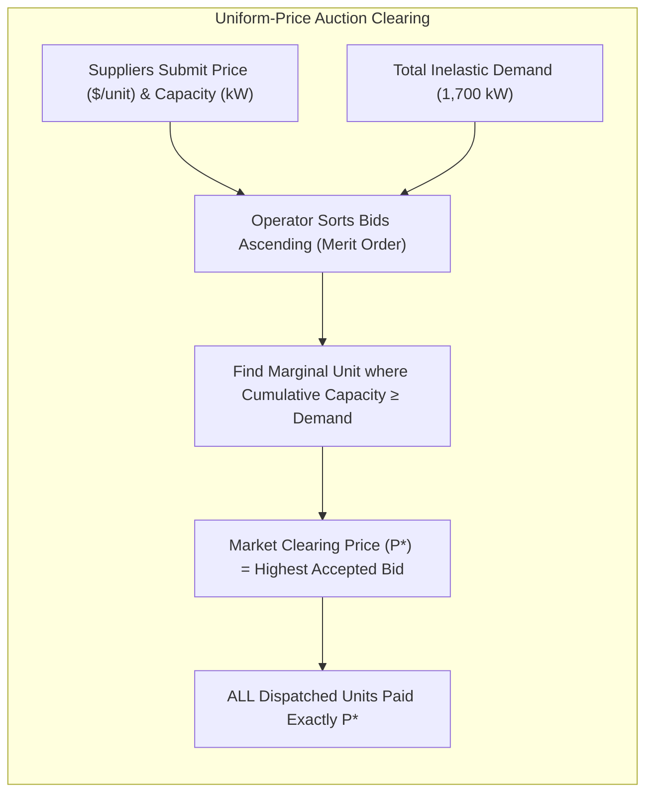
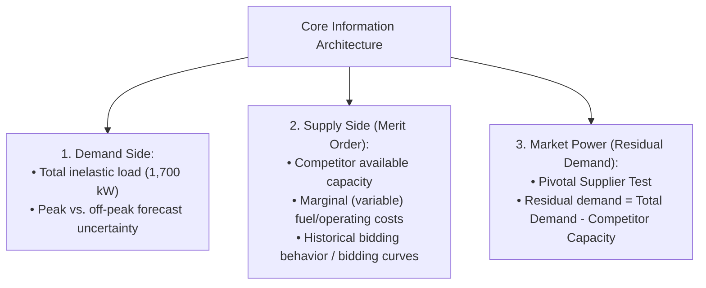
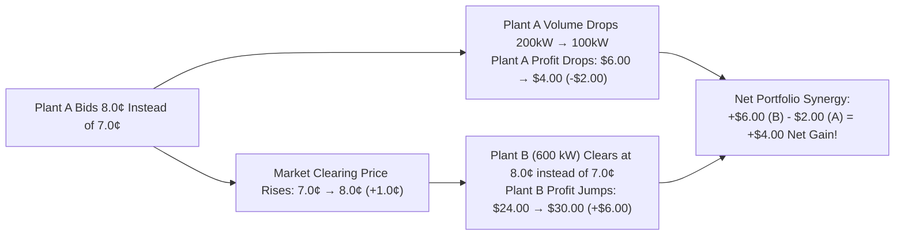
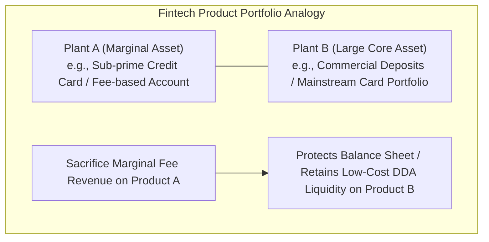

# Case 05: Uniform-Price Auction Dynamics, Merit Order Bidding & Portfolio Game Theory

> **Domain**: Commercial Strategy, Microeconomics, Auction Game Theory, Pricing Optimization  
> **Target Roles**: Senior Business Manager, Director of Strategy, Quantitative Product Manager, Business Analyst  
> **Key Frameworks**: Uniform-Price (Pay-as-Clear) Auction, Merit Order / Supply Stack, Pivotal Supplier Market Power, Margin vs. Volume Optimization, Portfolio Cannibalization, Principal-Agent Problem  

---

## 1. Executive Summary & Business Context

In competitive commodity and financial wholesale markets—such as wholesale electricity grids (ERCOT, PJM, CAISO), Treasury bond issuances, and capacity exchanges—transactions are cleared using a **Uniform-Price Auction** (also known as a **Pay-as-Clear** or **Marginal-Pricing Auction**).

Unlike a pay-as-bid auction (discriminatory auction) where each winner pays what they bid, a **Uniform-Price Auction settles all winning volume at a single uniform price**: the bid of the **marginal unit** required to meet total demand.

This case study analyzes a high-stakes market simulation frequently used in **Capital One Senior Business Manager** and top-tier **Economic Strategy / Consulting** interviews. It tests:
1. **Microeconomic Intuition**: Constructing and interpreting a merit order supply stack.
2. **Unilateral Market Power**: Identifying pivotal suppliers and optimizing the margin vs. volume frontier.
3. **Multi-Asset Portfolio Bidding**: Deliberately sacrificing a marginal unit's volume to push up clearing prices for a massive baseload asset (cross-subsidization).
4. **The "Bidding 9¢" Trap**: Mathematical proof of why overbidding forfeits price-setting power to competitors.
5. **Organizational Governance**: Resolving the Principal-Agent conflict when corporate optimization cannibalizes divisional P&Ls.

---

## 2. Problem Setup & Baseline Market Data

A wholesale market operator needs to procure **`1,700 kW` of power** to meet fixed, perfectly inelastic demand. Suppliers submit bids consisting of capacity (kW) and minimum offer price (¢/kW).

The market consists of seven generation plants with known capacities and marginal operating costs (variable cost per kW):

| Plant | Owner | Capacity (kW) | Marginal Cost / Offer (¢/kW) | Cumulative Capacity (kW) | Merit Order Classification |
| :--- | :--- | :--- | :--- | :--- | :--- |
| **Plant D** | Competitor | `300` | `2.0¢` | `300` | Baseload (Infra-marginal) |
| **Plant B** | Competitor (initially) | `600` | `3.0¢` | `900` | Baseload / Mid-merit |
| **Plant C** | Competitor | `600` | `3.5¢` | `1,500` | Mid-merit |
| **Plant A** | **Your Company** | `300` | `4.0¢` | `1,800` | **Marginal / Swing Unit** |
| **Plant E** | Competitor | `100` | `7.0¢` | `1,900` | Peaker Unit |
| **Plant F** | Competitor | `100` | `8.0¢` | `2,000` | Peaker Unit |
| **Plant G** | Competitor | `100+` | `9.0¢` | `2,100+` | Out-of-the-money Peaker |

### Supply Stack / Merit Order Curve (Demand = `1,700 kW`)

```mermaid
gantt
    title Market Supply Stack vs Inelastic Demand (1,700 kW)
    dateFormat X
    axisFormat %s
    section Merit Order
    Plant D (300kW @ 2.0¢)        :active, 0, 300
    Plant B (600kW @ 3.0¢)        :active, 300, 900
    Plant C (600kW @ 3.5¢)        :active, 900, 1500
    Demand Shortfall (200kW)      :crit, 1500, 1700
    Plant A Remaining (100kW)     :done, 1700, 1800
    Plant E Peaker (100kW @ 7.0¢) :done, 1800, 1900
    Plant F Peaker (100kW @ 8.0¢) :done, 1900, 2000
    Plant G Peaker (100kW @ 9.0¢) :done, 2000, 2100
```

> **Key Observation**: The three lowest-cost plants (D + B + C) offer a combined `1,500 kW`. Total demand is `1,700 kW`. Therefore, **the market faces a `200 kW` deficit that cannot be satisfied without Plant A**. Plant A holds structural **pivotal market power**.

---

## 3. Question 1: Information Architecture & Market Fundamentals

### Interviewer Prompt
> *"As the General Manager of Plant A, you must formulate your bid. What information do you need to collect, and what market fundamentals govern your pricing decision?"*

### Strong Answer Framework

1. **Demand-Side Visibility**:
    - In auction markets, demand is often price-inelastic in real time. We must know the exact procurement target (`1,700 kW`) to identify where on the supply curve the market will clear.
2. **Competitor Supply Stack (Merit Order)**:
    - Identify competitor available capacities and **short-run marginal costs (SRMC)**.
    - *Critical distinction between fixed and marginal costs*: Sunk fixed capital investments (amortization, debt service) do not affect short-run bidding order. In competitive clearing, bids should reflect marginal operating costs (fuel, variable O&M) plus any strategic markup.
3. **The Pivotal Supplier Test & Residual Demand**:
    - Total competitor capacity cheaper than A is:
     $$\text{Capacity}_{D+B+C} = 300 + 600 + 600 = 1,500\text{ kW}$$
    - Residual demand facing Plant A is:
     $$\text{Residual Demand}_A = \text{Demand} - \text{Capacity}_{D+B+C} = 1,700 - 1,500 = 200\text{ kW}$$
    - Because residual demand is strictly positive (`> 0`), **Plant A is a Pivotal Supplier**. The market operator *must* clear at least `200 kW` from Plant A (or more expensive peakers) to avoid grid failure. Plant A has unilateral power to set the market clearing price.

---

## 4. Question 2: Standalone Decision for Plant A (Margin vs. Volume)

### Interviewer Prompt
> *"Assuming Plant A acts as an independent entity maximizing its own standalone profit, what price should Plant A bid? Evaluate bidding at 4.0¢, 4.1¢, 7.0¢, and 8.0¢."*

### Quantitative Evaluation of Bidding Strategies

#### Option A: Cost-Reflective Bidding (Bid `4.0¢`)
- **Clearing Mechanics**: D (`300`), B (`600`), C (`600`), and A (`200`) clear the market.
- **Clearing Price ($P^*$)**: `4.0¢/kW`.
- **Plant A Volume**: `200 kW`.
- **Plant A Unit Margin**: `4.0¢ - 4.0¢ = 0.0¢`.
- **Profit**:
  $$\Pi_A = 200\text{ kW} \times (4.0¢ - 4.0¢) = \$0.00$$
- *Outcome*: Terrible outcome. Plant A sells `200 kW` of power but captures zero economic profit.

#### Option B: Minimal Markup (Bid `4.1¢`)
- **Clearing Mechanics**: Plant A is still well below Plant E (`7.0¢`), so A clears `200 kW`.
- **Clearing Price ($P^*$)**: `4.1¢/kW`.
- **Plant A Volume**: `200 kW`.
- **Profit**:
  $$\Pi_A = 200\text{ kW} \times (4.1¢ - 4.0¢) = 200 \times 0.1¢ = 20¢ = \$0.20$$
- *Outcome*: Captures nominal margin, but leaves enormous economic rent on the table.

#### Option C: Strategic Profit-Maximizing Bid (Bid `7.0¢` or `6.99¢`)
- **Market Dynamic**: The next cheapest available capacity is **Plant E (`100 kW @ 7.0¢`)**.
- **Clearing Mechanics**:
    - If Plant A bids just below E (`6.99¢`, or `7.0¢` under tie-breaking priority):
    - D (`300`) + B (`600`) + C (`600`) = `1,500 kW`.
    - Plant A supplies the remaining `200 kW`. Plant E is excluded.
- **Clearing Price ($P^*$)**: `7.0¢/kW`.
- **Plant A Volume**: `200 kW`.
- **Plant A Unit Margin**: `7.0¢ - 4.0¢ = 3.0¢/kW`.
- **Profit**:
  $$\Pi_A = 200\text{ kW} \times (7.0¢ - 4.0¢) = 200 \times 3.0¢ = 600¢ = \$6.00$$
- *Outcome*: **Global Maximum for Standalone Plant A!**

#### Option D: Overbidding Pressure Test (Bid `8.0¢`)
- **Market Dynamic**: If Plant A bids `8.0¢`, it becomes more expensive than Plant E (`7.0¢`).
- **Clearing Mechanics**:
    - Plant E (`100 kW @ 7.0¢`) enters the dispatch queue before Plant A!
    - Dispatched units: D (`300`) + B (`600`) + C (`600`) + E (`100`) = `1,600 kW`.
    - Remaining deficit: `1,700 - 1,600 = 100 kW`.
    - Plant A is dispatched for only `100 kW` (the final unit needed).
- **Clearing Price ($P^*$)**: `8.0¢/kW` (set by Plant A).
- **Plant A Volume**: `100 kW` (suffered a `50%` volume loss).
- **Plant A Unit Margin**: `8.0¢ - 4.0¢ = 4.0¢/kW`.
- **Profit**:
  $$\Pi_A = 100\text{ kW} \times (8.0¢ - 4.0¢) = 100 \times 4.0¢ = 400¢ = \$4.00$$
- *Trade-Off Analysis*: Bidding `8.0¢` increases unit margin by `+1.0¢` (`4.0¢` vs `3.0¢`), but cuts volume in half (`100 kW` vs `200 kW`). Because:
  $$\Delta \text{Volume Loss} (-100\text{ kW} \times 3.0¢ = -\$3.00) > \Delta \text{Margin Gain} (+100\text{ kW} \times 1.0¢ = +\$1.00)$$
  Net profit falls from `$6.00` to `$4.00`.

### Summary Comparison for Standalone Plant A

| Bid Price | Dispatched Volume | Market Clearing Price | Unit Margin | Total Profit | Strategic Evaluation |
| :--- | :--- | :--- | :--- | :--- | :--- |
| `4.0¢` | `200 kW` | `4.0¢` | `0.0¢` | **`$0.00`** | Baseline competitive bid; zero producer surplus. |
| `4.1¢` | `200 kW` | `4.1¢` | `0.1¢` | **`$0.20`** | Minimal markup; leaves all rent to buyers. |
| **`7.0¢`** | **`200 kW`** | **`7.0¢`** | **`3.0¢`** | **`$6.00`** | **Optimal Standalone Strategy**: Maximizes price without volume surrender. |
| `8.0¢` | `100 kW` | `8.0¢` | `4.0¢` | **`$4.00`** | Overbidding trap: `50%` volume destruction outweighs `33%` margin gain. |

> **Follow-Up Question**: *"Could Plant B also bid higher than 4.0¢?"*  
> **Strategic Insight**: Yes! Plant B (`600 kW`) is also a pivotal supplier because the sum of all other plants (D `300` + C `600` + A `300` + E `100` + F `100` = `1,400 kW`) cannot meet `1,700 kW`. However, in a non-cooperative game without explicit collusion, Plant A cannot control Plant B. Plant A's optimal unilateral response given B's baseline is to bid `7.0¢`.

---

## 5. Question 3: Portfolio Bidding (Parent Company Acquires Plant A + Plant B)

### Interviewer Prompt
> *"A parent company acquires both Plant A (300 kW @ 4.0¢) and Plant B (600 kW @ 3.0¢). Both plants operate independently, but executive bonuses and CEO KPIs are tied to total portfolio profitability. How does this acquisition change your bidding strategy for Plant A?"*

### The Strategic Paradigm Shift: Cross-Subsidization
When a single entity owns both a **large baseload asset (Plant B: 600 kW)** and a **flexible marginal asset (Plant A: 300 kW)**, the objective shifts from standalone profit maximization to **Portfolio P&L Maximization**:

$$\Pi_{\text{Portfolio}} = \Pi_A + \Pi_B = \left[ Q_A \times (P^* - MC_A) \right] + \left[ Q_B \times (P^* - MC_B) \right]$$

Because the auction is uniform-price, **every 1¢ increase in the market clearing price ($P^*$) generates a massive `+$6.00` windfall on Plant B** (`600 kW \times 1¢ = $6.00`)!

Therefore, the parent company should eagerly sacrifice volume and profit on Plant A if doing so pushes up the clearing price for Plant B's large volume.

---

### Step-by-Step Mathematical Evaluation of Portfolio Scenarios

#### Scenario 1: Plant A Bids `7.0¢` (The Standalone Optimum)
- **Clearing Price ($P^*$)**: `7.0¢/kW`.
- **Plant A**: Sells `200 kW`, margin = `7.0¢ - 4.0¢ = 3.0¢`.
  $$\Pi_A = 200 \times 3.0¢ = \$6.00$$
- **Plant B**: Sells `600 kW`, margin = `7.0¢ - 3.0¢ = 4.0¢`.
  $$\Pi_B = 600 \times 4.0¢ = 2,400¢ = \$24.00$$
- **Total Portfolio Profit**:
  $$\Pi_{\text{Portfolio}} = \$6.00 + \$24.00 = \$30.00$$

---

#### Scenario 2: Plant A Bids `8.0¢` (Sacrificing A to Enrich B)
- **Clearing Mechanics**: Plant E (`100 kW @ 7.0¢`) is dispatched ahead of A. Plant A fills the final `100 kW`.
- **Clearing Price ($P^*$)**: `8.0¢/kW` (set by Plant A).
- **Plant A**: Sells `100 kW`, margin = `8.0¢ - 4.0¢ = 4.0¢`.
  $$\Pi_A = 100 \times 4.0¢ = \$4.00 \quad (-\$2.00\text{ vs Scenario 1})$$
- **Plant B**: Sells `600 kW`, margin = `8.0¢ - 3.0¢ = 5.0¢`.
  $$\Pi_B = 600 \times 5.0¢ = 3,000¢ = \$30.00 \quad (+\$6.00\text{ vs Scenario 1})$$
- **Total Portfolio Profit**:
  $$\Pi_{\text{Portfolio}} = \$4.00 + \$30.00 = \$34.00 \quad (+\$4.00\text{ net corporate profit!})$$
- *Conclusion*: **Scenario 2 beats Scenario 1 by `$4.00`**. The `$6.00` uplift on Plant B easily absorbs the `$2.00` sacrifice on Plant A.

---

#### Scenario 3: The "Bidding 9¢" Trap (The Critical Interview Flaw)

> 🚨 **The Classic Interview Trap**:  
> Candidates frequently think: *"If bidding 8¢ was good, bidding 9¢ must be even better! Plant A will bid 9¢, clearing price becomes 9¢, Plant A sells 0, but Plant B makes $600 \times (9¢ - 3¢) = $36.00$!"*  
> **This calculation is mathematically flawed under auction clearing mechanics.**

Let us trace the exact Merit Order dispatch if Plant A bids `9.0¢`:

1. **Plant D**: `300 kW @ 2.0¢` (Cumulative: `300 kW`)
2. **Plant B**: `600 kW @ 3.0¢` (Cumulative: `900 kW`)
3. **Plant C**: `600 kW @ 3.5¢` (Cumulative: `1,500 kW`)
4. **Plant E**: `100 kW @ 7.0¢` (Cumulative: `1,600 kW`)
5. **Plant F**: `100 kW @ 8.0¢` (Cumulative: `1,700 kW`) $\leftarrow$ **Demand of 1,700 kW is 100% satisfied!**

```mermaid
gantt
    title Bidding 9¢ Trap: Plant F Clears the Market at 8¢, Excluding A & G
    dateFormat X
    axisFormat %s
    section Merit Order when A bids 9¢
    D (300kW @ 2¢) :active, 0, 300
    B (600kW @ 3¢) :active, 300, 900
    C (600kW @ 3.5¢) :active, 900, 1500
    E (100kW @ 7¢) :active, 1500, 1600
    F (100kW @ 8¢) :crit, 1600, 1700
    A & G (Excluded) :done, 1700, 1900
```

#### What Happens to the Market Clearing Price?
- The last unit required to meet demand is **Plant F (`100 kW @ 8.0¢`)**.
- Neither Plant G (`9.0¢`) nor Plant A (`9.0¢`) is dispatched!
- Therefore, **the Market Clearing Price is `8.0¢`, NOT `9.0¢`!**

#### The Portfolio Financial Result of Bidding `9.0¢`:
- **Market Clearing Price ($P^*$)**: `8.0¢/kW`.
- **Plant A**: Excluded from dispatch (`0 kW` sold).
  $$\Pi_A = 0 \times (8.0¢ - 4.0¢) = \$0.00$$
- **Plant B**: Sells `600 kW` at `8.0¢`.
  $$\Pi_B = 600 \times (8.0¢ - 3.0¢) = 600 \times 5.0¢ = \$30.00$$
- **Total Portfolio Profit**:
  $$\Pi_{\text{Portfolio}} = \$0.00 + \$30.00 = \$30.00$$

### Why Bidding `9.0¢` Fails: The Economic Principle
- Bidding `9.0¢` results in **`$30.00`**, which is **`$4.00` worse** than bidding `8.0¢` (`$34.00`).
- **The Core Flaw**: By bidding `9.0¢`, Plant A completely surrendered its **pricing power to competitor Plant F**. Because Plant F is willing to produce at `8.0¢`, Plant F sets the price ceiling at `8.0¢` while stealing Plant A's remaining `100 kW` volume.
- To achieve the maximum portfolio profit of **`$34.00`**, Plant A must bid **`8.0¢`** itself (or `7.99¢`):
    - It permits Plant E (`7.0¢`) to enter.
    - It sets the clearing price at `8.0¢`.
    - It supplies the final `100 kW` needed, **locking out competitor Plant F** and capturing the final `$4.00` on Plant A!

---

### Master Portfolio Comparison Matrix

| Strategy | Plant A Bid | Market Clearing Price | Plant A Volume | Plant A Profit | Plant B Volume | Plant B Profit | Total Portfolio Profit | Assessment |
| :--- | :--- | :--- | :--- | :--- | :--- | :--- | :--- | :--- |
| **A-Standalone Optimum** | `7.0¢` | `7.0¢` | `200 kW` | **`$6.00`** | `600 kW` | `$24.00` | **`$30.00`** | Maximizes Plant A unit P&L; suboptimal for parent company. |
| **Portfolio Optimum** | **`8.0¢`** | **`8.0¢`** | **`100 kW`** | **`$4.00`** | **`600 kW`** | **`$30.00`** | **`$34.00`** | **Global Optimum**: Plant B gain (`+$6`) exceeds Plant A loss (`-$2`). |
| **Overbidding Trap** | `9.0¢` | `8.0¢` | `0 kW` | **`$0.00`** | `600 kW` | `$30.00` | **`$30.00`** | **Fatal Flaw**: Surrenders price-setting to Plant F; loses `$4.00`. |

---

## 6. Executive Leadership Insights for Senior Business Managers

### 1. The Principal-Agent Dilemma & Organizational Alignment
In a decentralized corporate structure:
- **Plant A's General Manager**: Performance bonus is tied to Plant A's standalone P&L. Plant A's GM will fight fiercely to bid `7.0¢` (capturing `$6.00` profit) and will actively refuse to bid `8.0¢` (which cuts their division's profit to `$4.00`).
- **Plant B's General Manager**: Would love Plant A to bid `8.0¢` because Plant B gets a free `+$6.00` windfall without lifting a finger.
- **The Senior Business Manager Solution**:
    - Implement a corporate **Transfer Pricing / Cross-Subsidization Mechanism**: Plant B transfers `$3.00` of its `+$6.00` windfall to Plant A.
    - Both divisions now show higher net P&L (Plant A makes `$7.00`, Plant B makes `$27.00`), perfectly aligning divisional incentives with overall enterprise value creation.

### 2. Antitrust & Market Manipulation Risks (Economic Withholding)
In regulated markets (FERC, FTC, state public utility commissions):
- Intentionally bidding an asset above its marginal cost or withholding generation capacity to artificially inflate market clearing prices for affiliate units is classified as **Economic Withholding / Market Manipulation**.
- Regulators apply the **Conduct & Impact Test**:
    - *Conduct*: Did the generator bid substantially above its reference marginal cost?
    - *Impact*: Did this bid cause a material increase in the market clearing price?
- Penalties include disgorgement of profits, multimillion-dollar fines, and revocation of market-based rate authority.

### 3. Application to Capital One & Fintech Strategy
This microeconomic case study directly mirrors strategic dilemmas faced in banking:

- **Credit Card vs. Debit DDA Economics**: Sacrificing interchange fee margins on a high-risk consumer segment to protect bank-wide deposit liquidity and reduce enterprise credit losses.
- **Acquiring vs. Issuing Synergy**: In a vertically integrated payment rail (like Capital One owning PULSE), managing internal pricing to optimize the combined enterprise margin rather than maximizing the isolated profits of the network switch versus the issuing bank.
