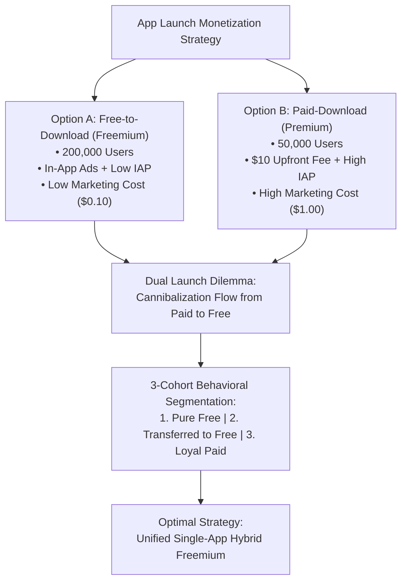
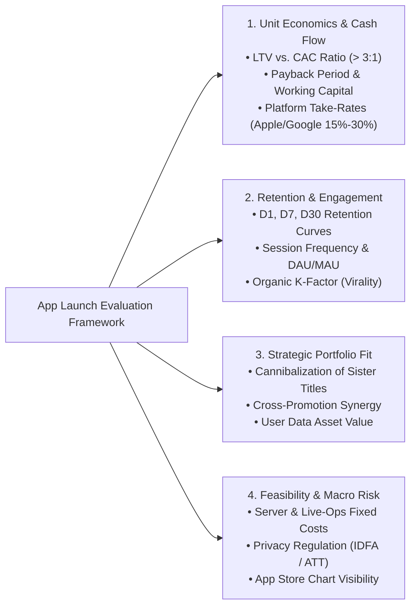
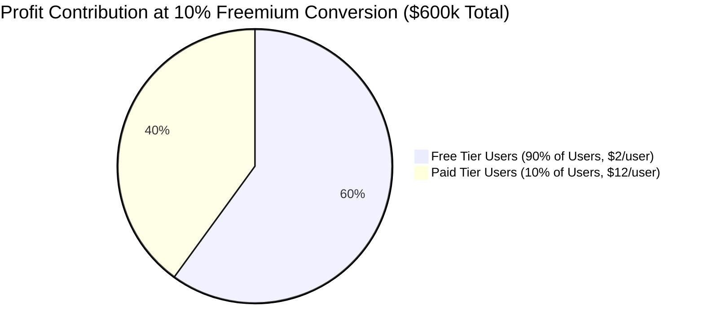
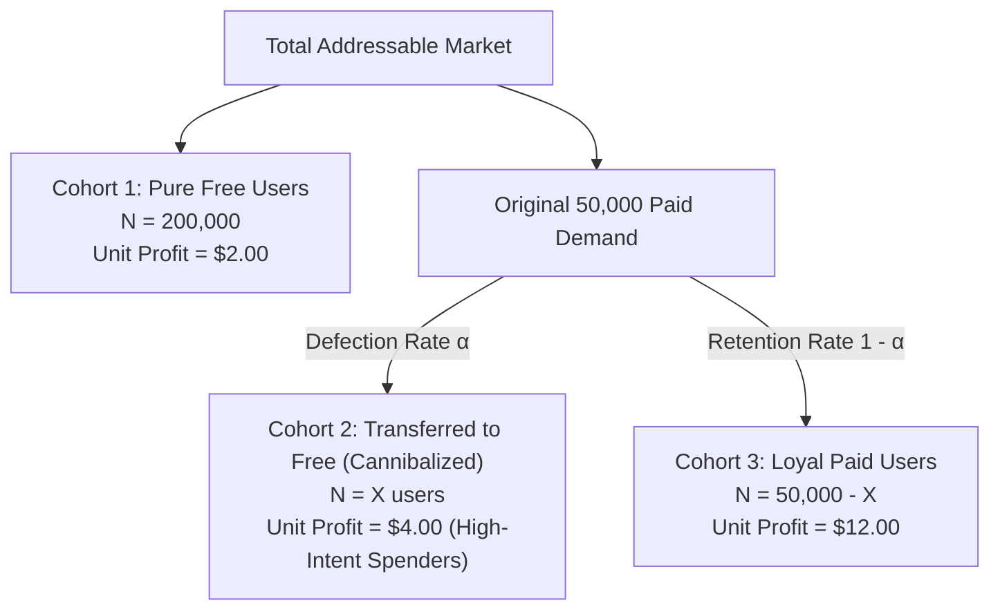
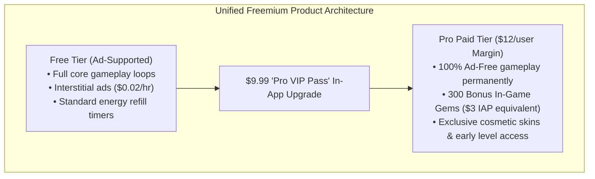

# Case 06: Mobile Gaming App: Free vs. Paid Monetization, Cannibalization & 3-Cohort Break-Even

> **Domain**: Product Economics, Pricing Strategy, Unit Economics, Cannibalization Modeling, Break-Even Analysis  
> **Target Roles**: Senior Business Manager, Business Analyst, Strategy Director, Product Strategy Manager  
> **Key Frameworks**: Freemium vs. Premium Unit Economics, Ad Yield vs. IAP Monetization, Cannibalization Flow Modeling, 3-Cohort Behavioral Segmentation, Unified Single-App Gating  

---

## 1. Executive Summary & Problem Overview

A mobile gaming studio has developed a new flagship title and faces a critical commercial decision: **Should the game be launched as a Free-to-Download app (monetized via in-app ads and microtransactions) or as a Paid-Download app (upfront purchase price)?**

This case study is a classic quantitative problem frequently asked in **Capital One Business Analyst / Senior Business Manager (SBM)** and top-tier tech product strategy interviews. It tests:

1. **End-to-End Evaluation Framework**: Assessing launch viability beyond simple revenue and cost.
2. **P&L Profitability Modeling**: Calculating unit economics across downloads, in-app purchases (IAP), ad yield, and customer acquisition cost (CAC).
3. **Cannibalization Analysis**: Quantifying what happens when free and paid options coexist in the same market.
4. **Break-Even Conversion Modeling**: Deriving the exact percentage of paid conversions required to maintain target profitability.
5. **The 3-Cohort Behavioral Segmentation**: Modeling the complex dynamics of *Pure Free*, *Transferred to Free*, and *Loyal Paid* cohorts.
6. **Strategic Product Recommendations**: Designing a unified freemium model with feature gating to eliminate cannibalization and maximize total P&L.

---

## 2. Baseline Market & Unit Economics Data

The studio conducted extensive soft-launch testing and marketing surveys across both distribution models. The empirical data is summarized below:

| Economic Metric | Free-to-Download Version | Paid-Download Version | Notes & Behavioral Drivers |
| :--- | :--- | :--- | :--- |
| **Download Volume ($N$)** | **`200,000` users** | **`50,000` users** | Free download eliminates friction; Paid suffers `75%` volume drop. |
| **Upfront Download Fee ($P_{\text{dl}}$)** | **`$0.00`** | **`$10.00`** | Upfront paywall at App Store install. |
| **In-App Purchase (IAP) Price** | `$1.00 / txn` | `$1.00 / txn` | Standard microtransaction token price. |
| **IAP Frequency per User ($IAP$)** | **`1.0` purchase/user** | **`3.0` purchases/user** | Paying users have 3x higher willingness to spend on microtransactions. |
| **Lifetime Gameplay Time ($T$)** | **`55 hours`** | **`55 hours`** | Equal engagement across both cohorts over product lifecycle. |
| **In-App Ad Yield ($R_{\text{ad}}$)** | **`$0.02 / hour`** | **`$0.00 / hour`** | Paid app is completely ad-free; Free app serves interstitial/banner ads. |
| **Marketing CAC ($C_{\text{mkt}}$)** | **`$0.10 / user`** | **`$1.00 / user`** | Paid installs require high-intent targeted performance marketing (10x CAC). |

---

## 3. Question 1: Comprehensive App Launch Evaluation Framework

### Interviewer Prompt
> *"Beyond a basic revenue minus cost formula, what holistic factors should you consider when deciding whether an app is commercially viable and worth launching?"*

### Strong Candidate Response Framework

A top-tier strategy answer structures the decision into five pillars:

1. **Unit Economics & Financial Sustainability**:
   - **LTV to CAC Ratio**: Ensure $\text{LTV} / \text{CAC} \ge 3:1$.
   - **Payback Velocity**: Paid downloads generate upfront cash flow on Day 0; ad-driven free models have extended payback periods (`30–90 days`).
   - **Platform Commissions**: Both Apple App Store and Google Play take a `15%–30%` cut on download fees and IAPs, but `0%` on third-party in-app ad revenue.
2. **Engagement & Retention Mechanics**:
   - **Retention Decay**: Does gameplay sustain past Day 30? If players churn at hour 10 instead of hour 55, ad revenue drops by `82%`.
   - **Organic Virality (K-Factor)**: Free apps benefit from network effects, organic social sharing, and viral word-of-mouth ($K > 1$).
3. **App Store Distribution & Discoverability**:
   - The App Store algorithm heavily weights download velocity. Free apps can reach Top Free charts, generating millions of free organic impressions; paid apps face a steep discovery hurdle.
4. **Portfolio Cannibalization & Brand Synergy**:
   - Will this game drain players from existing portfolio titles?
   - Can this app serve as a top-of-funnel user acquisition feeder for higher-margin enterprise or subscription products?
5. **Operational & Regulatory Constraints**:
   - Ongoing Live-Ops and content generation costs.
   - Privacy tracking changes (Apple ATT, Google Privacy Sandbox) that degrade ad targeting and eCPMs.

---

## 4. Question 2: Baseline Standalone Profitability Comparison

### Interviewer Prompt
> *"Using the provided data, calculate the total revenue, total cost, and net profit for both the Free and Paid versions. Which version is more profitable as a standalone product?"*

### Mathematical Breakdown

#### 1. Free-to-Download Version Economics

- **User Base ($N_{\text{free}}$)**: `200,000` users.
- **Revenue Components**:

  - *Download Revenue*: $200,000 \times \$0.00 = \$0.00$.
  - *In-App Purchase (IAP) Revenue*:
    $$\text{IAP Rev} = 200,000\text{ users} \times 1\text{ purchase} \times \$1.00 = \$200,000$$
  - *In-App Advertising Revenue*:
    $$\text{Ad Rev} = 200,000\text{ users} \times 55\text{ hours} \times \$0.02/\text{hour} = \$220,000$$
    > **Ad Revenue per User**: $55\text{ hrs} \times \$0.02/\text{hr} = \mathbf{\$1.10 / user}$.
  - *Total Free Revenue*:
    $$\text{Rev}_{\text{free}} = \$0 + \$200,000 + \$220,000 = \mathbf{\$420,000} \quad (\mathbf{\$2.10 / user})$$

- **Cost Components**:

  - *Marketing Cost*: $200,000\text{ users} \times \$0.10/\text{user} = \mathbf{\$20,000}$.

- **Net Profit (Free Version)**:
  $$\Pi_{\text{free}} = \text{Revenue} - \text{Cost} = \$420,000 - \$20,000 = \mathbf{\$400,000} \quad (\mathbf{\$2.00 / user})$$

---

#### 2. Paid-Download Version Economics

- **User Base ($N_{\text{paid}}$)**: `50,000` users.
- **Revenue Components**:

  - *Download Revenue*:
    $$\text{Download Rev} = 50,000\text{ users} \times \$10.00 = \$500,000$$
  - *In-App Purchase (IAP) Revenue*:
    $$\text{IAP Rev} = 50,000\text{ users} \times 3\text{ purchases} \times \$1.00 = \$150,000$$
  - *In-App Advertising Revenue*:
    $$\text{Ad Rev} = 50,000\text{ users} \times 55\text{ hours} \times \$0.00/\text{hour} = \$0.00$$
  - *Total Paid Revenue*:
    $$\text{Rev}_{\text{paid}} = \$500,000 + \$150,000 + \$0 = \mathbf{\$650,000} \quad (\mathbf{\$13.00 / user})$$

- **Cost Components**:

  - *Marketing Cost*: $50,000\text{ users} \times \$1.00/\text{user} = \mathbf{\$50,000}$.

- **Net Profit (Paid Version)**:
  $$\Pi_{\text{paid}} = \text{Revenue} - \text{Cost} = \$650,000 - \$50,000 = \mathbf{\$600,000} \quad (\mathbf{\$12.00 / user})$$

---

### Standalone Comparison Summary

| Metric | Free Version | Paid Version | Delta (Paid vs. Free) |
| :--- | :--- | :--- | :--- |
| **Total Installs** | `200,000` | `50,000` | `-150,000` (`-75%`) |
| **Gross Revenue** | `$420,000` | `$650,000` | `+$230,000` (`+55%`) |
| **Total Marketing Cost** | `$20,000` | `$50,000` | `+$30,000` |
| **Total Net Profit** | **`$400,000`** | **`$600,000`** | **`+$200,000` (`+50%`)** |
| **Profit Margin per User** | **`$2.00 / user`** | **`$12.00 / user`** | **6x higher unit profit!** |

> **Strategic Takeaway**: The **Paid version is substantially more profitable standalone** (`$600k` vs. `$400k`). Even though the upfront paywall shrinks the total audience by `75%`, each paid user is **6x more lucrative** (`$12.00` vs. `$2.00` net margin).

---

## 5. Question 3 & 4: Simultaneous Launch, Cannibalization & The 10% Break-Even

### Interviewer Prompt
> *"Can we simply release both apps simultaneously to capture both audiences? What happens if they coexist? If we combine them into a single app, what percentage of users must convert to the paid tier to match our $600k profit benchmark?"*

### 1. Market Dynamics of Simultaneous Launch (Cannibalization)

Releasing two separate versions of the same title creates severe friction:

1. **Downside Cannibalization**: Price-sensitive gamers who would have paid `$10` will substitute into the free version. Every user who downgrades destroys **`$10.00` of net margin** (`$12.00` paid profit $\rightarrow$ `$2.00` free profit).
2. **App Store Ranking Dilution**: Splitting marketing spend across two App Store URLs fragments download velocity, depressing organic chart rankings for both.
3. **Consumer Frustration**: Paying `$10` for an app and seeing friends play the same game for free triggers negative App Store reviews.

---

### 2. Mathematical Proof: The 10% Conversion Threshold

Suppose the studio launches a **Single Freemium App** that reaches the full top-of-funnel reach of **`200,000` users**. 

- Let $p$ = the percentage of users who convert to the **Paid / Premium tier** (generating `$12.00` net profit).
- The remaining $(1 - p)$ users remain on the **Free tier** (generating `$2.00` net profit).
- To match the standalone Paid benchmark of **`$600,000`**:

$$200,000 \times \left[ p \times \$12.00 + (1 - p) \times \$2.00 \right] = \$600,000$$

Divide both sides by $200,000$:

$$12p + 2(1 - p) = 3$$
$$12p + 2 - 2p = 3$$
$$10p = 1 \implies \mathbf{p = 10\%}$$

#### Verification:
- **Paid Upgraders** ($10\% \times 200\text{k} = 20,000\text{ users}$): $20,000 \times \$12.00 = \mathbf{\$240,000}$.
- **Free Users** ($90\% \times 200\text{k} = 180,000\text{ users}$): $180,000 \times \$2.00 = \mathbf{\$360,000}$.
- **Total Combined Profit**:
  $$\Pi = \$240,000 + \$360,000 = \mathbf{\$600,000}$$

> **Key Takeaway**: If just **`10%`** of the 200,000 free audience converts to paid, the studio matches the `$600k` profit of the standalone paid app. **Any conversion rate above 10% generates pure upside beyond anything either standalone app could achieve!**

---

## 6. Question 5: The Advanced 3-Cohort Cannibalization Model

### Interviewer Prompt
> *"Now let's examine the hard problem. Suppose both apps are released in parallel, creating three distinct behavioral groups: (1) Pure Free Users, (2) Transferred Users who defected from Paid to Free, and (3) Loyal Paid Users who stay in Paid. Calculate the unit profit for each cohort, and determine the exact cannibalization break-even threshold."*

---

### Step 1: Unit Profit Breakdown Across the 3 Cohorts

#### Cohort 1: Pure Free Users (`Stay Free`)
- **Volume**: $N_1 = 200,000$.
- **Ad Revenue**: $55\text{ hrs} \times \$0.02 = \mathbf{\$1.10}$.
- **IAP Revenue**: $1\text{ txn} \times \$1.00 = \mathbf{\$1.00}$.
- **Marketing Cost**: $\mathbf{\$0.10}$.
- **Unit Profit**:
  $$\pi_1 = \$1.00 + \$1.10 - \$0.10 = \mathbf{\$2.00 / user}$$

#### Cohort 2: Transferred Users (`Defected from Paid to Free`)
- **Volume**: $X$ users (defectors from the 50,000 paid target).
- **Behavioral Nature**: These are **high-intent core gamers**. They refused to pay the `$10` download fee because a free option existed, but once inside the free game:
  - *Ad Revenue*: They play for 55 hours and watch ads $\rightarrow 55 \times \$0.02 = \mathbf{\$1.10}$.
  - *IAP Revenue*: They maintain their high-intent gaming habits and make **3 microtransactions** $\rightarrow 3 \times \$1.00 = \mathbf{\$3.00}$.
  - *Marketing Cost*: Organic / free acquisition $\rightarrow \mathbf{\$0.10}$.
- **Unit Profit (Transferred Cohort)**:
  $$\pi_2 = \$0.00\text{ (download)} + \$3.00\text{ (IAP)} + \$1.10\text{ (Ads)} - \$0.10\text{ (mkt)} = \mathbf{\$4.00 / user}$$
  > *Critical Insight*: A transferred user generates **`$4.00` profit**—twice as much as a regular free user (`$2.00`), but `$8.00` less than if they had paid upfront (`$12.00`).

#### Cohort 3: Loyal Paid Users (`Stay in Paid`)
- **Volume**: $N_3 = 50,000 - X$.
- **Unit Profit**:
  $$\pi_3 = \$10.00\text{ (download)} + \$3.00\text{ (IAP)} + \$0.00\text{ (Ads)} - \$1.00\text{ (mkt)} = \mathbf{\$12.00 / user}$$

---

### Step 2: Deriving the Cannibalization Break-Even Threshold

Let total dual-launch profit be $\Pi_{\text{Dual}}(X)$:

$$\Pi_{\text{Dual}}(X) = (200,000 \times \pi_1) + (X \times \pi_2) + ((50,000 - X) \times \pi_3)$$

Substitute unit profits ($\pi_1 = \$2.00$, $\pi_2 = \$4.00$, $\pi_3 = \$12.00$):

$$\Pi_{\text{Dual}}(X) = (200,000 \times \$2.00) + 4X + ((50,000 - X) \times \$12.00)$$
$$\Pi_{\text{Dual}}(X) = \$400,000 + 4X + \$600,000 - 12X$$
$$\Pi_{\text{Dual}}(X) = \mathbf{\$1,000,000 - 8X}$$

Where:
- **`$1,000,000`** = The theoretical maximum profit if there were zero cannibalization ($X = 0$).
- **`-$8.00`** = The net profit destroyed for every paid user who defects to free ($\$4.00 - \$12.00 = -\$8.00$).

---

### Step 3: Solving for Break-Even Against Standalone Paid Benchmark (`$600k`)

At what defection volume $X$ does the dual-launch strategy become worse than simply launching the Paid app alone (`$600,000`)?

$$\Pi_{\text{Dual}}(X) \ge \$600,000$$
$$\$1,000,000 - 8X \ge \$600,000$$
$$8X \le \$400,000 \implies X \le \mathbf{50,000\text{ users}}$$

As a percentage of the 50,000 paid user base:

$$\alpha = \frac{50,000}{50,000} = \mathbf{100\%}$$

#### 🔍 Critical Strategic Finding:
Because $X \le 50,000$ represents **100% of the paid user base**:
- Even in the absolute worst-case scenario where **100% of paid users defect to the free app** ($X = 50,000$):
  $$\Pi_{\text{worst-case}} = \$1,000,000 - 8(50,000) = \$1,000,000 - \$400,000 = \mathbf{\$600,000}$$
- **Releasing both products will NEVER make less than the standalone Paid app ($600k)!**
- The high-intent spend of transferred users (`$4.00/user`) combined with baseline free profit (`$400k`) creates a guaranteed floor at `$600,000`.

---

### Sensitivity Analysis: What if Transferred Users Degrade to Standard Free Users?

If transferred users become stingy and only spend like regular free users ($\pi_2 = \$2.00$ instead of `$4.00`):

$$\Pi(X) = \$400,000 + 2X + \$600,000 - 12X = \$1,000,000 - 10X$$
$$\$1,000,000 - 10X \ge \$600,000 \implies 10X \le \$400,000 \implies X \le \mathbf{40,000\text{ users}} \quad (\mathbf{80\%})$$

Under full behavioral degradation, the studio can tolerate up to **`80%` cannibalization** (`40,000` users) before dual launch underperforms standalone paid.

---

### Master 3-Cohort Summary Matrix

| Metric | Cohort 1: Pure Free | Cohort 2: Transferred to Free | Cohort 3: Loyal Paid | Total Portfolio (At 50% Cannibalization: X = 25k) |
| :--- | :--- | :--- | :--- | :--- |
| **User Count** | `200,000` | `25,000` | `25,000` | **`250,000`** |
| **Download Revenue** | `$0` | `$0` | `$250,000` | `$250,000` |
| **IAP Revenue** | `$200,000` | `$75,000` | `$75,000` | `$350,000` |
| **Ad Revenue** | `$220,000` | `$27,500` | `$0` | `$247,500` |
| **Marketing Cost** | `$20,000` | `$2,500` | `$25,000` | `$47,500` |
| **Unit Net Profit** | **`$2.00`** | **`$4.00`** | **`$12.00`** | **—** |
| **Total Cohort Profit** | **`$400,000`** | **`$100,000`** | **`$300,000`** | **`$800,000` (+33% over Paid!)** |

---

## 7. Question 6: Strategic Recommendations to Maximize Profit

### 1. Reject Dual App Store Listings; Deploy a Unified "Hybrid Freemium" Architecture

Launching two separate app listings is an operational anti-pattern:

- **Solution**: Publish **one single Free-to-Download app** on the App Store to maximize top-of-funnel reach (`200,000+` downloads) and secure #1 rankings on the Top Free charts.
- **In-App Monetization**: Offer an in-app upgrade: **"Ad-Free Pro Pass" for `$9.99`**.

---

### 2. Feature Gating & Value Architecture

To convert the required `10%+` of users into paid spenders without angering free players, create sharp product differentiation:

1. **Permanently Remove All Ads**: Solves the biggest player pain point while preserving the `$10` revenue equivalent.
2. **Bundle Immediate Value**: Include `$3.00` worth of in-game items (the exact historical IAP spend of paid users) to make the `$9.99` price point feel like an immediate 2x bargain.
3. **Early Access & VIP Badges**: Social proof drives conversion in competitive games.

---

### 3. Monetize the "Middle 90%" with Rewarded Video Ads

Traditional banner and interstitial ads underperform in engagement:

- **Opt-In Rewarded Ads**: Introduce rewarded video placements (*"Watch a 30-second video to revive without losing progress"* or *"Double your match rewards"*).
- **Substantial eCPM Lift**: Rewarded video ads command industry eCPMs of **`$25–$45`** (equivalent to **`$0.05–$0.08 / hour`**), lifting the baseline profit of the 180k free users from `$400k` to over **`$600k`** on ad revenue alone!

---

### 4. Dynamic Pricing & Elasticity Testing

Optimize monetization across diverse geographies:

- **Price Elasticity Testing**: Run localized A/B price elasticity tests on the Pro Pass (`$4.99` vs. `$9.99` vs. `$14.99`).
- **Emerging Market Expansion**: In developing markets with low credit card penetration, a `$4.99` price point can increase conversion from `10%` to `25%`, expanding total gross margin.
