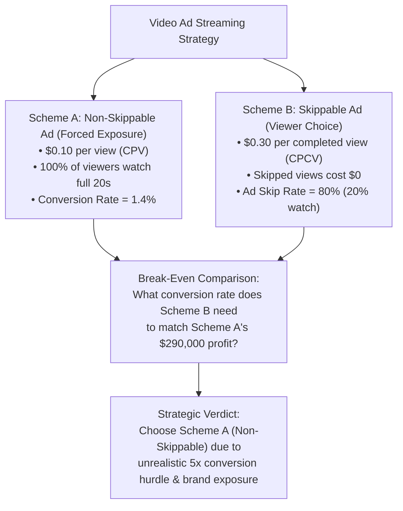
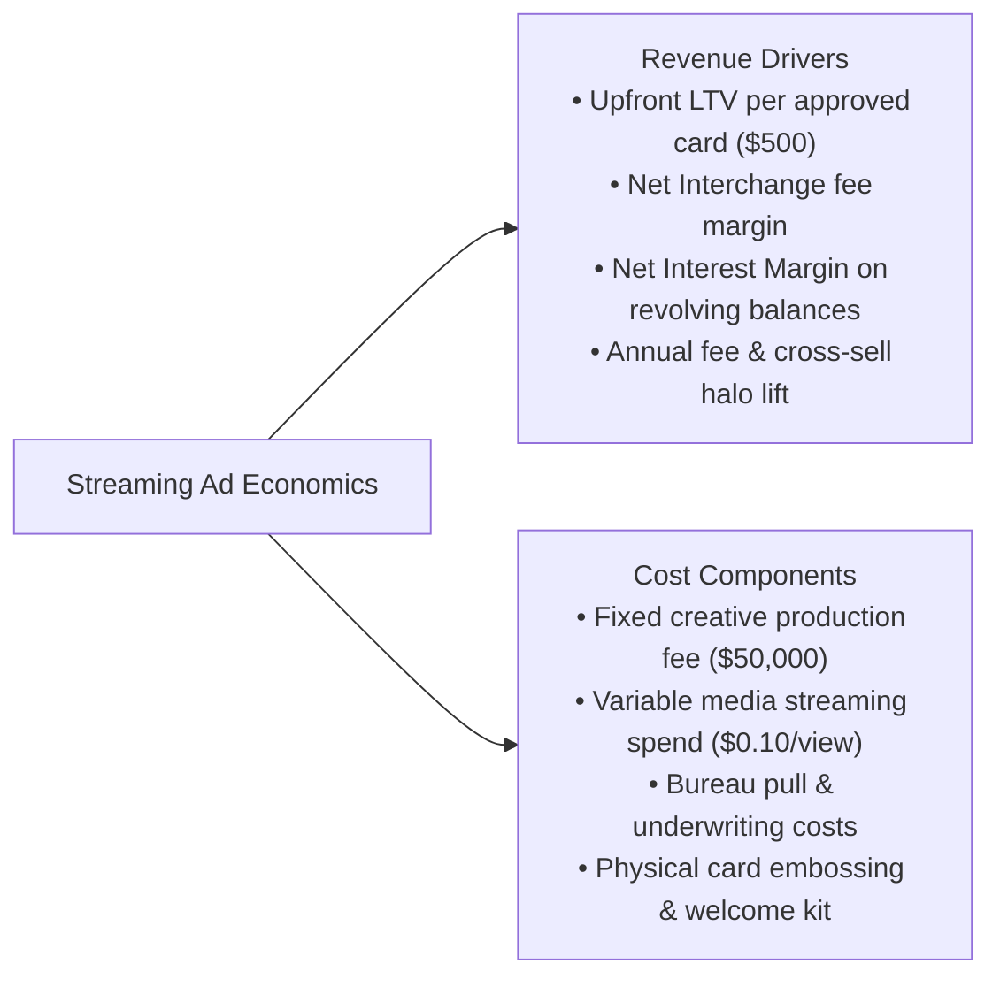
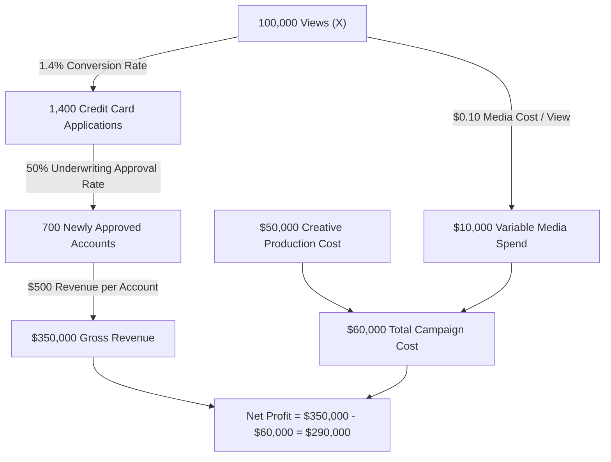
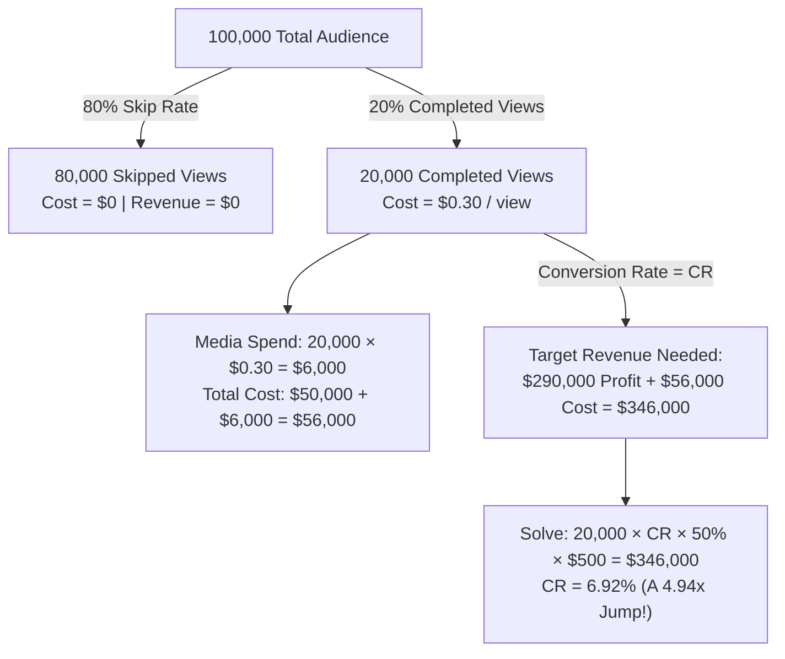
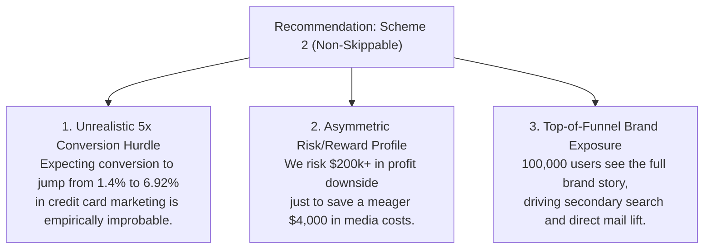

# Case 07: Video Ad Streaming Campaign: Skippable vs. Non-Skippable Economics & Conversion Break-Even

> **Domain**: Growth Marketing Analytics, Customer Acquisition Cost (CAC), Funnel Optimization, Media Bidding  
> **Target Roles**: Senior Business Manager, Business Analyst, Marketing Strategy Lead, Growth Product Manager  
> **Key Frameworks**: Non-Skippable vs. Skippable (CPV vs. CPCV) Bidding, Acquisition Funnel Math, Break-Even Conversion Threshold, The Mere Exposure Effect  

---

## 1. Executive Summary & Problem Overview

As a Business Analyst / Senior Business Manager at Capital One, you are evaluating marketing efficiency for a newly launched flagship credit card. The growth marketing team is producing a **20-second video advertisement** to be deployed across major connected TV and video streaming platforms (e.g., Hulu, Peacock, YouTube).

The team must evaluate two distribution structures:

This case study is an authentic Capital One quantitative interview problem testing:

1. **Revenue & Cost Taxonomy**: Identifying direct unit economics versus secondary brand/halo effects.
2. **Funnel Conversion Modeling**: Calculating end-to-end profit across impressions, applications, approvals, and cardholder LTV.
3. **Skippable Ad Pricing Mechanics**: Modeling cost per completed view (CPCV) under an 80% skip rate.
4. **Break-Even Threshold Solving**: Deriving the exact conversion rate needed to match baseline profitability.
5. **Strategic Decision-Making**: Evaluating empirical feasibility, asymmetric risk, and the psychological impact of forced exposure.

---

## 2. Question 1: Comprehensive Revenue and Cost Taxonomy

### Interviewer Prompt
> *"As a Capital One Analyst evaluating this 20-second streaming ad campaign, what are all the potential revenue drivers and cost components you should consider?"*

### Candidate Response Framework

A top-tier financial analyst structures the taxonomy into direct transaction unit economics and indirect portfolio effects:

#### 1. Revenue Drivers

- **Direct Cardholder Lifetime Value (LTV)**: Newly acquired approved cardholders generate recurring financial value:

  - *Net Interchange Revenue*: Merchant discount rate cut minus network assessment fees and customer cashback/rewards.
  - *Net Interest Margin (NIM)*: Interest earned on revolving credit card balances minus the bank's cost of funds.
  - *Annual & Ancillary Fees*: Annual membership fees, balance transfer fees, foreign transaction fees, and late fees.
  - *Standard Model Assumption*: In this case, direct net present value is modeled as a lump-sum **`$500` per approved account**.

- **Indirect / Brand Halo Value**:

  - *Brand Recall & Top-of-Funnel Lift*: Viewers exposed to the streaming ad are more likely to convert later via direct mail or organic search.
  - *Cross-Sell Synergies*: New credit card holders opening high-yield savings (HYSA) or auto loans with Capital One.

#### 2. Cost Drivers

- **Fixed Production Costs**:

  - Scriptwriting, talent acquisition, agency fees, and video post-production editing (**`$50,000`**).

- **Variable Media Distribution Costs**:

  - Streaming ad insertion fees: Cost Per Mille (CPM) or Cost Per View (CPV) paid to streaming networks.

- **Underwriting & Onboarding Fulfillment Costs**:

  - Credit bureau pull fees (hard inquiry fees paid to Experian, TransUnion, Equifax).
  - Know-Your-Customer (KYC) and fraud screening.
  - Physical card manufacturing (metal/plastic embossing), welcome packet printing, and postal delivery.

---

## 3. Question 2: Baseline Profitability (Non-Skippable Ad)

### Interviewer Prompt
> *"Assume the creative production cost is $50,000, and media cost is $0.10 per view. Each newly opened account yields $500 in revenue. The application conversion rate (applications / views) is 1.4%, and the approval rate (approvals / applications) is 50%. Express profit as a function of total views X. What is the net profit if X = 100,000 views?"*

### Mathematical Derivation

#### 1. General Profit Formulation

Let $X$ equal the number of viewers who watch the advertisement:

- **Gross Revenue Function**:

  $$\text{Applications}(X) = X \times 1.4\%$$
  $$\text{Approved Accounts}(X) = X \times 1.4\% \times 50\% = 0.007 X$$
  $$\text{Revenue}(X) = 0.007 X \times \$500 = \mathbf{\$3.50 X}$$

  > *Every single view generates an expected revenue of **`$3.50`**.*

- **Total Cost Function**:

  $$\text{Cost}(X) = \text{Fixed Production} + \text{Variable Media Spend}$$
  $$\text{Cost}(X) = \mathbf{\$50,000 + \$0.10 X}$$

- **Net Profit Function**:

  $$\Pi(X) = \text{Revenue}(X) - \text{Cost}(X)$$
  $$\Pi(X) = \$3.50 X - (\$50,000 + \$0.10 X) = \mathbf{\$3.40 X - \$50,000}$$

---

#### 2. Evaluating for $X = 100,000$ Views

Substitute $X = 100,000$ into the profit function:

- **Revenue**:

  $$\text{Revenue} = 100,000 \times 1.4\% \times 50\% \times \$500$$
  $$\text{Revenue} = 1,400\text{ apps} \times 50\% \times \$500 = 700\text{ accounts} \times \$500 = \mathbf{\$350,000}$$

- **Cost**:

  $$\text{Cost} = \$50,000 + (100,000 \times \$0.10) = \$50,000 + \$10,000 = \mathbf{\$60,000}$$

- **Net Profit**:

  $$\Pi = \$350,000 - \$60,000 = \mathbf{\$290,000}$$

---

## 4. Question 3: Skippable Ad Mechanics & Break-Even Conversion Rate

### Interviewer Prompt
> *"Now suppose the streaming platform offers skippable ads. If a user skips the ad, Capital One pays $0. However, if the user watches the ad without skipping, Capital One pays $0.30 per completed view. The historical ad skip rate is 80%. All other conditions (audience of 100,000, fixed cost of $50,000, 50% approval rate, $500 revenue) remain unchanged. What application conversion rate among completed viewers is required to achieve the exact same $290,000 profit?"*

### Mathematical Formulation

#### 1. Calculating Total Cost under Skippable Bidding

With an audience of `100,000` users and an `80%` skip rate:

- **Completed Viewers**: $100,000 \times (1 - 80\%) = 20,000\text{ users}$.
- **Skipped Viewers**: $100,000 \times 80\% = 80,000\text{ users}$ (Billed at `$0.00`).
- **Variable Media Spend**: $20,000\text{ completed views} \times \$0.30 = \mathbf{\$6,000}$.
- **Total Campaign Cost**:

  $$\text{Cost}_{\text{skippable}} = \$50,000\text{ (fixed)} + \$6,000\text{ (media)} = \mathbf{\$56,000}$$

  > *Notice that media spend fell from `$10,000` to `$6,000`, reducing total costs by **`$4,000`**.*

---

#### 2. Solving for the Required Conversion Rate ($CR$)

Let $CR$ be the application conversion rate among the `20,000` users who watch the full ad:

- **Expected Approved Accounts**:

  $$\text{Accounts} = 20,000 \times CR \times 50\% = 10,000 \times CR$$

- **Gross Revenue**:

  $$\text{Revenue} = (10,000 \times CR) \times \$500 = \mathbf{\$5,000,000 \times CR}$$

- **Target Profit Constraint**:

  $$\Pi = \text{Revenue} - \text{Cost} = \$290,000$$
  $$\$5,000,000 \times CR - \$56,000 = \$290,000$$
  $$\$5,000,000 \times CR = \$346,000$$
  $$CR = \frac{\$346,000}{\$5,000,000} = 0.0692 = \mathbf{6.92\%}$$

---

### Comparative Funnel Breakdown

| Funnel Stage | Scheme 2: Non-Skippable Ad | Scheme 3: Skippable Ad (Break-Even) |
| :--- | :--- | :--- |
| **Total Exposed Audience** | `100,000` users | `100,000` users |
| **Completed Video Views** | **`100,000` (100%)** | **`20,000` (20%)** |
| **Cost per Completed View** | **`$0.10`** | **`$0.30`** |
| **Total Media Spend** | `$10,000` | `$6,000` |
| **Fixed Creative Cost** | `$50,000` | `$50,000` |
| **Total Campaign Cost** | **`$60,000`** | **`$56,000`** (`-$4,000` savings) |
| **Required Conversion Rate** | **`1.40%`** | **`6.92%` (4.94x higher!)** |
| **Total Applications** | `1,400` | `1,384` |
| **Approved Accounts (50%)** | `700` | `692` |
| **Gross Revenue** | **`$350,000`** | **`$346,000`** |
| **Net Campaign Profit** | **`$290,000`** | **`$290,000`** |

---

## 5. Question 4: Strategic Recommendation & Analytical Decision

### Interviewer Prompt
> *"Between Scheme 2 (Non-Skippable) and Scheme 3 (Skippable), which advertising option should Capital One choose, and why?"*

### Executive Recommendation: Choose Scheme 2 (Non-Skippable)

A Senior Business Manager should decisively recommend **Scheme 2 (Non-Skippable)** based on three strategic and mathematical pillars:

#### 1. The 5x Conversion Hurdle is Empirically Improbable

To match the `$290,000` profit, the conversion rate among completed viewers must surge from **`1.40%` to `6.92%`**—an increase of **`+394%` (nearly 5x)**:

- While completed viewers exhibit higher intent than skippers, credit card applications require entering sensitive personal financial information (SSN, income, housing costs).
- Moving cold video streaming traffic to a `6.92%` financial application conversion rate on a 20-second video is virtually unheard of in consumer lending benchmarks (industry average sits between `1%` and `2.5%`).

#### 2. Severe Asymmetric Risk for a Trivial $4,000 Cost Savings

The downside risk of Scheme 3 vastly outweighs its upside:

- **The Upside**: Scheme 3 saves only **`$4,000`** in total media spend (`$56,000` vs. `$60,000`).
- **The Downside**: If completed viewers convert at an optimistic `2.5%` (nearly double baseline):

  $$\text{Revenue} = 20,000 \times 2.5\% \times 50\% \times \$500 = \$125,000$$
  $$\Pi_{\text{skippable}} = \$125,000 - \$56,000 = \mathbf{\$69,000}$$

  > *Profit collapses by **`$221,000`** (from `$290,000` down to `$69,000`) just to chase `$4,000` in cost savings!*

#### 3. Full-Funnel Brand Recall and The "Mere Exposure Effect"

In financial services marketing, brand awareness drives future conversion:

- Under **Scheme 2**, `100,000` consumers are guaranteed to see the entire 20-second creative. Even if they do not click immediately on their smart TV, they are primed for future touchpoints (Capital One pre-approved mailers, airport lounge billboards, search ads).
- Under **Scheme 3**, `80,000` consumers hit "Skip" at second 5, completely missing the card's value proposition, reward multipliers, and call to action.
