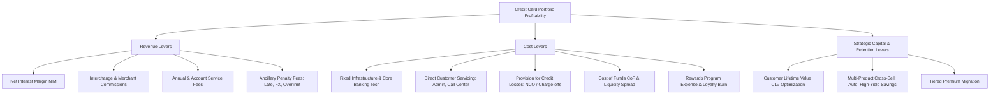
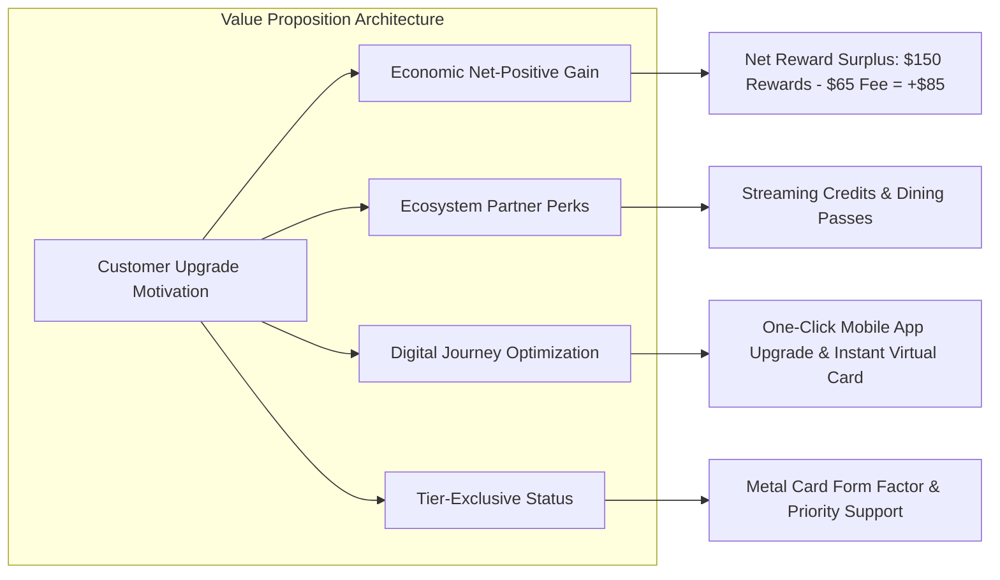
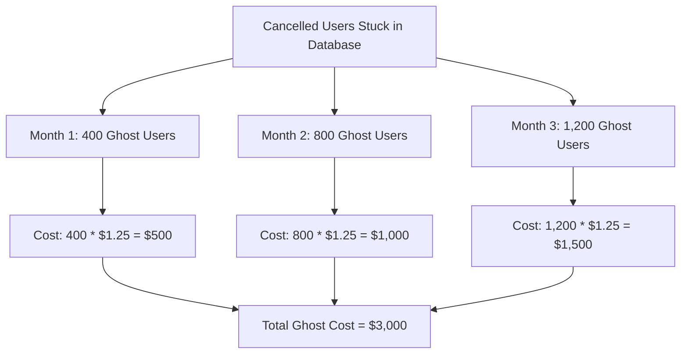

# Case 08: Capital One Credit Card P&L Turnaround, Premium Tier Segmentation, and Database Outage Analysis

## Executive Summary

This business strategy case models a retail bank credit card portfolio management turnaround. It evaluates portfolio unit economics, tiered product segmentation, break-even customer migration dynamics, and a quantitative incident root-cause analysis involving database desynchronization.

The case spans five core interview stages:

1. **Strategic Profitability Framework**: Identifying balance sheet, income statement, and operational levers to reverse portfolio losses.
2. **Baseline P&L Financial Modeling**: Quantifying baseline annual financial performance on a customer base of `2M` accounts with fixed infrastructure overhead.
3. **Product Tiering & Break-Even Modeling**: Formulating the mathematical conditions required to split the portfolio into `Regular` and `Premium` tiers to achieve overall operational break-even.
4. **Behavioral Economics & Product Marketing**: Designing upgrade mechanisms, value proposition architectures, and friction-reducing adoption channels.
5. **Data Incident Quantitative Impact Analysis**: Modeling cumulative cohort revenue leakage and unnecessary operational costs resulting from a three-month database synchronization outage.

---

## Part 1: Strategic Profitability Framework

### Core Question

> The company's primary corporate objective is to increase portfolio profitability. What dimensions, financial levers, and operational drivers should be considered?

### Strategic Framework

A structured credit card portfolio P&L decomposes into three fundamental pillars: Revenue Drivers, Cost Drivers, and Capital / Risk Adjustments.

### Analytical Breakdown

#### 1. Revenue Drivers (Gross Margin Expansion)

To evaluate top-line revenue expansion, analysts assess four primary streams:

1. **Interchange & Merchant Discount Fees**: Commission percentage earned on gross purchase volume (GMV). Driven by transaction count, average basket size, merchant tier mix (commercial vs. everyday spend), and payment rails.
2. **Net Interest Margin (NIM)**: Spread between interest yields earned on revolving balances and the bank's internal cost of funds. Optimizing the proportion of "transactors" (revolving `$0`, paying no interest) vs. "revolvers" (carrying balances at standard APR).
3. **Annual & Membership Fees**: Recurring subscription revenue providing stable, non-cyclical cash flows independent of monthly cardholder transaction volume.
4. **Ancillary Fee Optimization**: Foreign transaction fees (`2%` - `3%`), late payment penalties, cash advance charges, and balance transfer origination fees.

#### 2. Cost Drivers (Efficiency & Loss Mitigation)

Card operations incur both scale-dependent variable costs and fixed tech platform expenses:

1. **Credit Risk & Net Charge-Offs (NCO)**: Bad debt write-offs net of recoveries. Underwriting policy dictates risk-adjusted margins across prime, near-prime, and subprime segments.
2. **Rewards & Loyalty Redemption Liability**: The effective unit cost of cashback, points, air miles, or merchant partner discount vouchers funded by the issuer.
3. **Cost of Funds (CoF)**: Federal funds benchmark rate plus deposit beta; funding liquidity needed to float open receivables during statement grace periods.
4. **Variable Servicing & Account Administration**: Per-account core banking ledger maintenance, statement generation, compliance audits, dispute processing, and customer support.
5. **Fixed IT & Platform Overhead**: Data warehouse infrastructure, fraud detection engine hosting, regulatory capital buffers, and corporate SG&A.

---

## Part 2: Current Baseline Financial Modeling

### Scenario Parameters

The bank currently operates a single monolithic credit card tier with the following audited metrics:

* Total Active Customers: `2,000,000` (`2M`)
* Annual Membership Fee: `$50` per customer per year
* Average Spend per Customer: `$500` per month
* Merchant Interchange Commission: `1.0%` on gross spending volume
* Fixed Annual Platform Overhead: `$250,000,000` (`$250M`) per year
* Variable Servicing Cost: `$5` per customer per year

### Financial Calculation

#### Revenue Schedule

Gross annual spend per customer:

$$\text{Annual Spend per Customer} = \$500 \times 12 = \$6,000$$

Annual interchange commission earned per customer:

$$\text{Commission per Customer} = 1.0\% \times \$6,000 = \$60$$

Total annual revenue per customer:

$$\text{Revenue per Customer} = \$50 + \$60 = \$110$$

Portfolio total gross revenue across `2M` cardholders:

$$\text{Annual Fee Revenue} = 2,000,000 \times \$50 = \$100,000,000 \quad (\$100\text{M})$$

$$\text{Interchange Commission Revenue} = 2,000,000 \times \$60 = \$120,000,000 \quad (\$120\text{M})$$

$$\text{Total Portfolio Revenue} = \$100\text{M} + \$120\text{M} = \mathbf{\$220,000,000} \quad (\mathbf{\$220M})$$

#### Cost Schedule

Fixed platform maintenance expense:

$$\text{Fixed Operating Expense} = \mathbf{\$250,000,000} \quad (\mathbf{\$250M})$$

Total variable servicing costs:

$$\text{Variable Cost} = 2,000,000 \times \$5 = \mathbf{\$10,000,000} \quad (\mathbf{\$10M})$$

Total operating expenses:

$$\text{Total Portfolio Cost} = \$250\text{M} + \$10\text{M} = \mathbf{\$260,000,000} \quad (\mathbf{\$260M})$$

#### Baseline Net Profit

$$\text{Current Net Profit} = \text{Total Revenue} - \text{Total Cost} = \$220\text{M} - \$260\text{M} = \mathbf{-\$40,000,000} \quad (\mathbf{-\$40M})$$

### Baseline Financial Summary

| P&L Item | Per Customer / Yr | Portfolio Total (`2M` Customers) |
| :--- | :--- | :--- |
| **Annual Membership Fee** | `$50.00` | `$100,000,000` |
| **Interchange Commission (`1%`)** | `$60.00` | `$120,000,000` |
| **Gross Total Revenue** | **`$110.00`** | **`$220,000,000`** |
| **Fixed Platform Maintenance** | N/A (Fixed) | `$250,000,000` |
| **Variable Servicing Cost** | `$5.00` | `$10,000,000` |
| **Total Operating Cost** | **`$130.00` (Blended)** | **`$260,000,000`** |
| **Net Operating Income (EBIT)** | **`-$20.00`** | **`-$40,000,000` (Deficit)** |

> [!CAUTION]
> **Deficit Alert**: The portfolio is losing `$20` per customer annually, generating an aggregate operational deficit of `-$40M`. Maintaining status-quo economics will compound corporate capital depletion.

---

## Part 3: Premium Tier Segmentation & Break-Even Analysis

### Program Restructuring Parameters

Management intends to bifurcate the existing homogeneous customer pool into two distinct tiers: **Regular** and **Premium**. The total customer count remains capped at `2,000,000`.

* **Regular Plan**:
    * Terms identical to baseline: `$50` annual fee, `$500/month` spend, `1%` commission, `$5/year` variable cost, `$0` additional admin cost.
* **Premium Plan**:
    * Annual Membership Fee: `$65` per year (+$15 increase)
    * Average Spend: `$625` per month (`$7,500` per year, +25% volume expansion)
    * Merchant Interchange Commission: `2.0%` on gross spending volume
    * Variable Account Servicing Cost: `$15` per year
    * Additional Core Banking Administration Cost: `$1.25` per month (`$15` per year)

### Unit Contribution Margin Analysis

Contribution Margin ($CM$) measures revenue generated per customer above variable costs available to offset the `$250M` fixed corporate platform overhead.

#### Regular Tier Contribution Margin

$$\text{Revenue}_{\text{reg}} = \$50 + (1.0\% \times \$500 \times 12) = \$50 + \$60 = \$110$$

$$\text{Direct Cost}_{\text{reg}} = \$5$$

$$CM_{\text{reg}} = \$110 - \$5 = \mathbf{\$105 \text{ per customer / year}}$$

#### Premium Tier Contribution Margin

Gross annual spend:

$$\text{Annual Spend}_{\text{prem}} = \$625 \times 12 = \$7,500$$

Annual commission earned:

$$\text{Commission}_{\text{prem}} = 2.0\% \times \$7,500 = \$150$$

Total revenue:

$$\text{Revenue}_{\text{prem}} = \$65 + \$150 = \$215$$

Direct costs (variable servicing + monthly admin fee):

$$\text{Direct Cost}_{\text{prem}} = \$15 + (\$1.25 \times 12) = \$15 + \$15 = \$30$$

$$CM_{\text{prem}} = \$215 - \$30 = \mathbf{\$185 \text{ per customer / year}}$$

#### Incremental Contribution Margin per Upgraded Account

$$\Delta CM = CM_{\text{prem}} - CM_{\text{reg}} = \$185 - \$105 = \mathbf{+\$80 \text{ per customer / year}}$$

### Mathematical Break-Even Derivation

Let $N = 2,000,000$ be total customers, $P$ be the number of Premium tier customers, and $R = N - P$ be the number of Regular tier customers.

Overall corporate break-even occurs when total aggregate contribution margin equals the fixed platform overhead of `$250,000,000`:

$$(R \times CM_{\text{reg}}) + (P \times CM_{\text{prem}}) = \text{Fixed Overhead}$$

$$((2,000,000 - P) \times 105) + (P \times 185) = 250,000,000$$

$$210,000,000 - 105P + 185P = 250,000,000$$

$$80P = 250,000,000 - 210,000,000$$

$$80P = 40,000,000$$

$$P = \frac{40,000,000}{80} = \mathbf{500,000}$$

$$R = 2,000,000 - 500,000 = \mathbf{1,500,000}$$

### Verification of Break-Even

$$\text{Regular Contribution} = 1,500,000 \times \$105 = \$157,500,000$$

$$\text{Premium Contribution} = 500,000 \times \$185 = \$92,500,000$$

$$\text{Total Contribution Margin} = \$157,500,000 + \$92,500,000 = \mathbf{\$250,000,000}$$

$$\text{Net Operating Income} = \$250,000,000 - \$250,000,000 = \mathbf{\$0.00} \quad (\text{Break-Even Confirmed})$$

> [!NOTE]
> **Portfolio Composition Requirement**: The bank must convert exactly **`25.0%` (`500,000` users)** of its existing customer base to the Premium tier, while retaining `75.0%` (`1,500,000` users) on Regular, to completely erase the `-$40M` operational deficit.

---

## Part 4: Marketing & Behavioral Product Architecture

### Brainstorming Challenge

> How can Capital One incentivize existing cardholders to voluntarily upgrade to the Premium plan and maintain sustained high utilization?

### Strategic Incentive Pillars

#### 1. Economic Value Demonstration (The Math for the Consumer)

Consumers will upgrade if the perceived monetary gain exceeds the incremental `$15` annual fee increase (`$65` vs. `$50`):

1. **Reward Return Math**: On `$625/month` (`$7,500/year`) spend, `2.0%` cashback yields `$150` in customer rewards, compared to `$75` under a `1.0%` program.
2. **Net Positive Surplus**: Incremental cashback earned ($+\$75$) vastly exceeds the incremental annual fee ($+\$15$), generating a **net consumer dividend of `$60/year`**.
3. **Spend Break-Even Calculator**: In-app calculators showing users: *"If you spend more than `$125/month`, the Premium plan pays for its own fee upgrade entirely."*

#### 2. Ecosystem Partnerships & Category Multipliers

1. **Lifestyle Statement Credits**: Partner with streaming platforms, ride-share services, or grocery delivery (e.g., `$5/month` Uber or DoorDash credits) to create perceived value exceeding `$60/year` at near-zero wholesale acquisition cost to the bank.
2. **Accelerated Category Boosts**: Offer `3%` - `5%` on selected high-frequency spend categories (dining, travel, gas) while maintaining `2%` flat across all non-category spend.

#### 3. Frictionless Product Onboarding & Physical Prestige

1. **Zero-Friction In-App Upgrades**: Eliminate full underwriting re-checks. Pre-screen existing active Regular users in good standing for instant 1-click upgrades without a hard credit pull.
2. **Immediate Virtual Card Issuance**: Push the activated Premium card immediately into Apple Wallet / Google Pay, enabling instant higher-rate transactions before physical delivery.
3. **Card Form Factor**: Issue a sleek weighted metal card (e.g., stainless steel composite), triggering social proof and status gratification.

---

## Part 5: Database Synchronization Outage Root-Cause Analysis

### Incident Scenario

A critical production database synchronization failure persisted for three consecutive months (Months 1 through 3):

* **System Architecture Constraint**: All Premium users must be active in the central relational database to receive system authorization for the `2.0%` merchant interchange commission rate. Without database record synchronization, the processing engine defaults to the standard `1.0%` regular commission rate.
* **Cost Accounting Rule**: Unregistered accounts bypass the `$1.25/month` third-party core administration cost.
* **Failure Dynamics (Months 1–3)**:
    1. **Cohort A (Cancelled Premium Accounts)**: `400` cardholders canceled their Premium plan each month, but their database records **were not purged**. They remained registered.
    2. **Cohort B (New Premium Accounts)**: `2,000` new customers joined the Premium tier each month, but **failed to register in the database**.

### Quantitative Financial Decomposition

#### Unit Economic Rules

* **In Database**:
    * Interchange Commission Rate = `2.0%` on `$625` monthly spend = `+$12.50 / month`
    * Administration Cost = `-$1.25 / month`
    * Net Monthly Benefit to Bank = $\$12.50 - \$1.25 = \mathbf{+\$11.25 / month}$
* **Out of Database (Failed Registration)**:
    * Interchange Commission Rate = `1.0%` on `$625` monthly spend = `+$6.25 / month`
    * Administration Cost = `-$0.00 / month` (saved)
    * Net Monthly Benefit to Bank = $\$6.25 - \$0 = \mathbf{+\$6.25 / month}$
* **Delta Loss per Unregistered Active Premium User**:
    * Revenue Lost: $\$12.50 - \$6.25 = -\$6.25 / \text{month}$
    * Cost Saved: $+\$1.25 / \text{month}$
    * **Net Loss per Account**: $-\$6.25 + \$1.25 = \mathbf{-\$5.00 / \text{month}}$

---

### Cohort A: Ghost Cancelled Accounts (Not Purged)

These customers canceled their accounts. Consequently, their monthly card spend drops to `$0`, generating **`$0.00` interchange commission**.

However, because their records remained stuck in the active database, the bank was billed the monthly administrative fee of **`$1.25` per ghost record**.

#### Monthly Cumulative Loss Breakdown

* **Month 1**: `400` active ghost records $\times \$1.25 = \mathbf{\$500}$
* **Month 2**: `800` active ghost records ($400 + 400$) $\times \$1.25 = \mathbf{\$1,000}$
* **Month 3**: `1,200` active ghost records ($400 \times 3$) $\times \$1.25 = \mathbf{\$1,500}$

$$\text{Total Cohort A Overhead Loss} = \$500 + \$1,000 + \$1,500 = \mathbf{-\$3,000}$$

---

### Cohort B: New Premium Accounts (Unregistered)

Each month, `2,000` genuine premium cardholders spent `$625`, but settled at `1.0%` instead of `2.0%` while avoiding the `$1.25` monthly admin charge.

The net opportunity loss per user per month is:

$$\text{Net Loss} = (1\% - 2\%) \times \$625 + \$1.25 = -\$6.25 + \$1.25 = \mathbf{-\$5.00 \text{ per user / month}}$$

#### Monthly Cumulative Loss Breakdown

* **Month 1**: `2,000` unregistered users $\times (-\$5.00) = \mathbf{-\$10,000}$
* **Month 2**: `4,000` unregistered users ($2,000 + 2,000$) $\times (-\$5.00) = \mathbf{-\$20,000}$
* **Month 3**: `6,000` unregistered users ($2,000 \times 3$) $\times (-\$5.00) = \mathbf{-\$30,000}$

$$\text{Total Cohort B Revenue Leakage} = -\$10,000 - \$20,000 - \$30,000 = \mathbf{-\$60,000}$$

---

### Total Net Financial Impact of the Outage

Combining both error surfaces over the three-month duration:

$$\text{Total Net Outage Loss} = \text{Cohort A Ghost Expense} + \text{Cohort B Leakage}$$

$$\text{Total Net Outage Loss} = (-\$3,000) + (-\$60,000) = \mathbf{-\$63,000}$$

### Comprehensive Incident Financial Audit Table

| Financial Dimension | Month 1 | Month 2 | Month 3 | Total Q1 Impact |
| :--- | :--- | :--- | :--- | :--- |
| **Cohort A Ghost Records** | `400` accounts | `800` accounts | `1,200` accounts | `2,400` account-months |
| **Cohort A Ghost Admin Cost** | `-$500` | `-$1,000` | `-$1,500` | **`-$3,000`** |
| **Cohort B Unregistered Accounts** | `2,000` accounts | `4,000` accounts | `6,000` accounts | `12,000` account-months |
| **Cohort B Lost Commission (`-1%`)** | `-$12,500` | `-$25,000` | `-$37,500` | `-$75,000` |
| **Cohort B Admin Fee Saved (`+$1.25`)**| `+$2,500` | `+$5,000` | `+$7,500` | `+$15,000` |
| **Cohort B Net Opportunity Loss** | `-$10,000` | `-$20,000` | `-$30,000` | **`-$60,000`** |
| **Aggregate Net P&L Impact** | **`-$10,500`** | **`-$21,000`** | **`-$31,500`** | **`-$63,000`** |

---

## Executive Interview Takeaways & Synthesis

1. **Holistic P&L Intuition**: Top candidates distinguish between fixed infrastructure cost allocation and marginal contribution margin per cardholder.
2. **Break-Even Leverage**: Moving just `25%` of the base to a higher-yielding tier transforms a chronic `-$40M` loss into corporate solvency.
3. **Cohort Cumulative Compounding**: In operational outages involving recurring monthly additions, cumulative losses scale triangularly ($1x + 2x + 3x$), rapidly magnifying financial severity.
4. **Resilience Engineering**: Database write consistency and asynchronous transaction enrichment pipelines must maintain automated reconcile-and-alert monitors to prevent recurring billing discrepancies.
