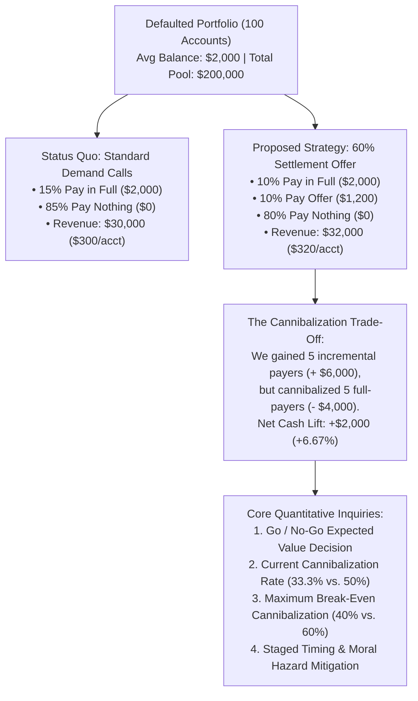
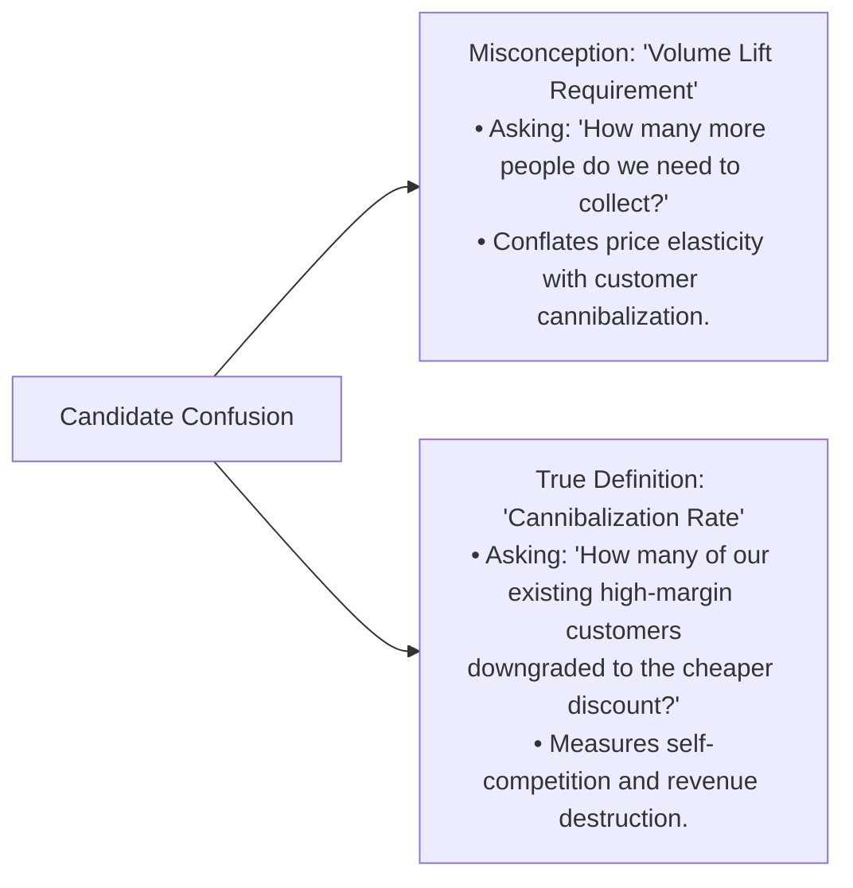
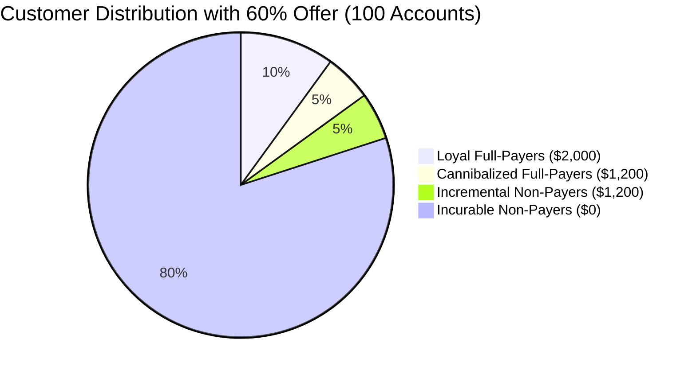
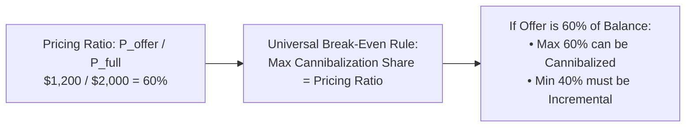
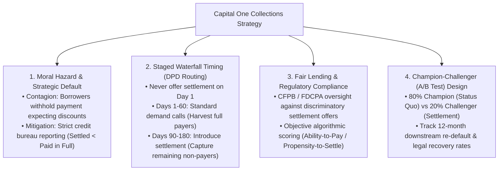

# Case 09: Capital One Default Collections: Settlement Offer Strategy, Cannibalization Modeling & Break-Even Frontier

> **Domain**: Credit Risk, Debt Collections & Recovery, Portfolio Management, Price Discrimination, Cannibalization Modeling, Break-Even Analysis  
> **Target Roles**: Senior Business Manager (SBM), Business Analyst (BA), Risk Strategy Manager, Credit Risk Data Scientist  
> **Key Frameworks**: Expected Cash Recovery Modeling, Price Discrimination Mechanics, Cannibalization Flow Decomposition, Break-Even Defection Frontier ($P_{\text{offer}} / P_{\text{full}}$), Moral Hazard & Dynamic Game Theory, Champion-Challenger Rollout  

---

## 1. Executive Summary & Problem Overview

In consumer credit card portfolio management, delinquent and defaulted receivables represent one of the largest drags on Return on Equity (ROE). When credit card accounts enter serious delinquency (typically 90+ to 180 days past due), issuers face a classic recovery optimization dilemma: **Should they continue demanding full repayment, or should they extend a discounted lump-sum settlement offer to incentivize cash recoveries?**

### Problem Statement & Given Parameters

* **Portfolio Size**: Normalized to $N = 100$ defaulted accounts (or $N$ total accounts).
* **Average Account Balance ($B$)**: `$$2,000` per defaulted cardholder.
* **Status Quo (Baseline Strategy)**:
  * Collections agents call defaulted customers demanding 100% full balance payment.
  * **$15\%$** of customers pay off their accounts in full (`$$2,000`).
  * **$85\%$** of customers pay nothing (`$$0`).
* **Proposed Promotion (Settlement Strategy)**:
  * Agents offer an immediate lump-sum settlement discount: pay **$60\%$** of the outstanding balance (`$$1,200`) to settle and close the account.
  * **$10\%$** of customers still pay in full (`$$2,000`).
  * **$10\%$** of customers accept and pay the 60% offer (`$$1,200`).
  * **$80\%$** of customers pay nothing (`$$0`).

---

## 2. Part (a): Baseline vs. Proposed Strategy (The Go / No-Go Decision)

### Interviewer Prompt
> *"Should Capital One roll out this 60% settlement offer or maintain the current collection strategy? Quantify the expected revenue per account."*

### Mathematical Breakdown

Let $N = 100$ defaulted accounts. Total face value of delinquent receivables = $100 \times \$2,000 = \$200,000$.

#### 1. Baseline Expected Recovery
Under standard full-balance collections calls:
$$\text{Revenue}_{\text{base}} = (15\% \times 100 \times \$2,000) + (85\% \times 100 \times \$0) = 15 \times \$2,000 = \mathbf{\$30,000}$$

$$\text{Expected Value per Account (EV}_{\text{base}}\text{)} = \frac{\$30,000}{100} = \mathbf{\$300 / \text{account}} \quad (15.0\% \text{ gross recovery rate})$$

#### 2. Proposed Promotion Expected Recovery
When extending the 60% settlement offer:
* **Full-Pay Recovery**: $10\% \times 100 \times \$2,000 = 10 \times \$2,000 = \mathbf{\$20,000}$
* **Settlement Recovery**: $10\% \times 100 \times (60\% \times \$2,000) = 10 \times \$1,200 = \mathbf{\$12,000}$
* **Non-Payers**: $80\% \times 100 \times \$0 = \mathbf{\$0}$

$$\text{Revenue}_{\text{promo}} = \$20,000 + \$12,000 + \$0 = \mathbf{\$32,000}$$

$$\text{Expected Value per Account (EV}_{\text{promo}}\text{)} = \frac{\$32,000}{100} = \mathbf{\$320 / \text{account}} \quad (16.0\% \text{ gross recovery rate})$$

#### 3. Portfolio Lift Comparison

| Metric | Baseline Strategy (100% Demand) | Proposed Strategy (60% Settlement) | Absolute Delta | Percentage Delta |
| :--- | :--- | :--- | :--- | :--- |
| **Full-Pay Rate ($P_{\text{full}}$)** | `15.0%` (15 accts) | `10.0%` (10 accts) | `-5.0%` (-5 accts) | `-33.3%` |
| **Settlement Rate ($P_{\text{offer}}$)** | `0.0%` (0 accts) | `10.0%` (10 accts) | `+10.0%` (+10 accts) | N/A |
| **Non-Payment Rate ($P_{\text{zero}}$)**| `85.0%` (85 accts) | `80.0%` (80 accts) | `-5.0%` (-5 accts) | `-5.9%` |
| **Gross Revenue (per 100 accts)** | **`$30,000`** | **`$32,000`** | **`+$2,000`** | **`+6.67%`** |
| **Expected Value per Account** | **`$300.00`** | **`$320.00`** | **`+$20.00`** | **`+6.67%`** |

### Recommendation & Verdict

> **Recommendation**: **Yes, approve the offer from an expected cash recovery standpoint.**  
> Capital One captures an incremental **`$20.00` per account** (`+$2,000` per 100 accounts, or `+$200,000` across a typical 10,000-account default cohort). The revenue gained from activating previously unrecoverable accounts (`+$6,000`) exceeds the margin lost from cannibalized cardholders (`-$4,000`).

---

## 3. Demystifying Cannibalization: What It Is (and What It Is Not)

### Common Interview Pitfall: Volume Lift vs. Cannibalization

Candidates frequently confuse two fundamentally different business metrics:

1. **Volume Lift / Multiplier**: Answers *"By what factor must total paying volume expand to offset a price cut if no one pays full price?"*
   * If full-payment is abolished and all payers only pay 60% ($1,200), to match $30,000 you would need $\$30,000 / \$1,200 = 25\text{ payers}$, a volume lift of $25 / 15 = 1.67\text{x}$.
2. **Cannibalization Rate**: Answers *"How many of our own full-paying customers were 'stolen' by the cheaper offer?"*
   * When Capital One offered the $1,200 settlement, 5 customers who were fully willing and able to pay the full $2,000 took the discount instead.

### The 4-Cohort Flow Model

To track where every dollar and customer originates, partition the 100 accounts into four distinct behavioral cohorts:

1. **Loyal Full-Payers (10 accounts)**: Cardholders who ignore or miss the settlement and pay the full balance ($10 \times \$2,000 = \$20,000$).
2. **Cannibalized Full-Payers (5 accounts)**: Cardholders who **would have paid $2,000**, but took the $1,200 deal.
   * *Economic Impact*: Instead of collecting $5 \times \$2,000 = \$10,000$, we collected $5 \times \$1,200 = \$6,000$.
   * **Revenue Loss (Destruction)**: $5 \times (\$2,000 - \$1,200) = \mathbf{-\$4,000}$.
3. **Incremental Converted Non-Payers (5 accounts)**: Cardholders who **would have paid $0**, but the 40% haircut incentivized them to settle.
   * *Economic Impact*: Instead of collecting $5 \times \$0 = \$0$, we collected $5 \times \$1,200 = \$6,000$.
   * **Revenue Gain (Creation)**: $5 \times (\$1,200 - \$0) = \mathbf{+\$6,000}$.
4. **Incurable Non-Payers (80 accounts)**: Severe hardship or insolvent accounts that cannot pay even at a 40% discount ($80 \times \$0 = \$0$).

$$\text{Net Economic Change} = \text{Revenue Created} - \text{Revenue Destroyed} = +\$6,000 - \$4,000 = \mathbf{+\$2,000}$$

---

## 4. Part (b): Quantifying the Cannibalization Rate

### Interviewer Prompt
> *"Since we are stealing our own customers by giving an offer, what is the cannibalization rate?"*

In consulting and credit risk strategy, interviewers accept two distinct framings. An elite candidate states both:

### Framing A: Defection Rate of the Baseline Full-Pay Cohort (Standard Macro View)

What percentage of our original full-paying customers were cannibalized by the promotion?

$$\text{Cannibalization Rate (Baseline Defection)} = \frac{\text{Full-Payers Lost}}{\text{Original Full-Payers}} = \frac{N_{\text{full, base}} - N_{\text{full, promo}}}{N_{\text{full, base}}}$$

$$\text{Cannibalization Rate} = \frac{15 - 10}{15} = \frac{5}{15} = \frac{1}{3} \approx \mathbf{33.33\%}$$

> **Interpretation**: Exactly **one-third (33.3%)** of the cardholders who would have paid in full downgraded to the settlement discount.

---

### Framing B: Cannibalization Share of the Promotion Cohort (Standard Micro View)

Of the customers who accepted the 60% offer, what proportion was cannibalized from full-payers vs. generated from previously uncollectible accounts?

$$\text{Cannibalization Share (Offer Composition)} = \frac{\text{Cannibalized Customers}}{\text{Total Customers Taking 60\% Offer}} = \frac{N_{\text{cannibalized}}}{N_{\text{offer}}}$$

$$\text{Cannibalization Share} = \frac{15 - 10}{10} = \frac{5}{10} = \mathbf{50.0\%}$$

> **Interpretation**: Exactly **half (50.0%)** of the customers taking the settlement offer represent cannibalized revenue; the other half (50.0%) represents pure incremental cash recovery.

---

## 5. Part (b): Maximum Cannibalization Rate to Break Even

### Interviewer Prompt
> *"What is the maximum cannibalization rate that Capital One can sustain before the offer becomes unprofitable (breaks even)?"*

### Mathematical Derivation

Let $C$ be the number of cannibalized customers out of the original 15 full-payers.  
Assuming the settlement offer continues to capture $10$ total accounts ($10\% \times 100$):

* **Remaining Full-Payers**: $15 - C$
* **Revenue from Full-Payers**: $(15 - C) \times \$2,000 = \$30,000 - \$2,000 C$
* **Revenue from Offer-Payers**: $10 \times \$1,200 = \$12,000$
* **Total Revenue**: $\text{Rev}(C) = (\$30,000 - \$2,000 C) + \$12,000 = \$42,000 - \$2,000 C$

To break even with the baseline ($R_{\text{base}} = \$30,000$):

$$\$42,000 - \$2,000 C = \$30,000$$
$$\$2,000 C = \$12,000 \implies \mathbf{C = 6\text{ customers}}$$

#### Minimum Full-Payer Threshold:
The full-payer rate can drop from $15\%$ down to $15 - 6 = \mathbf{9\%}$ (9 customers out of 100).

#### Verification:
$$\text{Revenue at Break-Even} = (9 \times \$2,000) + (10 \times \$1,200) = \$18,000 + \$12,000 = \mathbf{\$30,000} \quad (\text{Exact Break-Even})$$

---

### Expressing Maximum Cannibalization under Both Framings

#### 1. Maximum Cannibalization Rate of Baseline Full-Payers (Framing A)
$$\text{Max Cannibalization Rate}_{\text{base}} = \frac{C_{\max}}{N_{\text{full, base}}} = \frac{6}{15} = \frac{2}{5} = \mathbf{40.0\%}$$

> **Strategic Takeaway**: Capital One can afford to lose at most **40.0%** of its full-paying customers (up to 6 out of 15). If more than 6 full-payers defect, the promotion destroys portfolio value.

#### 2. Maximum Cannibalization Share of the Offer Cohort (Framing B)
$$\text{Max Cannibalization Share}_{\text{offer}} = \frac{C_{\max}}{N_{\text{offer}}} = \frac{6}{10} = \frac{3}{5} = \mathbf{60.0\%}$$

> **Strategic Takeaway**: Of the 10 accounts taking the settlement offer, at most **60.0%** (6 accounts) can be cannibalized. The remaining **40.0%** (4 accounts) must be incremental non-payers.

---

## 6. The Universal Break-Even Identity: The $P_{\text{offer}} / P_{\text{full}}$ Rule

A signature of an elite Capital One analyst is demonstrating that the **60.0% break-even cannibalization share is not a coincidence**—it is a fundamental mathematical identity.

### Proof:

Let:
* $P_{\text{full}}$ = Full balance owed (`$2,000`)
* $P_{\text{offer}}$ = Settlement amount (`$1,200`)
* $C$ = Number of cannibalized customers
* $I$ = Number of incremental converted customers
* $V = C + I$ = Total volume accepting the settlement offer

For any customer cannibalized, the issuer loses:
$$\Delta \text{Margin}_{\text{cannibal}} = P_{\text{full}} - P_{\text{offer}}$$

For any incremental customer gained, the issuer earns:
$$\Delta \text{Margin}_{\text{incremental}} = P_{\text{offer}} - \$0 = P_{\text{offer}}$$

At break-even, total margin lost must equal total margin gained:
$$C \times (P_{\text{full}} - P_{\text{offer}}) = I \times P_{\text{offer}}$$

Rearranging for the ratio of cannibalized to incremental customers:
$$\frac{C}{I} = \frac{P_{\text{offer}}}{P_{\text{full}} - P_{\text{offer}}}$$

Now solve for the cannibalization share of total promotional volume ($\frac{C}{V} = \frac{C}{C + I}$):
$$\frac{C}{C + I} = \frac{\frac{C}{I}}{\frac{C}{I} + 1} = \frac{\frac{P_{\text{offer}}}{P_{\text{full}} - P_{\text{offer}}}}{\frac{P_{\text{offer}}}{P_{\text{full}} - P_{\text{offer}}} + 1} = \frac{P_{\text{offer}}}{P_{\text{offer}} + (P_{\text{full}} - P_{\text{offer}})} = \mathbf{\frac{P_{\text{offer}}}{P_{\text{full}}}}$$

$$\mathbf{\text{Break-Even Cannibalization Share}} = \frac{P_{\text{offer}}}{P_{\text{full}}} = \frac{\$1,200}{\$2,000} = \mathbf{60.0\%}$$

> **Universal Rule**: For any zero-marginal-cost recovery or digital discount, **the maximum allowable cannibalization share of the promotional cohort exactly equals the discount price ratio ($P_{\text{offer}} / P_{\text{full}}$)**.

---

## 7. Sensitivity Analysis: The 2D Break-Even Frontier

To prepare for interview pushback (*"What if we offered 50% or 70% instead?"*), evaluate the break-even dynamics across different settlement tiers:

| Settlement Offer ($P_{\text{offer}} / P_{\text{full}}$) | Dollars Collected per Settled Account | Loss per Cannibalized User ($P_{\text{full}} - P_{\text{offer}}$) | Gain per Incremental User ($P_{\text{offer}}$) | Max Cannibalization Share ($\frac{P_{\text{offer}}}{P_{\text{full}}}$) | Min Incremental Share Required |
| :--- | :--- | :--- | :--- | :--- | :--- |
| **`40%` Settlement** | `$800` | `-$1,200` | `+$800` | **`40.0%`** | `60.0%` |
| **`50%` Settlement** | `$1,000` | `-$1,000` | `+$1,000` | **`50.0%`** | `50.0%` |
| **`60%` Settlement (Case)**| **`$1,200`** | **`-$800`** | **`+$1,200`** | **`60.0%`** | **`40.0%`** |
| **`70%` Settlement** | `$1,400` | `-$600` | `+$1,400` | **`70.0%`** | `30.0%` |
| **`80%` Settlement** | `$1,600` | `-$400` | `+$1,600` | **`80.0%`** | `20.0%` |

> **Key Insight**: Deeper discounts (e.g., 40% payment) are far more vulnerable to cannibalization. At a 40% settlement, at least **60% of adopters must be incremental** non-payers for the strategy to break even!

---

## 8. Strategic Implementation & Capital One Executive Considerations

In a Capital One on-site case, getting the math right is the minimum expectation. The offer is won on strategic judgment, risk mitigation, and experimentation design.

### 1. Dynamic Waterfall Staging (Preventing Cannibalization by Design)
The fundamental flaw of the proposed strategy is presenting the settlement offer to **all customers simultaneously**.  
* **Recommended Architecture**: Implement a **Two-Stage Temporal Waterfall**:
  * **Stage 1 (Days 1 to 60 Past Due)**: Aggressive standard demand outreach. Capture the 15% of customers who have the liquidity to pay in full.
  * **Stage 2 (Days 90+ Past Due / Pre-Charge-Off)**: For accounts that have refused or failed Stage 1, present the 60% settlement offer.
  * **Result**: Virtually **eliminates cannibalization** because full-payers have already cured their balances before the discount is ever mentioned!

### 2. Credit Bureau Reporting Disincentive
To deter moral hazard and preserve credit discipline:
* Full payers receive a credit report update: **`"Paid in Full - Current"`** (minimal credit score damage).
* Settlement payers receive: **`"Settled for Less Than Full Balance"`** (severe derogatory mark, suppressing credit scores for 7 years).
* Communicating this trade-off during collections calls naturally sorts customers based on their true willingness to pay (second-degree price discrimination).

### 3. Ability-to-Pay (ATP) Machine Learning Model
Instead of universal broadcast offers, train an XGBoost propensity model using:
* External bureau attributes (debt-to-income, credit inquiries, trade lines in default).
* Historical deposit cash flow data (checking account balance velocity, direct deposit continuity).
* **Targeting Rule**: Restrict 60% settlement offers exclusively to cardholders with low liquidity scores (high probability of zero recovery), shielding high-liquidity cardholders for full collection.

### 4. Champion-Challenger Rollout Plan
* **Rollout Structure**: 80% Control (Standard Demand) vs. 20% Challenger (Settlement Offer).
* **Primary KPI**: Net Cash Recovered per Gross Defaulted Balance ($NPV / \text{Receivables}$).
* **Guardrail KPIs**:
  * Full-payer defection rate (must remain $\le 40\%$).
  * Average Handle Time (AHT) per recovery.
  * 12-month re-delinquency / charge-off rates across portfolio sister products.
