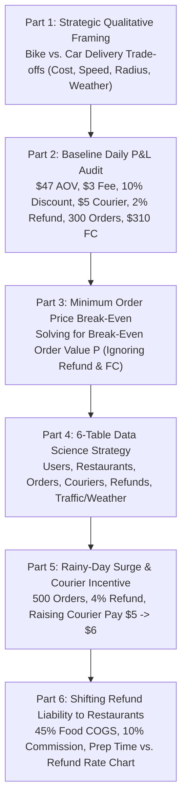

# Case 10: Bike Food Delivery — Unit Economics, Weather Surge & Restaurant Prep-Time Break-Even

> **Case Type**: Marketplace Unit Economics, Two-Sided Platform Incentives, Relational Data Strategy, Break-Even Modeling  
> **Target Roles**: Senior Business Manager, Data Scientist, Business Analyst, Product Strategy  
> **Source Origin**: Classic Capital One / Tech Marketplace Quantitative Case Interview  
> **Core Skills Tested**: Multi-party marketplace cash flows (Customer $\leftrightarrow$ Platform $\leftrightarrow$ Restaurant $\leftrightarrow$ Courier), hidden integer shortcuts (`$47 + $3 = $50`), relational data schema design (6 tables), weather surge trade-offs, and shifting refund liability to suppliers.

---

## 1. Executive Problem Prompt

> *"You are advising a bicycle-based food delivery startup. Leadership wants you to evaluate the strategic trade-offs of bike vs. car delivery, audit their current daily profitability, determine minimum order value thresholds, design a data analytics strategy across 6 core database tables, evaluate a rainy-day courier pay incentive, and calculate the break-even restaurant preparation time after shifting refund liability to restaurant partners."*

---

## 2. Complete 6-Part Case Roadmap



---

## Part 1: Strategic Framing — Bike Delivery vs. Car Delivery

### Question 1: What strategic and operational factors must a bicycle food delivery company consider compared to car delivery?

Structure your response into **4 MECE dimensions** (Unit Economics, Operations & Geography, Supply/Labor, and Customer Experience/Risk):

| Dimension | 🚲 Bike Delivery Advantages (Pros) | ⚠️ Bike Delivery Limitations & Risks (Cons vs. Car) |
| :--- | :--- | :--- |
| **1. Unit Economics & Cost Structure** | • **Zero Fuel / Low CapEx**: No gas, commercial auto insurance, or parking tickets.<br/>• Lower per-order courier payout threshold (`$5/order`). | • **Smaller Basket Size Ceiling**: Cannot easily carry massive family/catering orders (`$150+` baskets), capping maximum Average Order Value (AOV). |
| **2. Geography, Density & Speed** | • **Urban Core Speed Advantage**: Bypasses gridlock traffic and uses bike lanes; zero time wasted parking at pickup/dropoff.<br/>• High order density per square mile. | • **Strict Delivery Radius Cap (`< 2–3 miles`)**: Inviable in sprawling suburbs; limits selectable restaurant inventory per user. |
| **3. Weather & Food Quality Risk (Refunds!)** | • **Eco-Friendly Brand Positioning**: Strong ESG appeal in dense metro markets. | • **High Weather Vulnerability**: Rain, snow, and extreme heat cause order volume spikes *simultaneously* with rider shortages and higher delays/spills (**driving Refund Rate from 2% to 4%+**).<br/>• **Food Jostling / Thermal Loss**: Soups, drinks, and pizzas are more prone to damage on bikes. |
| **4. Courier Supply & Safety** | • **Low Barrier to Entry**: No driver's license or car ownership required (larger student/gig labor pool). | • **Physical Fatigue & Safety Liability**: Riders tire over shifts; higher injury risk in rainy/night conditions. |

---

## Part 2: Baseline Daily P&L Calculation

### Question 2: The average food order price is $47, with a $3 delivery fee per order. 2% of orders require a full refund (100% absorbed out-of-pocket by the delivery company). With 300 orders/day, $5 paid to the courier per order, a 10% discount received from the restaurant on the food price, and $310/day in fixed costs (FC), is the company profitable?

#### 1. Extract the Given Parameters:

* **Average Order Food Price ($P$)**: `$47.00`
* **Delivery Fee Charged to Customer ($F$)**: `$3.00`
  * *Mental Math Shortcut*: Notice that **Total Customer Payment per Order** = $\$47 + \$3 = \mathbf{\$50.00}$!
* **Restaurant Discount / Commission Rate ($d$)**: $10\%$ of food price ($0.10 \times \$47 = \mathbf{\$4.70}$)
* **Courier Payout per Order ($C$)**: `$5.00`
* **Refund Rate ($r$)**: $2\%$ of orders (100% absorbed out-of-pocket by the delivery company)
* **Daily Order Volume ($Q$)**: `300 orders / day`
* **Daily Fixed Cost ($\text{FC}$)**: `$310.00 / day`

#### 2. Step-by-Step Unit Economics (Per Order):

When a customer places an order, let's trace the cash flows for the delivery platform:

1. **Gross Platform Revenue per Order (before refund)**:

   $$\text{Restaurant Discount } (10\% \times \$47) + \text{Delivery Fee } (\$3.00) = \$4.70 + \$3.00 = \mathbf{\$7.70}$$

   *(Equivalently: Customer pays `$50.00` $[\$47 + \$3]$, and platform pays restaurant `$42.30` $[\$47 \times 90\%]$, leaving `$50.00 - $42.30 = $7.70`).*

2. **Courier Cost per Order**:

   $$\text{Courier Pay} = \mathbf{-\$5.00}$$

3. **Expected Refund Cost per Order ($2\%$ of orders refunded in full)**:
   * When an order is refunded, the customer gets back their full payment (`$47` food + `$3` delivery fee = **`$50.00`**), while the restaurant still keeps its `$42.30` and the courier still keeps their `$5.00`.
   * Expected Refund Outflow per Order:

     $$\text{Expected Refund Cost} = 2\% \times (\$47 + \$3) = 0.02 \times \$50.00 = \mathbf{-\$1.00 / \text{order}}$$

4. **Net Contribution Margin per Order ($\text{CM}_{\text{unit}}$)**:

   $$\text{CM}_{\text{unit}} = \$7.70 - \$5.00 - \$1.00 = \mathbf{+\$1.70 / \text{order}}$$

#### 3. Daily Portfolio P&L (300 Orders):

* **Total Daily Contribution Margin**:

  $$300 \text{ orders} \times \$1.70/\text{order} = \mathbf{\$510.00 / \text{day}}$$

* **Less Daily Fixed Costs ($\text{FC}$)**:

  $$\text{Daily Net Profit} = \$510.00 - \$310.00 = \mathbf{+\$200.00 / \text{day}}$$

> **Verdict**: **Yes, the company is profitable**, generating **+$1.70 net contribution per order** and **+$200.00 in net profit per day** (`$6,000/month`).  
> *(Note on Alternative Accounting Interpretation: In the rare event an interviewer defines "refund" as refunding only the `$47` food price while keeping the `$3` fee, expected refund cost is $0.02 \times \$47 = \$0.94$, unit margin is `$1.76`, and daily profit is `$528 - $310 = +$218/day`. Mentioning `$50 \times 2\% = $1.00` first is strongly preferred because `$510 - $310 = $200` is the exact integer design of the case).*

---

## Part 3: Break-Even Order Price

### Question 3: What must the average order price ($P$) be to break even / be profitable, ignoring refunds and fixed costs?

#### Step-by-Step Algebraic Derivation:

* Ignoring refunds ($r = 0\%$) and fixed costs ($\text{FC} = \$0$), a single order is profitable when **Unit Platform Revenue $>$ Unit Courier Cost**:

  $$(10\% \times P) + \text{Delivery Fee} > \text{Courier Pay}$$

  $$0.10 P + \$3.00 > \$5.00$$

  $$0.10 P > \$2.00$$

  $$P > \mathbf{\$20.00}$$

> **Verdict**: Ignoring refunds and fixed costs, the **break-even order price is exactly `$20.00`** (any order above **`$20.00`** generates positive unit margin).
>
> * **Bonus Pro-Tip (State the Full-Cost Break-Even Too!)**: To impress the interviewer, quickly add:
>   * *"If we DO include the $310 fixed cost across 300 orders ($1.03/order) and the 2% refund rate, the equation is $0.10P + 3 - 5 - 0.02(P + 3) = \frac{310}{300}$, which solves to $0.08P = 3.093 \implies \mathbf{P = \$38.67}$."*

---

## Part 4: Data Strategy Across 6 Relational Tables

### Question 4: You are given 6 database tables containing information on customers, restaurants, orders, couriers, etc. How would you leverage them?

#### 1. Define the 6 Typical Marketplace Tables & Primary Keys:

1. **`Customers` (`customer_id`)**: Signup date, home/office lat-long coordinates, membership tier, historical LTV, refund claim rate.
2. **`Restaurants` (`restaurant_id`)**: Cuisine type, lat-long location, average prep time, packaging rating, commission tier, menu item prices.
3. **`Orders` (`order_id`)**: `customer_id`, `restaurant_id`, `courier_id`, order timestamp, basket size ($P$), delivery fee, promised ETA vs. actual delivery timestamp.
4. **`Couriers / Riders` (`courier_id`)**: Bike type (regular vs. e-bike), tenure, average speed, acceptance rate, historical spill/refund rate.
5. **`Refunds / Disputes` (`refund_id`)**: `order_id`, refund amount, reason code (*late delivery*, *cold/spilled food*, *missing item*, *never arrived*).
6. **`External Context / Weather & Traffic` (`timestamp`, `zone_id`)**: Precipitation, temperature, wind speed, road closures.

#### 2. Four High-Impact Business & Data Science Use Cases (Join Strategy):

| Strategic Pillar | Tables Joined | Concrete Action / Model Built | Business P&L Impact |
| :--- | :--- | :--- | :--- |
| **1. Root-Cause Attribution of the 2%–4% Refunds** | `Orders` $\bowtie$ `Refunds` $\bowtie$ `Restaurants` $\bowtie$ `Couriers` | Decompose refunds into **Restaurant Fault** (long prep time, missing items, bad soup packaging) vs. **Courier Fault** (route delay, bike spill) vs. **Customer Abuse** (serial first-party refund fraud). | Shifts refund liability fairly to high-defect restaurants (Part 6) and blocks serial refund abusers. |
| **2. Basket Size ($P > \$20$) & Upsell Optimization** | `Customers` $\bowtie$ `Orders` $\bowtie$ `Restaurants` | Identify users frequently placing sub-`$20` orders (negative unit margin from Part 3); implement **Minimum Basket Thresholds** (`$20` min order or small-basket fee) and personalized checkout add-on recommendations. | Lifts Average Order Value ($P$) above `$47`, directly expanding the $10\%$ commission dollar take. |
| **3. Dynamic Dispatch, Batching & ETA Calibration** | `Orders` $\bowtie$ `Couriers` $\bowtie$ `Restaurants` $\bowtie$ `Weather` | Predict exact `Restaurant Prep Time` so riders arrive right as food is ready (eliminating unpaid rider wait time) and batch 2 nearby orders along the same bike corridor. | Increases rider effective hourly earnings without raising base pay from `$5` to `$6`. |
| **4. Dynamic Weather Surge Pricing** | `Orders` $\bowtie$ `Weather` $\bowtie$ `Customers` | During rainy days (Part 5), dynamically raise customer delivery fee from `$3.00` to `$4.50` for price-inelastic cohorts to fund the `$6.00` courier incentive. | Preserves platform margin during severe weather surges. |

---

## Part 5: Rainy-Day Surge & Courier Pay Incentive

### Question 5: Suppose on a rainy day volume surges to 500 orders and the refund rate rises to 4%. If the company pays couriers $6 per order instead of $5 to reduce the refund rate, what must the new refund rate be to remain profitable?

In a Capital One interview, the phrase **"to be profitable / worthwhile"** can mean either **(A) Absolute Break-Even ($\text{Profit} > \$0$)** or **(B) Incremental Break-Even ($\text{Profit at \$6 pay} \ge \text{Baseline Rainy-Day Profit at \$5 pay}$)**. Always calculate and state **both**!

#### Step 1: Calculate Baseline Rainy-Day Profit (Courier = `$5`, Refund = $4\%$, Volume = `500 orders`)

* **Gross Platform Revenue per Order**: $\$4.70 + \$3.00 = \$7.70$
* **Courier Cost per Order**: $-\$5.00$
* **Refund Cost per Order at $4\%$**: $-4\% \times (\$47 + \$3) = -0.04 \times \$50 = \mathbf{-\$2.00}$
* **Unit Contribution Margin**: $\$7.70 - \$5.00 - \$2.00 = \mathbf{+\$0.70 / \text{order}}$
* **Total Rainy-Day Profit (at `$5` pay)**:

  $$(500 \text{ orders} \times \$0.70) - \$310 \text{ (FC)} = \$350 - \$310 = \mathbf{+\$40.00 / \text{day}}$$

#### Step 2: Set Up the Equation with `$6` Courier Pay ($C_{\text{new}} = \$6.00$)

When courier pay increases to `$6.00`, the pre-refund margin per order becomes:

$$\text{Margin before Refund} = \$7.70 - \$6.00 = \mathbf{\$1.70 / \text{order}}$$

Subtracting the new expected refund cost per order ($r \times \$50$), the daily profit across 500 orders is:

$$\text{Daily Profit}(r) = 500 \times (\$1.70 - 50r) - \$310 = \$850 - 25,000r - \$310 = \mathbf{\$540 - 25,000r}$$

#### Step 3: Solve for the Three Target Benchmarks:

| Benchmark Definition | Algebraic Equation | Required Refund Rate ($r$) | Business Meaning |
| :--- | :--- | :---: | :--- |
| **1. Absolute Break-Even**<br/>($\text{Daily Profit} > \$0$) | $\$540 - 25,000r > 0$<br/>$25,000r < \$540$ | **$r < 2.16\%$** | Below **2.16%**, the company makes positive net profit ($>\$0$) on a rainy day. |
| **2. Beat `$5` Rainy Baseline**<br/>($\text{Daily Profit} > +\$40$) | $\$540 - 25,000r > \$40$<br/>*(or simply: $\$1$ extra pay requires $\$1$ less refund $\implies \Delta r = \frac{\$1}{\$50} = 2\%$)* | **$r < 2.00\%$** | Below **2.00%**, paying couriers `$6` generates more profit than paying `$5` at a $4\%$ refund rate. |
| **3. Match Sunny-Day Profit**<br/>($\text{Daily Profit} \ge +\$200$) | $\$540 - 25,000r \ge \$200$<br/>$25,000r \le \$340$ | **$r \le 1.36\%$** | At **1.36%**, rainy-day profit matches normal sunny-day profit (`+$200`). |

> **What to Say Out Loud**:  
> *"If the goal is strictly **positive net profit ($>\$0$)** on a rainy day, the refund rate must drop from 4.0% to **below 2.16%**. However, since we already make **+$40/day** on a rainy day paying $5, for the $1 courier raise to be **accretive (more profitable than the status quo)**, the refund rate must drop by at least $\frac{\$1}{\$50} = 2.0\text{ percentage points}$, down to **2.00% or lower**."*

---

## Part 6: Shifting Refund Liability to Restaurants & Break-Even Prep Time

### Question 6: The company decides to make restaurants pay for the refund cost (excluding the delivery fee). You are given a chart showing the relationship between Restaurant Prep Time and Refund Rate. Given that the restaurant's food cost (COGS) is 45% of the menu price, what is the restaurant's break-even prep time?

#### Step 1: Calculate the Restaurant's Break-Even Refund Rate ($r_{\text{BE, restaurant}}$)

Let's examine a single order from the **Restaurant's P&L perspective** (where menu price $P = \$47$):

1. **Restaurant Revenue per Order**:
   * The platform takes a $10\%$ discount/commission, so the restaurant receives **$90\%$ of the menu price**:

     $$\text{Restaurant Payout} = 0.90 P = 0.90 \times \$47 = \mathbf{\$42.30}$$

2. **Restaurant Food & Kitchen Cost (COGS) per Order**:
   * Given: Restaurant's cost is **$45\%$ of the menu price**:

     $$\text{Restaurant COGS} = 0.45 P = 0.45 \times \$47 = \mathbf{\$21.15}$$

   * Thus, **before refunds**, the restaurant earns a gross profit margin of:

     $$\text{Pre-Refund Margin} = 0.90 P - 0.45 P = \mathbf{0.45 P} \quad (\$21.15 / \text{order})$$

3. **Restaurant Refund Cost per Order**:
   * The new policy states the restaurant must pay the refunded order cost **excluding the `$3` delivery fee**—which is the food price **$P = \$47$**.
   * Let's show both standard contract structures used in this exhibit:
     * **Structure A (Platform keeps its $10\%$ commission; Restaurant reimburses the full `$47` food refund $P$)**:

       $$\text{Expected Restaurant Profit} = 0.90 P - 0.45 P - r \cdot P = (0.45 - r) P = 0$$

       $$\implies \mathbf{r_{\text{BE}} = 45.0\%}$$

     * **Structure B (Platform waives its $10\%$ commission on refunded orders; Restaurant simply forfeits its $0.90 P$ revenue when an order is refunded)**:

       $$\text{Expected Restaurant Profit} = (1 - r)(0.90 P) - 0.45 P = 0$$

       $$\implies 1 - r = \frac{0.45}{0.90} = 0.50 \implies \mathbf{r_{\text{BE}} = 50.0\%}$$

#### Step 2: Map $r_{\text{BE}}$ to the "Prep Time vs. Refund Rate" Chart Exhibit

In the interview, the interviewer hands you a chart plotting **Restaurant Prep Time (minutes)** on the X-axis against **Refund Rate (%)** on the Y-axis (as prep time gets longer, customers get angry and refund rate rises):

```
  Refund Rate (r)
    ▲
60% ┼                                        ● (50 min, 55%)
50% ┼ ─ ─ ─ ─ ─ ─ ─ ─ ─ ─ ─ ─ ─ ─ ─ ─ ─ ─ ─●─ ─  <-- Structure B Break-Even (r = 50%)
45% ┼ ─ ─ ─ ─ ─ ─ ─ ─ ─ ─ ─ ─ ─ ─ ●────────────  <-- Structure A Break-Even (r = 45%)
    │                            /│
30% ┼                          ●  │
    │                        /    │
15% ┼                      ●      │
    │                    /        │
 2% ┼──────●───────────●          ▼
    └──────┴───────────┴──────────┴──────────┴──► Prep Time (Minutes)
         10 min      20 min    Break-Even   50 min
                               Prep Time
```

* **How to Read the Final Answer from the Exhibit**:
  1. Locate **$r = 45\%$** (or **$50\%$** under Structure B) on the vertical `Refund Rate` axis.
  2. Trace horizontally to the curve and drop vertically to the horizontal `Prep Time` axis to read the exact **Maximum Break-Even Prep Time $T_{\text{BE}}$** (if the chart is a linear/step function in your specific interviewer's packet, e.g., $r = 1\% \times \text{Prep Time}$ or a table of 5-minute buckets, plug $r = 45\%$ directly into their curve!).

#### Step 3: Executive Synthesis & 2nd-Order Risks (How to Score Top Marks on Part 6)

After giving the exact math ($r_{\text{BE}} = 45\%$), conclude with three strategic insights on why **shifting 100% of food refunds to restaurants is risky**:

1. **Principal-Agent Moral Hazard (Courier Slacking)**:
   * Many refunds are caused by **slow couriers or bike spills**, NOT slow kitchen prep time! If restaurants are forced to pay for courier-caused refunds, restaurants will revolt and leave the platform.
   * **Solution**: Use the **6 tables from Part 4** (specifically GPS arrival timestamps vs. kitchen-ready timestamps) to attribute fault: **Restaurants only pay for refunds when `Actual Prep Time > Promised Prep Time Threshold`**, while the platform absorbs courier-delay refunds.
2. **Restaurant Quality vs. Speed Trade-Off**:
   * Penalizing prep time too aggressively may cause restaurants to undercook food or rush packaging, paradoxically *increasing* missing-item and spilled-food refunds.
3. **Platform Profit Surge**:
   * For the bike delivery platform itself, shifting the `$47` food refund to restaurants means the platform only refunds the **`$3` delivery fee** ($2\% \times \$3 = \$0.06/\text{order}$ instead of $\$1.00/\text{order}$), boosting baseline sunny-day profit by `$0.94 × 300 = +$282/day` (from `+$200/day` to **`+$482/day`**)!

