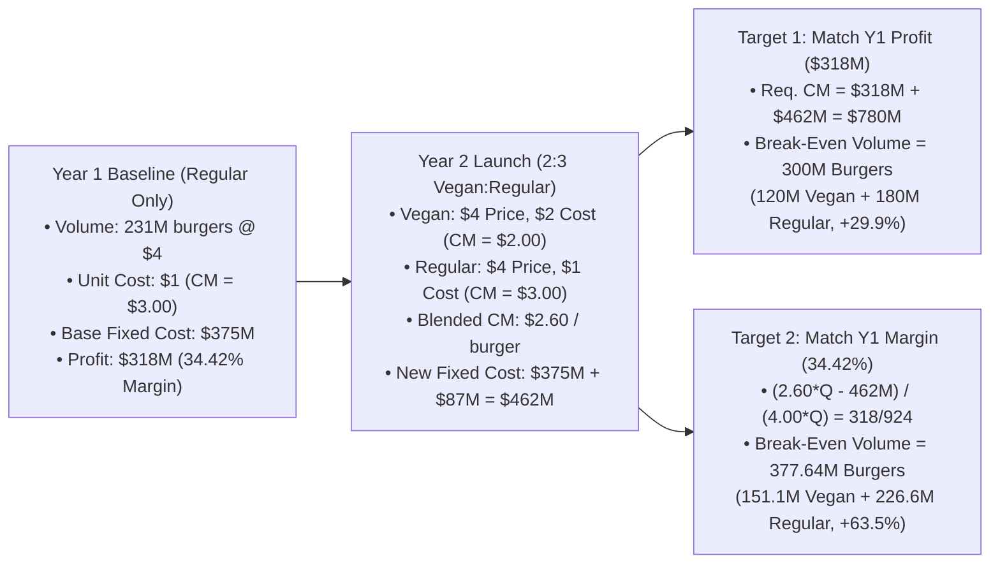

# Case 11: Burger Chain CEO — Vegan Burger Launch, Cannibalization & Margin Break-Even

## 1. Executive Summary & Case Archetype

This is a classic **Capital One / McKinsey / Tech Strategy Product Launch & Cannibalization Case**. You step into the shoes of the **CEO of a national Burger Chain** evaluating whether to launch a new **Vegan Burger** alongside your core **Regular Beef Burger**.

* **Core Analytical Tension**: Launching a lower-margin product (Vegan Burger at `$2.00` COGS vs. Regular Burger at `$1.00` COGS) at price parity (`$4.00`) introduces **two compounding profit headwinds**:
  1. **Unit Margin Dilution (Cannibalization)**: Every existing customer who switches from a Regular Burger (`$3.00` contribution margin) to a Vegan Burger (`$2.00` contribution margin) destroys `$1.00` of contribution margin.
  2. **Incremental Fixed Overhead**: Adding `$60M/year` in staff training and `$2.25M/month` (`$27M/year`) in supplier fees adds `$87M/year` in new fixed hurdles.
* **Key Quantitative Takeaways**:
  * **Q2 (Standalone Projection at `$5` Price)**: `120M` vegan burgers at `$5` price (`$3` unit margin) less `$87M` fixed cost yields **`+$273M` incremental profit**.
  * **Q4 (Regular Only vs. `2:3` Vegan:Regular Mix at `$4` Price & `120M` Volume)**: Blended contribution margin drops from **`$3.00/burger`** to **`$2.60/burger`**, and net profit per burger (after the `$87M` vegan fixed cost) plunges from **`$3.00/burger`** to **`$1.875/burger`** (a `-$1.125/burger` or `-$135M` profit drop).
  * **Q6 (Year 2 Break-Even Volume to Match Year 1 Profit Dollars of `$318M`)**: Requires **`300M` total burgers** (`120M` Vegan + `180M` Regular)—a **`+29.9%` (`+69M` burger) volume surge** over Year 1's `231M` regular burgers.
  * **Q7 & Q8 (Year 1 Profit Margin & Year 2 Volume to Maintain `34.42%` Profit Margin)**: Year 1 Profit Margin is **`34.42%`** (`$318M / $924M`). Because Vegan Burgers have a higher cost-to-price ratio, maintaining a **`34.42%` percentage margin** in Year 2 requires **`377.64M` total burgers** (`+63.5%` volume growth).

---

## 2. Question 1: Strategic Framework — What Should the CEO Consider Before Launching a Vegan Burger?

> **Prompt**: *You are the CEO of a burger company considering launching a Vegan Burger. What factors should you consider across Pricing, Operations, and the Competitor Landscape?*

Structure your answer into **4 MECE strategic pillars**:

### 1. Pricing & Unit Economics (`Margin vs. Cannibalization`)

* **Ingredient COGS vs. Price Elasticity**: Plant-based patties typically cost `2x` as much as beef patties (`$2.00` vs. `$1.00`). Can we charge a **price premium** (`$5.00` vs. `$4.00`) to preserve a `$3.00` unit contribution margin, or will price sensitivity force us into **price parity** (`$4.00`), compressing unit margin to `$2.00`?
* **Incremental Traffic vs. Internal Cannibalization**: What share of Vegan Burger buyers are **new customers** (strict vegans, vegetarians, or groups drawn in by the *"Veto Vote"* effect where one vegetarian previously vetoed the restaurant) versus **existing beef customers** trading across?
* **Basket Attachment & Cross-Sell Lift**: Burgers are often a traffic driver while **sides and beverages** (fries, sodas, shakes) carry `80%+` gross margins. Do vegan burger buyers purchase full combo meals at a higher or lower attachment rate?

### 2. Operations & Supply Chain (`Kitchen Throughput & Fixed Overhead`)

* **Cross-Contamination & Kitchen Equipment**: Strict vegans require dedicated cooking surfaces (separate broilers/grills, separate tongs/utensils, and separate prep zones) so vegan patties never touch beef grease. Does this require store-level CapEx or slow down kitchen ticket times at peak lunch/dinner rush?
* **Staff Training & QSR Turnover**: High front-line employee turnover in fast food means training (`$60M/year`) is a recurring operational burden to ensure proper food safety, allergen separation, and build accuracy.
* **Supply Chain Reliability & Spoilage**: Plant-based suppliers require fixed minimum commitments (`$2.25M/month`). If initial demand is uneven across urban vs. rural stores, perishable vegan patties will suffer higher **spoilage/shrinkage waste**.

### 3. Competitor Landscape & Market Positioning

* **Competitor Benchmarks & Saturation**: Have direct QSR rivals (e.g., Burger King's *Impossible Whopper*, McDonald's *McPlant*) already saturated the plant-based fast-food segment, or have competitors struggled with repeat purchase rates after initial novelty wore off?
* **Differentiation vs. Third-Party Branding**: Are we co-branding with a well-known supplier (Beyond / Impossible, which boosts trial but gives the supplier pricing power) or developing a proprietary recipe?

### 4. Brand Equity & Regulatory / PR Risk

* **Brand Alignment**: Will launching a vegan burger modernize the brand for Gen-Z / Millennial diners, or risk backlash if marketed as "100% vegan" while cooked on shared broilers (which triggered real-world class-action lawsuits in the QSR industry)?

---

## 3. Question 2: Standalone Year 1 Incremental Profit Calculation

> **Prompt**: *Calculate the incremental profit of selling the Vegan Burger in Year 1 given the following projections:*
>
> * *Annual Training Fee: `$60M / year`*
> * *Supplier Fixed Fee: `$2.25M / month`*
> * *Vegan Ingredient Variable Cost: `$2.00 / burger`*
> * *Vegan Burger Selling Price: `$5.00 / burger`*
> * *Expected Year 1 Sales Volume: `120M burgers`*

### Step-by-Step Mathematical Breakdown

1. **Unit Contribution Margin ($\text{CM}_{\text{vegan}}$)**:

$$\text{CM}_{\text{vegan}} = P_{\text{vegan}} - C_{\text{vegan}} = \$5.00 - \$2.00 = \mathbf{\$3.00 \text{ / burger}}$$

2. **Total Year 1 Contribution Margin (Gross Profit before Fixed Costs)**:

$$\text{Total CM} = 120\text{M burgers} \times \$3.00 = \mathbf{\$360\text{M}}$$

   *(Composed of $120\text{M} \times \$5.00 = \$600\text{M}$ Revenue minus $120\text{M} \times \$2.00 = \$240\text{M}$ Variable Ingredient Cost).*

3. **Total Annual Incremental Fixed Costs ($\text{FC}_{\text{vegan}}$)**:
   * **Annual Training Cost**: `$60M / year`
   * **Annualized Supplier Cost**: $\$2.25\text{M / month} \times 12\text{ months} = \$27\text{M / year}$
   * **Total Vegan Fixed Cost**:

$$\text{FC}_{\text{vegan}} = \$60\text{M} + \$27\text{M} = \mathbf{\$87\text{M / year}}$$

4. **Year 1 Incremental Net Profit ($\Pi_{\text{vegan}}$)**:

$$\Pi_{\text{vegan}} = \text{Total CM} - \text{FC}_{\text{vegan}} = \$360\text{M} - \$87\text{M} = \mathbf{+\$273\text{M}}$$

   *(Equivalently, an average net profit of $\frac{\$273\text{M}}{120\text{M}} = \mathbf{\$2.275 \text{ / burger}}$).*

---

## 4. Question 3: Critical Evaluation — Which Assumptions in Q2 Are Likely Flawed?

> **Prompt**: *Looking at the calculation in Q2, which assumptions might be wrong or overly optimistic?*

1. **Zero Cannibalization Assumption (The #1 Flaw)**:
   * Q2 assumes that all `120M` vegan burgers represent **100% brand-new incremental purchases**. In reality, a substantial portion of those `120M` units will be purchased by **existing customers switching away from the Regular Burger**. Any cannibalized unit sacrifices the Regular Burger's `$3.00` contribution margin, meaning the *true* net contribution of a cannibalized vegan burger is $\$3.00 - \$3.00 = \$0.00$ (or `-$1.00` if priced at `$4.00`!).
2. **Unrealistic Price Premium Assumption (`$5.00` vs. `$4.00` Regular Burger)**:
   * Q2 assumes we can charge `$5.00` (`+25%` premium over the `$4.00` Regular Burger) and still sell `120M` units. In mass-market fast food, price-sensitive consumers often refuse to pay a premium for plant-based substitutes, forcing the chain to drop the price to `$4.00` parity.
3. **Zero Spoilage / 100% Sell-Through Assumption**:
   * Assumes every `$2.00` vegan patty purchased from suppliers is sold to a customer. Perishable new menu items typically experience `5%–15%` shrinkage/waste, inflating the effective variable cost per *sold* burger above `$2.00`.
4. **Omission of Marketing, Equipment & Throughput Costs**:
   * Launching a nationwide menu category requires heavy national advertising (`$30M–$50M+`), kitchen equipment modifications, and potential drive-thru throughput slowdowns that are omitted from the fixed cost line.

---

## 5. Question 4: Comparing Average Profit per Burger Across Two Scenarios

> **Prompt**: *Now we are given updated numbers:*
>
> * *Regular Burger: Selling Price = `$4.00`, Variable Production Cost = `$1.00`*
> * *Vegan Burger: Selling Price = `$4.00`, Variable Production Cost = `$2.00`*
> * *Sales Mix Ratio (Vegan : Regular) = `2 : 3`*
> * *Projected Year 1 Total Volume = `120M burgers`, Supplier Fee = `$2.25M/month` (`$27M/year`), Training Fee = `$60M/year`*
>
> *Calculate the difference in Average Profit per Burger between Scenario A (Selling Regular Burgers Only) and Scenario B (Selling Both Burgers at the `2:3` ratio).*

### 1. Unit Contribution Margins

* **Regular Burger Contribution Margin ($\text{CM}_R$)**:

$$\text{CM}_R = \$4.00 - \$1.00 = \mathbf{\$3.00 \text{ / burger}}$$

* **Vegan Burger Contribution Margin ($\text{CM}_V$)**:

$$\text{CM}_V = \$4.00 - \$2.00 = \mathbf{\$2.00 \text{ / burger}}$$

* **Sales Mix Shares (`2 : 3` Ratio)**:
  * **Vegan Share ($w_V$)**: $\frac{2}{2 + 3} = \frac{2}{5} = \mathbf{40\%}$ (`48M` burgers out of `120M`)
  * **Regular Share ($w_R$)**: $\frac{3}{2 + 3} = \frac{3}{5} = \mathbf{60\%}$ (`72M` burgers out of `120M`)

### 2. Scenario Comparison at `120M` Total Burgers

* **Scenario A (Regular Burgers Only — `120M` Regular Burgers)**:
  * **Total Contribution / Operating Profit**: $120\text{M} \times \$3.00 = \$360\text{M}$
  * **Average Profit per Burger**:

$$\text{Avg Profit}_A = \mathbf{\$3.00 \text{ / burger}}$$

* **Scenario B (Both Burgers at `2:3` Mix — `48M` Vegan + `72M` Regular)**:
  1. **Blended Contribution Margin per Burger (Before Fixed Costs)**:

$$\overline{\text{CM}}_B = (0.40 \times \$2.00) + (0.60 \times \$3.00) = \$0.80 + \$1.80 = \mathbf{\$2.60 \text{ / burger}}$$

     *(Total Contribution Margin = $120\text{M} \times \$2.60 = \$312\text{M}$, already `$48M` lower than Scenario A due to `-$0.40/burger` mix dilution).*
  2. **Net Profit After Vegan Incremental Fixed Costs (`$87M`)**:

$$\text{Total Net Profit}_B = \$312\text{M} - (\$60\text{M} + \$27\text{M}) = \$312\text{M} - \$87\text{M} = \mathbf{\$225\text{M}}$$

  3. **Average Net Profit per Burger (After Fixed Costs)**:

$$\text{Avg Net Profit}_B = \frac{\$225\text{M}}{120\text{M burgers}} = \$2.60 - \frac{\$87\text{M}}{120\text{M}} = \$2.60 - \$0.725 = \mathbf{\$1.875 \text{ / burger}}$$

| Metric (`120M` Total Burgers) | Scenario A: Regular Only (`100%` Regular) | Scenario B: Both (`40%` Vegan / `60%` Regular) | Difference (`B vs. A`) |
| :--- | :---: | :---: | :---: |
| **Regular / Vegan Units** | `120M` Reg / `0` Vegan | `72M` Reg / `48M` Vegan | `-48M` Reg / `+48M` Vegan |
| **Gross Contribution Margin / Burger** | **`$3.00`** | **`$2.60`** | **`-$0.40 / burger`** (`-$48M`) |
| **Vegan Fixed Cost / Burger (`$87M / 120M`)** | `$0.00` | `$0.725` | **`-$0.725 / burger`** (`-$87M`) |
| **Net Profit per Burger** | **`$3.00`** | **`$1.875`** | **`-$1.125 / burger`** (`-$135M`) |
| **Total Operating Profit** | **`$360M`** | **`$225M`** | **`-$135M` (`-37.5%`)** |

---

## 6. Question 5: Strategic Decision — Should We Sell Both Burgers or Only the Regular Burger?

> **Prompt**: *Based on Q4, should we sell both burgers or stick to only the Regular Burger?*

### 1. Direct Answer: It Depends Entirely on Incremental Volume Expansion ($Q_{\text{new}}$ vs. $Q_{\text{old}}$)

* **If Total Volume Is Fixed (`120M` vs. `120M`)**: **Do NOT sell both.** If total demand stays fixed at `120M` burgers, launching the Vegan Burger at `$4.00` cannibalizes `48M` high-margin beef purchases (`-$48M` contribution loss) and adds `$87M` in fixed overhead, destroying **`$135M`** in annual profit (`$3.00/burger` $\rightarrow$ `$1.875/burger`).
* **When Selling Both Wins (Market Expansion)**: We should only sell both if adding the Vegan Burger **expands total customer traffic** ($Q_{\text{new}} > Q_{\text{old}}$) by enough to overcome both the `-$0.40/burger` mix dilution and the `$87M` incremental fixed cost.

### 2. General Break-Even Condition & Numerical Example

For the two-product strategy ($Q_{\text{new}}$ at `$2.60` blended contribution margin minus `$87M` fixed cost) to beat the single-product strategy ($Q_{\text{old}}$ at `$3.00` contribution margin):

$$\$2.60 \cdot Q_{\text{new}} - \$87\text{M} \ge \$3.00 \cdot Q_{\text{old}} \implies Q_{\text{new}} \ge \frac{3.00 \cdot Q_{\text{old}} + 87\text{M}}{2.60}$$

* **Illustrative Example**: Suppose selling only Regular Burgers yields $Q_{\text{old}} = 100\text{M}$ burgers ($\text{Profit} = 100\text{M} \times \$3.00 = \$300\text{M}$). If launching the Vegan Burger expands total sales to $Q_{\text{new}} = 150\text{M}$ burgers (`60M` Vegan + `90M` Regular):

$$\text{New Profit} = (150\text{M} \times \$2.60) - \$87\text{M} = \$390\text{M} - \$87\text{M} = \mathbf{\$303\text{M}} > \$300\text{M}$$

  Here, even though Regular Burger sales dipped slightly from `100M` to `90M`, the `60M` Vegan Burgers brought in enough net contribution (`+$120M` contribution minus `$30M` lost regular contribution minus `$87M` fixed cost = `+$3M`) to lift overall company profit!

---

## 7. Question 6: Year 2 Break-Even Volume to Match Year 1 Profit Dollars

> **Prompt**: *Calculate how many total burgers must be sold in Year 2 (selling both Vegan and Regular at the `2:3` ratio) to match Year 1's total profit, given these numbers:*
>
> * *Baseline Annual Corporate Fixed Cost: `$375M / year`*
> * *Year 1 Sales (Regular Burgers Only): `231M` Regular Burgers at `$4.00` price and `$1.00` variable cost*
> * *Year 2 Vegan Addition: `$4.00` price, `$2.00` variable cost, `2:3` (Vegan:Regular) mix, plus `$60M/year` training fee and `$2.25M/month` (`$27M/year`) supplier cost*

### Step 1: Calculate Year 1 Baseline Profit ($\Pi_1$)

* **Year 1 Revenue ($R_1$)**: $231\text{M} \times \$4.00 = \$924\text{M}$
* **Year 1 Variable Cost ($\text{VC}_1$)**: $231\text{M} \times \$1.00 = \$231\text{M}$
* **Year 1 Contribution Margin ($\text{CM}_1$)**: $231\text{M} \times (\$4.00 - \$1.00) = 231\text{M} \times \$3.00 = \mathbf{\$693\text{M}}$
* **Year 1 Net Profit ($\Pi_1$)**:

$$\Pi_1 = \text{CM}_1 - \text{FC}_{\text{base}} = \$693\text{M} - \$375\text{M} = \mathbf{\$318\text{M}}$$

### Step 2: Set Up the Year 2 Profit Break-Even Equation ($\Pi_2 = \Pi_1 = \$318\text{M}$)

In Year 2, our blended contribution margin per burger at the `2:3` ratio is $\overline{\text{CM}}_2 = \$2.60 \text{ / burger}$, and our total fixed cost is:

$$\text{FC}_2 = \text{FC}_{\text{base}} + \text{FC}_{\text{vegan}} = \$375\text{M} + (\$60\text{M} + \$27\text{M}) = \$375\text{M} + \$87\text{M} = \mathbf{\$462\text{M}}$$

To achieve $\Pi_2 = \$318\text{M}$:

$$\$2.60 \cdot Q_2 - \$462\text{M} = \$318\text{M}$$

$$\$2.60 \cdot Q_2 = \$318\text{M} + \$462\text{M} = \mathbf{\$780\text{M}}$$

$$Q_2 = \frac{\$780\text{M}}{\$2.60 \text{ / burger}} = \mathbf{300\text{M total burgers}}$$

### Step 3: Decompose the `300M` Burgers by Product Line

* **Total Year 2 Volume Required**: **`300M burgers`** (`+69M` burgers or **`+29.87%`** total volume increase over Year 1's `231M`).
* **Vegan Burgers Sold (`40%` of `300M`)**: $\frac{2}{5} \times 300\text{M} = \mathbf{120\text{M Vegan Burgers}}$
* **Regular Burgers Sold (`60%` of `300M`)**: $\frac{3}{5} \times 300\text{M} = \mathbf{180\text{M Regular Burgers}}$ *(a cannibalization drop of `-51M` regular burgers from Year 1's `231M`!)*.

---

## 8. Question 7: Calculate Year 1's Profit Margin

> **Prompt**: *What was the company's Profit Margin (%) in Year 1?*

Using the Year 1 baseline figures from Q6 (`231M` Regular Burgers sold at `$4.00` each):

* **Year 1 Total Revenue ($R_1$)**:

$$R_1 = 231\text{M} \times \$4.00 = \mathbf{\$924\text{M}}$$

* **Year 1 Net Profit ($\Pi_1$)**:

$$\Pi_1 = \$693\text{M} - \$375\text{M} = \mathbf{\$318\text{M}}$$

* **Year 1 Net Profit Margin ($M_1$)**:

$$\text{Profit Margin}_1 = \frac{\Pi_1}{R_1} = \frac{\$318\text{M}}{\$924\text{M}} = \frac{53}{154} \approx \mathbf{34.42\%} \quad (34.4156\%)$$

---

## 9. Question 8: Year 2 Volume Required to Maintain Year 1's Profit Margin (`34.42%`)

> **Prompt**: *How many total burgers must be sold in Year 2 so that Year 2's Profit Margin (%) equals Year 1's Profit Margin (`34.42%`)?*

### 1. Why `300M` Burgers Is Not Enough for Margin Percentage Parity

At `300M` burgers (from Q6), Year 2 Profit Dollars equal `$318M`, but Year 2 Revenue rises to $300\text{M} \times \$4.00 = \$1,200\text{M}$. Thus, at `300M` burgers, Year 2's Profit Margin is only:

$$\frac{\$318\text{M}}{\$1,200\text{M}} = \mathbf{26.50\%} < 34.42\%$$

Because every burger sold in Year 2 adds `$4.00` to the revenue denominator while only adding `$2.60` (instead of `$3.00`) to the profit numerator, we must sell significantly more than `300M` burgers to further dilute fixed costs (`$462M`) and pull the percentage margin back up to `34.42%`.

### 2. Exact Algebraic Solution

In Year 2, for any total volume $Q_2$ (where both Regular and Vegan burgers sell for `$4.00`):

* **Year 2 Revenue**: $R_2 = 4.00 \cdot Q_2$
* **Year 2 Net Profit**: $\Pi_2 = 2.60 \cdot Q_2 - 462\text{M}$
* **Target Profit Margin Equation**:

$$\text{Profit Margin}_2 = \frac{2.60 \cdot Q_2 - 462\text{M}}{4.00 \cdot Q_2} = \frac{318}{924} = \frac{53}{154} \approx 0.344156$$

Multiply both sides by $4.00 \cdot Q_2$:

$$2.60 \cdot Q_2 - 462\text{M} = 4.00 \times \left(\frac{53}{154}\right) Q_2 \approx 1.376623 \cdot Q_2$$

Group the $Q_2$ terms:

$$(2.60 - 1.376623) \cdot Q_2 = 462\text{M}$$

$$1.223377 \cdot Q_2 = 462\text{M}$$

$$Q_2 = \frac{462\text{M}}{1.223377} = \frac{462\text{M} \times 77}{94.2} \approx \mathbf{377.64\text{M total burgers}} \quad (377,643,312\text{ burgers})$$

* **Breakdown of `377.64M` Burgers at `2:3` Ratio**:
  * **Vegan Burgers (`40%`)**: $\mathbf{151.06\text{M}}$ burgers
  * **Regular Burgers (`60%`)**: $\mathbf{226.59\text{M}}$ burgers
  * **Verification**:
    * Revenue $R_2 = 377.6433\text{M} \times \$4.00 = \$1,510.573\text{M}$
    * Net Profit $\Pi_2 = (377.6433\text{M} \times \$2.60) - \$462\text{M} = \$981.873\text{M} - \$462\text{M} = \$519.873\text{M}$
    * Profit Margin $= \frac{\$519.873\text{M}}{\$1,510.573\text{M}} = \mathbf{34.42\%}$ (Exact match!).

> [!TIP]
> **Whiteboard Rounding Reference**:
> * If the interviewer tells you to round Year 1's profit margin to **`34.4%`**:
>   $$Q_2 = \frac{462\text{M}}{2.60 - 4(0.344)} = \frac{462\text{M}}{1.224} \approx \mathbf{377.45\text{M burgers}}$$
> * If the interviewer tells you to round Year 1's profit margin to **`35.0%`** for easy mental math:
>   $$Q_2 = \frac{462\text{M}}{2.60 - 4(0.35)} = \frac{462\text{M}}{1.20} = \mathbf{385.00\text{M burgers}}$$

---

## 10. Question 9: CEO Executive Recommendation — Would You Develop and Launch This Vegan Burger?

> **Prompt**: *As the CEO of the burger chain, would you develop and launch this Vegan Burger? Why or why not?*

### 1. Executive Verdict: Do NOT Launch Chain-Wide Under Current `$4.00` Parity Terms

As CEO, I would **reject a nationwide rollout under the current `$4.00` price parity structure**, because the unit economics and volume hurdles are unrealistic for a mature burger chain:

* **Unrealistic Volume Growth Hurdles (`+30%` to `+63.5%`)**:
  * Just to **keep profit dollars flat (`$318M`)**, total burger sales must surge by **`+29.9%` (`+69M` units, from `231M` to `300M`)**.
  * To **preserve our `34.42%` profit margin**, total sales must explode by **`+63.5%` (`+146.6M` units, to `377.64M`)**. In the mature QSR burger industry (where same-store traffic typically grows `2%–5%` per year), expecting a single menu addition to lift total chain volume by `30%–64%` is highly unrealistic.
* **Severe Core Product Cannibalization**:
  * At the `2:3` sales ratio and `300M` break-even volume, we sell `120M` Vegan Burgers (`$2.00` margin), but our core Regular Burger volume drops from `231M` to `180M`—meaning **`51M` high-margin (`$3.00`) beef purchases are cannibalized** while we simultaneously absorb **`$87M`** in new fixed training and supplier overhead.

### 2. How to Restructure the Launch to Make It Profitable (3 CEO Counter-Proposals)

Rather than abandoning the plant-based market entirely, I would require **three structural changes** before approving a rollout:

1. **Price at a `$5.00` Premium (Eliminate Margin Dilution)**:
   * Restore the Vegan Burger price to **`$5.00`** (as tested in Q2) so its unit contribution margin (`$5.00 - $2.00 = $3.00`) matches the Regular Burger (`$4.00 - $1.00 = $3.00`).
   * At a `$5.00` price, **cannibalization becomes margin-neutral (`$0` unit margin loss)**! We would then only need $\frac{\$87\text{M}}{\$3.00} = \mathbf{29\text{M}}$ incremental vegan burgers (`+12.6%` total volume growth, or `260M` total burgers instead of `300M`) to break even on profit dollars.
2. **Stage a Regional Pilot in Top 20% Urban Markets (Slash the `$87M` Fixed Cost)**:
   * Instead of spending `$60M/year` training 100% of stores nationwide and committing `$27M/year` to suppliers upfront, launch in the **top 20% metro markets** (e.g., coastal/college hubs with high vegan/flexitarian density). This cuts fixed training and supplier risk by `~80%` (`~$17.4M`) and lets us empirically measure the true **incremental vs. cannibalized ratio** via A/B store holdouts.
3. **Mandate Combo-Meal Bundling & Supplier Cost Renegotiation**:
   * Market the Vegan Burger primarily inside **Combo Meals** (paired with `80%+` margin fries and fountain drinks) so basket-level contribution margin increases even if the patty costs `$1.00` more, while negotiating volume-tiered supplier pricing that brings patty COGS down from `$2.00` toward `$1.40` at scale.
