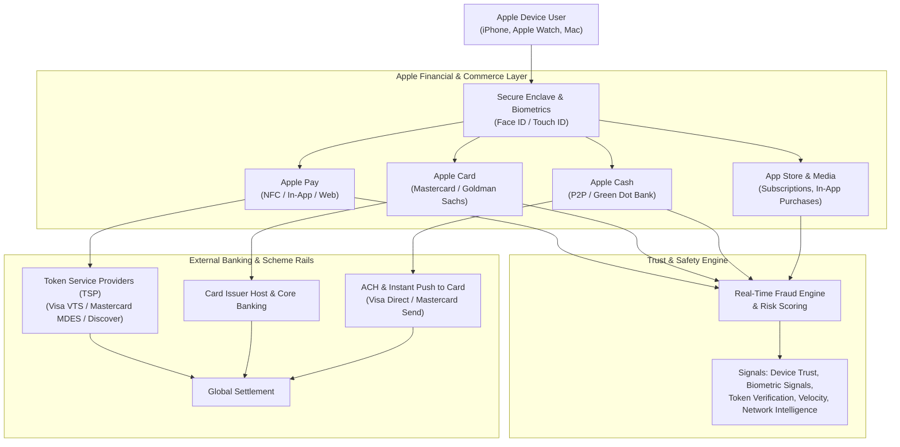

# Apple Inc. — Financial Services & Trust & Safety Ecosystem

> **Target Org**: Software & Services / Trust & Safety (Financial Fraud)  
> **Target Role**: [Trust & Safety Program Manager, Financial Fraud](trust_safety_program_manager_financial_fraud.md) ([Official Apple Job Link](https://jobs.apple.com/en-us/details/200668065-0157/trust-safety-program-manager-financial-fraud?team=SFTWR))  
> **Key Products**: Apple Pay, Apple Card, Apple Cash, App Store & In-App Purchases (IAP), Apple Accounts (Apple ID)  
> **Core Mission**: Safeguard Apple's global digital and physical commerce ecosystem against sophisticated financial crimes while upholding Apple's foundational pillar: **uncompromising user privacy**.

---

## 1. Apple's Financial Services Architecture & Rails

---

## 2. Core Products & Their Financial Risk Profiles

### A. Apple Pay (Tokenized Mobile Payments)
- **Architecture**: Employs network tokenization where the primary account number (FPAN) is replaced by a Device Account Number (DPAN) stored in the hardware **Secure Element (SE)**.
- **Card Provisioning Risk ("Yellow / Orange Path")**: Fraudsters acquire stolen credit card numbers from dark web leaks and attempt to provision (bind) them into Apple Wallet on their own devices.
  - *Green Path*: Instant automated provisioning based on issuer risk score.
  - *Yellow Path*: Step-up authentication required (SMS OTP, bank app approval, customer call center). Fraudsters often social-engineer call center agents or intercept SMS OTPs to complete fraudulent binding.
  - *Red Path*: Hard decline / block.
- **Post-Provisioning POS & Web Risk**: Once a card is fraudulently provisioned into Apple Pay, subsequent contactless transactions inherit high trust from merchants, making fraudulent spend difficult to detect at point-of-sale.

### B. Apple Card (Reinvented Consumer Credit)
- **Architecture**: Co-branded credit card created with Mastercard and Goldman Sachs. Features physical titanium card without printed numbers, dynamic virtual card numbers, and instant cash back (Daily Cash).
- **Fraud Vectors**:
  - *Application & First-Party Fraud (FPF)*: Synthetic identities and bust-out fraud at acquisition.
  - *Account Takeover (ATO)*: Compromising the user's Apple Account (Apple ID) to gain control over the wallet, request new virtual card numbers, or redirect Daily Cash.
  - *Friendly Fraud & Dispute Abuse*: Exploiting Regulation Z billing error rights for digital and physical purchases.

### C. Apple Cash (P2P Transfers & Stored Value)
- **Architecture**: Virtual prepaid debit card issued by Green Dot Bank. Enables peer-to-peer money transfers via iMessage and instant cash-outs via Visa Direct / Mastercard Send.
- **Fraud Vectors**:
  - *Money Mule Networks & Structuring*: Fraudsters funnel illicit proceeds across multiple compromised Apple Cash accounts, structuring amounts under $10,000 reporting thresholds before cashing out to prepaid debit cards.
  - *Account Linking Fraud*: Linking stolen external bank checking accounts (micro-deposit exploitation) to load funds into Apple Cash before the victim's bank flags unauthorized ACH debits.

### D. App Store & Media Commerce (IAP & Digital Goods)
- **Architecture**: Hundreds of billions in annual gross merchandise value (GMV) spanning developer subscriptions, digital items, and gift cards.
- **Fraud Vectors**:
  - *Carding & Bin Testing*: Automated bot attacks testing thousands of stolen card credentials against cheap $0.99 in-app purchases.
  - *Refund Abuse & Friendly Fraud*: Buyers purchasing consumable in-game items, consuming them, and submitting bad-faith refund requests through Apple Support.
  - *Gift Card Laundering*: Stolen credit cards used to buy Apple Gift Cards, which are resold on secondary marketplaces at a discount.

---

## 3. Apple's Core Philosophy: Privacy-First Fraud Defense

Unlike typical financial institutions that aggregate extensive cross-merchant tracking data, Apple views **privacy as a non-negotiable core value**:

| Dimension | Typical Fintech / Big Tech | Apple Trust & Safety Paradigm |
| :--- | :--- | :--- |
| **Data Collection** | Mass tracking, behavioral telemetry, location history, cross-site cookies | **Data Minimization**: Collect only what is strictly necessary to prevent fraud |
| **Computation Architecture** | Centralized cloud data lakes aggregating user transaction history | **On-Device Intelligence**: Edge scoring, Secure Enclave cryptographic proofs, Differential Privacy |
| **Merchant Visibility** | Merchants receive cardholder names, billing addresses, FPAN data | **Tokenization & Masking**: Dynamic device tokens, anonymous identifiers, private relay |
| **UX Principle** | Intrusive friction, frequent OTP challenges, CAPTCHAs | **"It Just Works"**: Seamless biometric auth (Face ID / Touch ID); zero unnecessary friction |

---

## 4. Key Metrics & Operational Health Indicators

- **Fraud Loss Rate (bps)**: Net fraudulent write-offs divided by total transaction volume across Apple Pay, Card, and Cash.
- **False Positive / Insult Rate**: Legitimate users blocked or challenged with step-up verification.
- **Provisioning Attack Capture Rate**: Percentage of stolen card binding attempts caught at the digital tokenization gateway.
- **Dispute & Chargeback Ratio**: Inbound Reg E (Apple Cash) and Reg Z (Apple Card) dispute volumes relative to total processed authorizations.
- **ATO Recovery MTTR**: Mean time to detect and restore compromised Apple Accounts before financial depletion.
